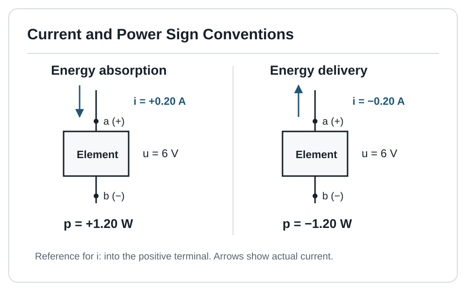

# M1-L1 – Charge, Current, Voltage and Power {#L1}

**Course area:** M1 – Bachelor: Linear Electrical Networks and Circuit Theory

**Level:** Bachelor · Introductory

**Prerequisites:** Basic fractions, powers of ten and unit conversion. The slope of a straight line is covered in [School Mathematics M1-L8](index.html?course=school_mathematics&module=M1&lesson=L8&syslang=en&doclang=en&theme=light).

**Learning objective:** Distinguish charge, current, voltage, power and energy, convert their units and determine the direction of energy transfer at a two-terminal element.

## Two Measurements, One Question {#S1}

A simulated device shows $6\,\mathrm{V}$ and $0.20\,\mathrm{A}$ at its terminals. Is the device absorbing energy? The numbers alone cannot answer the question until we know **which terminal is at the higher electric potential** and **in which direction current is counted**. The same measured voltage can occur at a source delivering energy or at a load absorbing energy.

This first lesson introduces the quantities and their signs using a **two-terminal element**, a component or system with exactly two terminals under consideration. In the next lesson, the resistor provides a specific constitutive law for such an element.

## Charge and Current {#S2}

Electric charge $q$ is measured in coulombs ($\mathrm{C}$). The elementary charge $e$ is the positive magnitude of the electron's charge. An electron has charge $-e$. Its exact numerical value is defined in the International System of Units:

$$
e=1.602\,176\,634\cdot 10^{-19}\,\mathrm{C}.
$$

Imagine a cross-section in the conductor. First choose a positive direction. The quantity $q_{\mathrm{tr}}(t)$ denotes the **net charge transferred in this direction** since a reference instant. The average current over an interval and the instantaneous current are then

$$
\overline{i}=\frac{\Delta q_{\mathrm{tr}}}{\Delta t},
\qquad
i(t)=\frac{\mathrm d q_{\mathrm{tr}}}{\mathrm dt}.
$$

One ampere equals one coulomb per second. If a net charge of $0.40\,\mathrm C$ passes in the positive reference direction in $2.0\,\mathrm s$, the average current is $0.20\,\mathrm A$. A negative result represents charge transport opposite to the defined conventional current direction. In a metallic conductor, the negatively charged electrons move on average opposite to conventional current.

### Current and Stored Charge

Current describes transport across a boundary. Charge within a volume is a different quantity. For example, if $2\,\mathrm{mA}$ enters a region and $2\,\mathrm{mA}$ leaves, its enclosed net charge does not change as a result. This is the idea behind Kirchhoff's current law in [M1-L3](M1-L3.md).

## Voltage Is a Difference {#S3}

The voltage $u_{ab}$ is measured from terminal $a$ relative to terminal $b$. In the electrostatic or lumped network model used here, the potentials $v_a$ and $v_b$ obey

$$
u_{ab}=v_a-v_b.
$$

One volt equals one joule per coulomb. If $u_{ab}=6\,\mathrm V$, the potential at $a$ is $6\,\mathrm V$ higher than at $b$. If positive charge $q$ is moved from $b$ to $a$, its potential energy changes by $\Delta E_{\mathrm{pot}}=q\,u_{ab}$. Moving the same charge in the opposite direction reverses the sign. A reference node can be assigned $0\,\mathrm V$ without changing any voltage difference.

In a circuit diagram, $+$ and $-$ indicate the **chosen reference polarity**. A calculation may yield a negative value. From $v_a=2\,\mathrm V$ and $v_b=5\,\mathrm V$, we obtain $u_{ab}=-3\,\mathrm V$ and $u_{ba}=+3\,\mathrm V$.

## Power and Energy {#S4}

Power describes energy transfer per unit time. Under the **passive sign convention**, the positive current arrow points into the terminal marked $+$ for the chosen voltage. The absorbed power $p$ and the net absorbed energy $E$ over an interval are

$$
p(t)=u(t)\,i(t),
\qquad
E_{[t_1,t_2]}=\int_{t_1}^{t_2}p(t)\,\mathrm dt.
$$

Positive power means absorption; negative power means delivery. The rule also applies when the substituted $u$ or $i$ is negative. The units agree, since $\mathrm{V}\,\mathrm{A}=(\mathrm{J}/\mathrm C)(\mathrm C/\mathrm s)=\mathrm W$. For constant current and voltage, $E=p\,\Delta t$. One watt-second is one joule; one watt-hour is $3\,600$ joules.

{alt="Two two-terminal elements with the same voltage and current magnitude. On the left, current enters the positive terminal and power is absorbed. On the right, current leaves the positive terminal and power is delivered."}

In the right-hand element, the current arrow shows the actual direction. Relative to the passive convention, its current is negative. Alternatively, one can choose a reference arrow pointing out of the positive terminal. In that convention the formula for absorbed power is $p=-ui$. Both representations give the same energy balance.

## Example: Energy Transfer in a Model Device {#S5}

A constant voltage of $6\,\mathrm V$ exists between $a$ and $b$. The reference voltage is $u_{ab}$, and current of $0.20\,\mathrm A$ enters terminal $a$. The model device therefore absorbs $1.20\,\mathrm W$. In one minute,

$$
E=1.20\,\mathrm W\cdot 60\,\mathrm s=72\,\mathrm J
$$

is transferred to the two-terminal element. At the same current magnitude, $12\,\mathrm C$ of net charge leaves one terminal and enters the other during this time. The device therefore does not necessarily store $12\,\mathrm C$ of charge. The fact that $E>0$ establishes only net energy absorption. What happens to the energy internally depends on the component model.

## Self-Check {#S6}

1. A net charge of $15\,\mathrm{mC}$ is transferred in the positive current direction over $250\,\mathrm{ms}$. Calculate the average current.
2. With $u_{ab}=+9\,\mathrm V$, current of $0.30\,\mathrm A$ flows out of $a$. Determine absorbed power under the passive convention and the net energy transferred after $20\,\mathrm s$.
3. A load absorbs $3\,\mathrm W$ during the first second and $1\,\mathrm W$ during the second. How much energy does it absorb in total, and what is its average power?

### Solutions

1. $\overline i=0.015\,\mathrm C/0.250\,\mathrm s=0.060\,\mathrm A$, or $60\,\mathrm{mA}$.
2. The current is negative relative to the direction into $a$. Thus $p=9\,\mathrm V\cdot(-0.30\,\mathrm A)=-2.7\,\mathrm W$ and $E=-54\,\mathrm J$. The two-terminal element delivers a net $54\,\mathrm J$.
3. $E=3\,\mathrm J+1\,\mathrm J=4\,\mathrm J$. Average power is $4\,\mathrm J/2\,\mathrm s=2\,\mathrm W$.

## Model Limitations and Next Step {#S7}

The model treats terminals and connections as lumped elements. At this stage it describes neither spatial field distributions nor propagation times along a line. In the following examples, clearly defined terminal quantities, reference directions and the balance across the model boundary are therefore essential.

**Further reading:** [M1-L2 – Resistance, Ohm's Law and Simple Networks](M1-L2.md) relates voltage and current through a constitutive law.

## Sources {#S8}

- [BIPM – SI Brochure, 9th edition](https://www.bipm.org/en/publications/si-brochure) · chapter 2, definition of the ampere and derived SI units. · Last accessed: 2026-11-25
- [OpenStax, University Physics Volume 2, § 9.1 – Electrical Current](https://openstax.org/books/university-physics-volume-2/pages/9-1-electrical-current) · Shared source context: definition of current and relationship to power. · Last accessed: 2026-11-25
- [OpenStax, University Physics Volume 2, § 9.5 – Electrical Energy and Power](https://openstax.org/books/university-physics-volume-2/pages/9-5-electrical-energy-and-power) · Shared source context: definition of current and relationship to power. · Last accessed: 2026-11-25
- [MIT OpenCourseWare, 6.002 – Circuits and Electronics, Lecture Notes](https://ocw.mit.edu/courses/6-002-circuits-and-electronics-spring-2007/pages/lecture-notes/) · course on lumped modelling and elementary circuit analysis, lectures 1–2 in the lecture notes. · Last accessed: 2026-11-25
