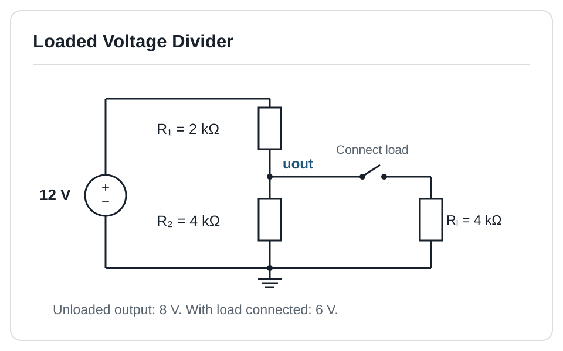

# M1-L2 – Resistance, Ohm's Law and Simple Networks {#L2}

**Course area:** M1 – Bachelor: Linear Electrical Networks and Circuit Theory

**Level:** Bachelor · Introductory

**Prerequisites:** [M1-L1](M1-L1.md), particularly voltage, direction of power transfer and units.

**Learning objective:** Calculate currents, voltages and powers from the linear resistor model, recognise series and parallel connections, and explain the behaviour of a loaded voltage divider.

## Same Source, Different Output Voltage {#S1}

Two resistors are connected to an ideal voltage source. At their common node, a defined fraction of the source voltage can be obtained. If you connect another device to this node, the output voltage may change. This change is due to **loading**. To calculate it, you only need a constitutive law and information about which resistors are connected via the same nodes.

## Ohmic Resistance and the Material Model {#S2}

For a linear, time-invariant ohmic resistor under the passive sign convention,

$$
u=R\,i,
\qquad
[R]=\Omega=\frac{\mathrm V}{\mathrm A}.
$$

$R>0$ is the slope of a plot of $u$ versus $i$. If you instead plot $i$ versus $u$, the slope is the conductance $G=1/R$ in siemens ($\mathrm S$). Both describe the same characteristic. The power absorbed by the resistor is non-negative for either current direction:

$$
p=ui=R i^2=\frac{u^2}{R}.
$$

For a straight, homogeneous conductor of uniform cross-sectional area $A$ and length $\ell$, $R=\rho\ell/A$ is a simple material model. Resistivity $\rho$ has units of $\Omega\,\mathrm m$. Temperature, contacts and non-uniform geometry may alter this model. A diode or a strongly heated wire cannot adequately be described by a single constant slope throughout its characteristic.

## Series and Parallel Connections {#S3}

The same current passes through all elements in series if the common node has no other connection. The individual voltages add with consistent reference directions. With $u_k=R_k i$,

$$
R_{\mathrm{series}}=\sum_k R_k.
$$

Elements are connected in parallel if their terminals are connected to the same pair of nodes. They have the same voltage, and the branch currents add. From $i_k=u/R_k$,

$$
\frac{1}{R_{\parallel}}=\sum_k\frac{1}{R_k},
\qquad
R_1\parallel R_2=\frac{R_1R_2}{R_1+R_2}.
$$

For two finite positive resistances, $R_{\parallel}$ is smaller than either individual resistance. This property is a quick check for calculation and classification errors. The geometrical positions of the symbols in a circuit diagram do not determine the connection type. The electrical nodes do.

## Worked Example: Loaded Voltage Divider {#S4}

An ideal source provides $u_\mathrm{in}=12\,\mathrm V$. The upper resistor is $R_1=2\,\mathrm{k}\Omega$ and the lower one is $R_2=4\,\mathrm{k}\Omega$. We measure $u_\mathrm{out}$ at the intermediate node relative to the reference node.

{alt="Voltage divider with a twelve-volt input, two kilohms at the top and four kilohms at the bottom. A switchable four-kilohm load resistor is connected in parallel with the lower resistor."}

**Unloaded.** The series current is $12\,\mathrm V/(6\,\mathrm{k}\Omega)=2\,\mathrm{mA}$. The voltage across the lower resistor is therefore $8\,\mathrm V$. In general, $u_\mathrm{out}=u_\mathrm{in}R_2/(R_1+R_2)$ as long as the output has no additional supplying or load branch.

**Loaded with $R_L=4\,\mathrm{k}\Omega$.** $R_L$ is in parallel with $R_2$. Their equivalent resistance is $2\,\mathrm{k}\Omega$. The source now sees a series combination of $2\,\mathrm{k}\Omega+2\,\mathrm{k}\Omega$. Source current is $3\,\mathrm{mA}$, and the output falls to $6\,\mathrm V$. Each of $R_2$ and $R_L$ carries $1.5\,\mathrm{mA}$.

| Element | Voltage magnitude | Current magnitude | Absorbed power |
| --- | ---: | ---: | ---: |
| Upper resistor $R_1$ | $6\,\mathrm V$ | $3\,\mathrm{mA}$ | $18\,\mathrm{mW}$ |
| Lower resistor $R_2$ | $6\,\mathrm V$ | $1.5\,\mathrm{mA}$ | $9\,\mathrm{mW}$ |
| Load $R_L$ | $6\,\mathrm V$ | $1.5\,\mathrm{mA}$ | $9\,\mathrm{mW}$ |

The ideal source delivers $12\,\mathrm V\cdot3\,\mathrm{mA}=36\,\mathrm{mW}$. Together the three resistors absorb the same power. In the limit $R_L\to\infty$, the unloaded output is recovered. As $R_L\to0$, $u_\mathrm{out}$ approaches zero. In this idealised example, input current remains limited by $R_1$.

## Self-Check {#S5}

1. Two resistors, $300\,\Omega$ and $600\,\Omega$, are connected in parallel across $6\,\mathrm V$. Calculate equivalent resistance, branch currents and total dissipation.
2. An unloaded divider with $R_1=R_2=10\,\mathrm{k}\Omega$ is connected to $10\,\mathrm V$. A measuring instrument is modelled by an input resistance of $100\,\mathrm{k}\Omega$. What voltage does the model indicate, and how far does it deviate from the intended unloaded value?
3. Two resistors share a node to which a current source is also connected. Is the common node sufficient to establish a series connection?

### Solutions

1. $R_\parallel=200\,\Omega$. The branch currents are $20\,\mathrm{mA}$ and $10\,\mathrm{mA}$. At a total current of $30\,\mathrm{mA}$, the power is $0.18\,\mathrm W$.
2. The lower equivalent resistance is $(100/11)\,\mathrm{k}\Omega\approx9.091\,\mathrm{k}\Omega$. The voltage is $100/21\,\mathrm V\approx4.762\,\mathrm V$. The deviation is about $-0.238\,\mathrm V$, or $-4.76\,\%$ relative to $5\,\mathrm V$.
3. No. The third branch permits different currents in the two resistors. The shared node alone does not guarantee equal currents.

## Model Limitations and Next Step {#S6}

The calculation uses ideal wires, an ideal voltage source and linear, time-invariant resistors. Real measurements may differ from the model due to temperature, tolerances, source impedance and additional electrical effects. Even in the ideal model, the loaded divider shows why the input of the next device is part of the circuit.

**Further reading:** [M1-L3 – Kirchhoff's Laws and Systematic Network Analysis](M1-L3.md) examines networks that cannot be solved simply by combining series and parallel connections.

## Sources {#S7}

- [OpenStax, University Physics Volume 2, § 9.3 – Resistivity and Resistance](https://openstax.org/books/university-physics-volume-2/pages/9-3-resistivity-and-resistance) · Shared source context: resistor model and network reduction. · Last accessed: 2026-11-25
- [OpenStax, University Physics Volume 2, § 9.4 – Ohm’s Law](https://openstax.org/books/university-physics-volume-2/pages/9-4-ohms-law) · Section 9.4 – Shared source context: resistor model and network reduction. · Last accessed: 2026-11-25
- [OpenStax, University Physics Volume 2, § 10.2 – Resistors in Series and Parallel](https://openstax.org/books/university-physics-volume-2/pages/10-2-resistors-in-series-and-parallel) · Section 10.2 – Shared source context: resistor model and network reduction. · Last accessed: 2026-11-25
- [MIT OpenCourseWare, 6.002 – Circuits and Electronics, Lecture Notes](https://ocw.mit.edu/courses/6-002-circuits-and-electronics-spring-2007/pages/lecture-notes/) · lecture 2 in the lecture notes. · Last accessed: 2026-11-25
