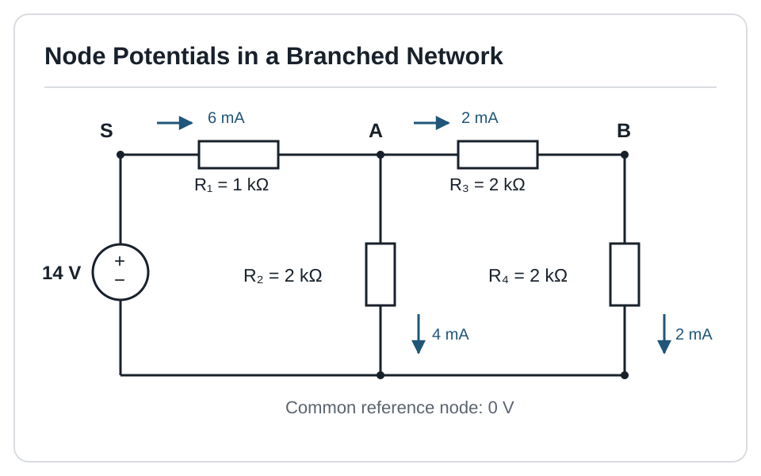

# M1-L3 – Kirchhoff's Laws and Systematic Network Analysis {#L3}

**Course area:** M1 – Bachelor: Linear Electrical Networks and Circuit Theory

**Level:** Bachelor

**Prerequisites:** [Charge, Current, Voltage and Power](M1-L1.md) and [Resistance, Ohm's Law and Simple Networks](M1-L2.md). The [lesson on systems of linear equations](index.html?course=school_mathematics&module=M1&lesson=L9&syslang=en&doclang=en&theme=light) helps with solving equations.

**Learning objective:** Define current and voltage signs, analyse a network with two unknown node potentials, and verify the result using mesh equations and the power balance.

## From a Circuit to an Equation {#S1}

Two resistors can only be combined directly in series if the same current flows through both. As soon as another branch leaves their junction, this condition must first be checked. Kirchhoff's laws provide a procedure that also works for multiple branches. The connections are described using node and loop equations, supplemented by the constitutive relations of the components.

A **node** includes all points directly connected by ideal wires. A **branch** connects two nodes through a component or an unbranched chain of components. A **closed loop** follows branches back to its starting point. In a planar circuit drawing, closed loops that enclose no other loop are called meshes.

## Current Law and Voltage Law {#S2}

**Kirchhoff's current law (KCL).** At an ideal node with no charge storage of its own, the algebraic sum of currents is zero. If currents leaving the node are taken as positive, currents entering it have a negative sign. At the next node, the same branch current may appear with the opposite sign.

$$
\sum_k I_k = 0
$$

**Kirchhoff's voltage law (KVL).** As you traverse a loop, add the potential changes. A step from $-$ to $+$ across a component contributes $+U$; the reverse step contributes $-U$. Since the starting and ending points coincide,

$$
\sum_k \Delta V_k = 0.
$$

A reference node is assigned $V_0=0$. The voltage $U_{ab}=V_a-V_b$ and assumed current $I_{ab}$ refer to the same ordered pair of nodes. For a resistor from $a$ to $b$, $I_{ab}=(V_a-V_b)/R$. A negative result indicates that actual conventional current flows opposite to the selected arrow.

## Nodal Analysis of a Two-Node Network {#S3}

An ideal source maintains $V_S=14\,\mathrm{V}$ relative to $0$. Between $S$ and $A$ is $R_1=1\,\mathrm{k\Omega}$. Between $A$ and $0$ is $R_2=2\,\mathrm{k\Omega}$, between $A$ and $B$ is $R_3=2\,\mathrm{k\Omega}$, and between $B$ and $0$ is $R_4=2\,\mathrm{k\Omega}$. Both unknown potentials are specified relative to the same reference node.

{alt="Network with a 14 V source, two unknown node potentials and four resistors. Labelled arrows show the four calculated branch currents."}

1. For each unknown node, write down the sum of the outgoing currents.
2. Replace resistor currents with potential differences divided by resistance.
3. Solve the system of equations and calculate branch currents from the potentials.

$$
\begin{aligned}
A:\quad
\frac{V_A-14\,\mathrm{V}}{1\,\mathrm{k\Omega}}+
\frac{V_A}{2\,\mathrm{k\Omega}}+
\frac{V_A-V_B}{2\,\mathrm{k\Omega}}&=0,\\
B:\quad
\frac{V_B-V_A}{2\,\mathrm{k\Omega}}+
\frac{V_B}{2\,\mathrm{k\Omega}}&=0.
\end{aligned}
$$

Multiplying by $2\,\mathrm{k\Omega}$ gives $4V_A-V_B=28\,\mathrm V$ and $2V_B=V_A$. Hence $V_A=8\,\mathrm V$ and $V_B=4\,\mathrm V$.

| Branch and positive reference direction | Current | Absorbed power |
| --- | ---: | ---: |
| $R_1$, $S\to A$ | $6\,\mathrm{mA}$ | $36\,\mathrm{mW}$ |
| $R_2$, $A\to 0$ | $4\,\mathrm{mA}$ | $32\,\mathrm{mW}$ |
| $R_3$, $A\to B$ | $2\,\mathrm{mA}$ | $8\,\mathrm{mW}$ |
| $R_4$, $B\to 0$ | $2\,\mathrm{mA}$ | $8\,\mathrm{mW}$ |

**Loop check.** Along $0\to S\to A\to 0$, the potential changes are $(+14-6-8)\,\mathrm V=0$. Along $0\to A\to B\to 0$, they are $(+8-4-4)\,\mathrm V=0$.

**Power check.** For each resistor, $P=I^2R$. The source delivers $14\,\mathrm V\cdot6\,\mathrm{mA}=84\,\mathrm{mW}$. Its current leaves the positive terminal. In the sign convention for absorbed power, it therefore contributes $-84\,\mathrm{mW}$. Including the resistors gives $-84+36+32+8+8=0$ in milliwatts.

### Second Method: Mesh Currents

Choose two clockwise mesh currents $j_1$ and $j_2$. On the left, $j_1$ passes through the source and $R_1$; on the right, $j_2$ passes through $R_3$ and $R_4$. In the shared branch $R_2$, the current from $A$ to the reference is the difference $j_1-j_2$. Kirchhoff's voltage law gives

$$
\begin{aligned}
(3\,\mathrm{k}\Omega)j_1-(2\,\mathrm{k}\Omega)j_2&=14\,\mathrm V,\\
-(2\,\mathrm{k}\Omega)j_1+(6\,\mathrm{k}\Omega)j_2&=0.
\end{aligned}
$$

The second equation gives $j_2=j_1/3$. Substitution yields $j_1=6\,\mathrm{mA}$ and $j_2=2\,\mathrm{mA}$. Again, $4\,\mathrm{mA}$ flows through $R_2$. For this network, both approaches yield two equations. Which method is shorter depends on how many node or mesh variables are needed.

## Ideal Voltage Source Between Two Unknown Nodes {#S4}

The current through an ideal voltage source cannot be inferred from its known voltage. If the source lies between two unknown nodes, the two can be treated together as a **supernode**. The current balance considers only the branches crossing its boundary. The unknown source current flows within the boundary and cancels from the combined balance. The second equation is the specified voltage difference between the two nodes. The source current can then be calculated using KCL at either individual node.

## Self-Check {#S5}

### Exercises

1. Remove $R_4$ from the two-node network. How do $I_{AB}$, $V_A$ and $V_B$ change?
2. An ideal current source injects $4\,\mathrm{mA}$ into $A$. Nodes $A$ and $B$ are connected to the reference node via $2\,\mathrm{k\Omega}$ and $4\,\mathrm{k\Omega}$, respectively. An ideal voltage source imposes $V_A-V_B=2\,\mathrm V$. Calculate $V_A$, $V_B$ and the current through the voltage source in direction $A\to B$.

### Solutions

1. Only one branch remains connected to $B$. KCL requires $I_{AB}=0$, hence $V_B=V_A$. $R_1$ and $R_2$ form the remaining voltage divider. Both nodes are therefore at $14\,\mathrm V\cdot 2/3\approx9.33\,\mathrm V$.
2. For the supernode, $V_A/(2\,\mathrm{k\Omega})+V_B/(4\,\mathrm{k\Omega})=4\,\mathrm{mA}$. This implies $2V_A+V_B=16\,\mathrm V$. Together with the voltage constraint, we obtain $V_A=6\,\mathrm V$ and $V_B=4\,\mathrm V$. Of the injected $4\,\mathrm{mA}$, $3\,\mathrm{mA}$ flows through the resistor from $A$ to the reference. The remaining $1\,\mathrm{mA}$ flows through the voltage source from $A$ to $B$.

## Scope of Validity and Outlook {#S6}

The model treats wires as ideal connections and concentrates voltage drops and storage effects in components. Where node capacitance is significant, its storage current can be modelled as a separate branch. When time-dependent magnetic flux passes through a wire loop, induction must be accounted for, for example as an induced voltage in an appropriate branch model. In spatially extended networks and with fast signals, propagation delays may also be important.

**Further reading:** [Equivalent Circuits and Maximum Power Transfer](M1-L4.md) uses the same equations to describe a network at two terminals using a simpler model.

## Sources {#S7}

- [MIT OpenCourseWare, 6.002 Circuits and Electronics, lecture 2](https://ocw.mit.edu/courses/6-002-circuits-and-electronics-spring-2007/resources/lecture-2/) · systematic circuit analysis; checked for the German original on 19 November 2026. · Last accessed: 2026-11-25
- [OpenStax, University Physics Volume 2, § 10.3](https://openstax.org/books/university-physics-volume-2/pages/10-3-kirchhoffs-rules) · Section 10.3 – current law, voltage law and power balance; checked for the German original on 19 November 2026. · Last accessed: 2026-11-25
