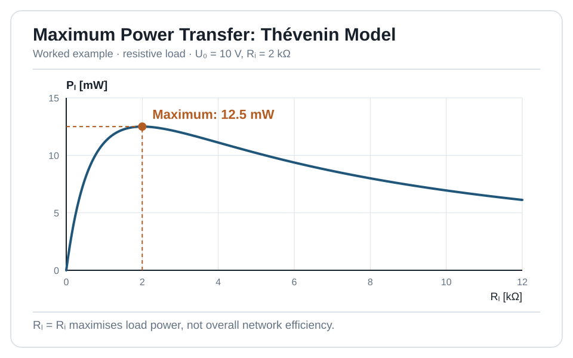

# M1-L4 – Equivalent Circuits and Maximum Power Transfer {#L4}

**Course area:** M1 – Bachelor: Linear Electrical Networks and Circuit Theory

**Level:** Bachelor

**Prerequisites:** [Kirchhoff's Laws and Systematic Network Analysis](M1-L3.md), voltage dividers and electrical power.

**Learning objective:** Describe a linear two-terminal network as a Thévenin or Norton source, determine its internal resistance even in the presence of dependent sources, and calculate the load resistance for maximum load power.

## What Can We Observe at the Terminals of a Network? {#S1}

A sensor may behave differently at its two output terminals as soon as a downstream device draws current. The open-circuit voltage describes only the case in which the output is open. The loaded voltage also depends on how much it falls as the load current increases.

For the following DC models, let $U=V_a-V_b$. The load current $I_L$ leaves the network at terminal $a$ and flows through the load from $a$ to $b$. For a linear two-terminal network with finite internal resistance, the characteristic

$$
U=U_0-R_\mathrm{i} I_L
$$

describes the terminal quantities. $U_0$ is the open-circuit voltage and $-R_\mathrm{i}$ is the slope of the characteristic under this sign convention. The **Thévenin equivalent circuit** consists of an ideal voltage source $U_0$ in series with $R_\mathrm{i}$. For finite $R_\mathrm{i}\ne 0$, the corresponding **Norton equivalent circuit** has $R_\mathrm{i}$ in parallel with an ideal current source $I_\mathrm{N}=U_0/R_\mathrm{i}$. Its reference direction within the equivalent network is from $b$ to $a$. The external short-circuit current in the chosen load direction is $I_L=I_\mathrm{N}$.

## Source Contributions, Internal Resistance and Test Sources {#S2}

With **superposition**, we calculate the contribution of each independent source and add the resulting voltages or currents with their signs. In each subcircuit, the source under consideration and all dependent sources remain active. All other independent sources are set to zero. An ideal voltage source of $0\,\mathrm V$ corresponds to a short circuit, and an ideal current source of $0\,\mathrm A$ to an open circuit. Components and internal resistances of the original circuit remain in place.

Power is calculated only after combining the currents and voltages. A resistor alone shows why individual power contributions cannot generally be added. The expression $R(I_1+I_2)^2$ contains the additional cross term $2RI_1I_2$.

To find $R_\mathrm{i}$, remove the load and set all independent sources to zero. If the remaining network consists of resistors, it can often be evaluated using series and parallel combinations. Dependent sources remain active in this step as well. We can then apply a test voltage $U_\mathrm{T}=V_a-V_b$ and calculate the current $I_\mathrm{T}$ injected into $a$ by the test source. With this reference current directed **into the network**, $R_\mathrm{i}=U_\mathrm{T}/I_\mathrm{T}$, provided the quotient is defined.

## A Voltage Divider Supplies a Load {#S3}

An ideal source of $15\,\mathrm V$ feeds output terminal $a$ through $R_1=3\,\mathrm{k\Omega}$. Resistor $R_2=6\,\mathrm{k\Omega}$ connects $a$ to reference terminal $b$. The load is also connected between $a$ and $b$.

1. **Open circuit.** With the load removed, the voltage divider gives $U_0=15\,\mathrm V\cdot 6/(3+6)=10\,\mathrm V$.
2. **Internal resistance.** After setting the ideal voltage source to zero, $R_1$ and $R_2$ are in parallel as seen from $a$. This gives $R_\mathrm{i}=2\,\mathrm{k\Omega}$.
3. **Norton current.** From $U_0/R_\mathrm{i}$ we obtain $5\,\mathrm{mA}$. As a check, the original model at $U=0$ supplies the same current through $R_1$, while no current flows through $R_2$.
4. **Loading.** With $R_L=2\,\mathrm{k\Omega}$ we obtain $I_L=\frac{10\,\mathrm V}{(2+2)\,\mathrm{k\Omega}}=2.5\,\mathrm{mA}$, $U=5\,\mathrm V$ and $P_L=12.5\,\mathrm{mW}$. In the original network, the parallel combination of $R_2$ and $R_L$ reduces the effective resistance to $1.5\,\mathrm{k\Omega}$. The voltage-divider calculation likewise gives $5\,\mathrm V$.

## Maximum Load Power and Efficiency {#S4}

For $R_\mathrm{i}>0$, $R_L>0$ and $U_0\ne 0$,

$$
P_L=I_L^2R_L
=\frac{U_0^2R_L}{(R_\mathrm{i}+R_L)^2}
=\frac{U_0^2}{4R_\mathrm{i}+(R_\mathrm{i}-R_L)^2/R_L}.
$$

The denominator is smallest exactly when $R_L=R_\mathrm{i}$. In our example, the maximum load power is therefore $\frac{(10\,\mathrm V)^2}{4\cdot2\,\mathrm{k\Omega}}=12.5\,\mathrm{mW}$.

In the Thévenin equivalent model, both resistors dissipate the same power when matched. The load receives $50\,\%$ of the power supplied by the ideal equivalent voltage source. To determine the efficiency of the original network, its internal losses must be calculated. At $U=5\,\mathrm V$, the original $15\,\mathrm V$ source supplies a current of $\tfrac{10}{3}\,\mathrm{mA}$ through $R_1$, or a total of $50\,\mathrm{mW}$. In this network, $12.5\,\mathrm{mW}$ reaches the load, corresponding to $25\,\%$.

{alt="Load power versus load resistance, with a maximum of 12.5 milliwatts at 2 kilohms."}

The curve represents the load-power formula for the worked example. Load power decreases for very small and very large load resistances; the maximum occurs when the resistances are matched.

## Self-assessment {#S5}

### Exercises

1. Add an independent ideal current source of $1\,\mathrm{mA}$ from $b$ to $a$ to the voltage divider. Keep the load disconnected. Calculate the new open-circuit voltage using superposition and state the internal resistance.
2. A $2\,\mathrm{k\Omega}$ resistor, an independent current source of $3\,\mathrm{mA}$ from $b$ to $a$ and a dependent current source are connected in parallel between $a$ and $b$. The latter carries current $G U$ from $a$ to $b$, with $G=0.25\,\mathrm{mS}$. Determine the internal resistance using a test voltage of $4\,\mathrm V$ and calculate $U_0$.

### Solutions

1. The voltage source contributes $10\,\mathrm V$. For the current-source contribution, the zero-valued voltage source is replaced by a short circuit. In $R_1\parallel R_2=2\,\mathrm{k\Omega}$, the injected current produces an additional $2\,\mathrm V$. Their sum is $12\,\mathrm V$. When both independent sources are set to zero, $R_\mathrm{i}=2\,\mathrm{k\Omega}$ remains.
2. With the independent current source open-circuited, the test produces $2\,\mathrm{mA}$ through the resistor and $1\,\mathrm{mA}$ through the still-active dependent source. The total current is $3\,\mathrm{mA}$, so $R_\mathrm{i}=\tfrac{4}{3}\,\mathrm{k\Omega}$. In open-circuit operation, the independent source injects exactly these $3\,\mathrm{mA}$, giving $U_0=4\,\mathrm V$.

## Assumptions and Outlook {#S6}

Linear equivalent models provide the terminal quantities for permissible loads. Assessing stresses on internal components requires the original network. For sources with current limiting or other nonlinear components, a linear approximation is valid only within a justified operating range. The short-circuit values here are results of idealised circuit calculations. The maximum-power condition in this lesson assumes a positive real internal resistance and a purely resistive load.

**Further reading:** [Capacitors, Inductors and Transient Responses](M1-L5.md) introduces components that temporarily store energy. There, the equivalent resistance seen from the storage elements helps determine the time constant.

## Sources {#S7}

- [MIT OpenCourseWare, 6.002 Circuits and Electronics, Lecture 3](https://ocw.mit.edu/courses/6-002-circuits-and-electronics-spring-2007/resources/lecture-3/) · superposition and two-terminal equivalent circuits · Last accessed: 2026-11-25
- [Cornell University – ECE/ENGRD 2100, Lecture 8 (PDF)](https://bpb-us-w2.wpmucdn.com/sites.coecis.cornell.edu/dist/4/81/files/2019/06/ECE2100-L8-notes.pdf) · Slides 9–10, Maximum Power Transfer: matched load and 50% efficiency at maximum power. · Last accessed: 2026-11-25
- [OpenStax, University Physics Volume 2, § 9.5](https://openstax.org/books/university-physics-volume-2/pages/9-5-electrical-energy-and-power) · electrical energy and power for resistive loads · Last accessed: 2026-11-25
