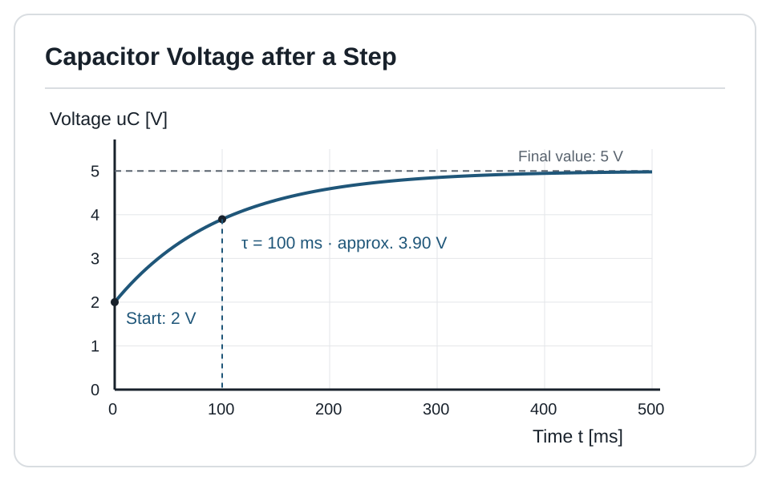

# M1-L5 – Capacitors, Inductors and Transient Responses {#L5}

**Course area:** M1 – Bachelor: Linear Electrical Networks and Circuit Theory

**Level:** Bachelor

**Prerequisites:** [Kirchhoff's Laws](M1-L3.md), [equivalent circuits](M1-L4.md) and differentiation of exponential functions.

**Learning objective:** Determine the initial value, final value and time constant of a first-order circuit and use them to calculate a step response.

## A Circuit with Memory {#S1}

A sensor signal jumps from $2\,\mathrm{V}$ to $5\,\mathrm{V}$. After a resistor and capacitor, the same change appears with a delay. How long does it take for the output to approach the new value? To answer this, we need an **initial condition**. It describes the energy already stored in the circuit at the instant of switching.

We use the passive sign convention for each component. Positive current enters at the terminal where the voltage is measured as positive. For an ideal capacitor with constant capacitance $C$ and an ideal inductor with constant inductance $L$,

$$
i_C(t)=C\frac{\mathrm d u_C}{\mathrm d t},\qquad
u_L(t)=L\frac{\mathrm d i_L}{\mathrm d t}.
$$

The stored energy is $W_C=Cu_C^2/2$ or $W_L=Li_L^2/2$, respectively. With finite capacitor current, $u_C$ remains continuous during switching. With finite inductor voltage, $i_L$ remains continuous. The other quantity of each component can jump. In the ideal model, a jump in the storage variable would require a current or voltage impulse, respectively.

## The Step Response of an RC Circuit {#S2}

A source of constant voltage $U_s$ drives a resistor $R>0$ in series with a capacitor $C>0$, starting at $t=0$. Write the loop equation and replace the current with the capacitor equation. This gives

$$
U_s=Ri_C+u_C,\qquad
RC\frac{\mathrm d u_C}{\mathrm d t}+u_C=U_s.
$$

The steady-state final value is $u_\infty=U_s$, because no current flows when the capacitor voltage is constant. For the deviation $x=u_C-U_s$, we have $\mathrm dx/\mathrm dt=-x/(RC)$. From $x(0^+)=u_C(0^-)-U_s$ it follows that

$$
u_C(t)=U_s+\bigl(u_C(0^-)-U_s\bigr)\mathrm e^{-t/\tau},
\qquad \tau=RC,\quad t\ge0.
$$

After one time constant, the fraction $\mathrm e^{-1}\approx0.368$ of the initial deviation remains. A charging curve has therefore completed about $63.2\,\%$ **of the change**. After five time constants, approximately $0.67\,\%$ remains.

## Example and Numerical Experiment {#S3}

Let $R=1\,\mathrm{k}\Omega$, $C=100\,\mu\mathrm F$, $u_C(0^-)=2\,\mathrm V$ and $U_s=5\,\mathrm V$. The time constant is $0.1\,\mathrm s$. The initial current is $(5-2)\,\mathrm V/(1\,\mathrm{k}\Omega)=3\,\mathrm{mA}$. After $100\,\mathrm{ms}$, $u_C=5\,\mathrm V-3\,\mathrm V/\mathrm e\approx3.896\,\mathrm V$. The curve approaches $5\,\mathrm V$ from below.

{alt="RC charging curve from 2 V towards 5 V. After 100 ms the step response reaches approximately 3.90 V."}

A numerical approximation uses the slope at the beginning of each time step. The following Python program compares this **explicit Euler method** with the closed-form solution. Both time-step sizes produce a stable, monotonic response here. The smaller step gives a more accurate curve at the indicated times.

```python
from math import exp

tau = 0.1
u_start = 2.0
u_final = 5.0

for dt in (0.01, 0.001):
    u = u_start
    sample_steps = {round(t / dt): t for t in (0.1, 0.3, 0.5)}
    for step in range(1, max(sample_steps) + 1):
        u += dt * (u_final - u) / tau
        if step in sample_steps:
            t = sample_steps[step]
            exact = u_final + (u_start - u_final) * exp(-t / tau)
            print(f"{dt:.3f} s | {t:.1f} s | {u:.6f} V | "
                  f"{exact:.6f} V | Error {abs(u - exact):.6f} V")
```

At $t=0.1\,\mathrm s$, a step of $\Delta t=10\,\mathrm{ms}$ gives approximately $3.953965\,\mathrm V$; with $1\,\mathrm{ms}$ the result is $3.901903\,\mathrm V$. The exact comparison value is $3.896362\,\mathrm V$. The error occurs because the method holds the decreasing slope constant during each step.

## The RL Circuit as a Counterpart {#S4}

In an RL series circuit, the inductor current is the storage variable. For a source step to $U_s$, the equation $U_s=Ri_L+L\,\mathrm d i_L/\mathrm dt$ gives

$$
i_L(t)=\frac{U_s}{R}
+\left(i_L(0^-)-\frac{U_s}{R}\right)\mathrm e^{-t/\tau},
\qquad \tau=\frac LR.
$$

For $L=100\,\mathrm{mH}$ and $R=20\,\Omega$, we obtain $\tau=5\,\mathrm{ms}$. If the source rises to $4\,\mathrm V$ with an initially current-free inductor, the current approaches $200\,\mathrm{mA}$. After $5\,\mathrm{ms}$, approximately $126\,\mathrm{mA}$ flows. Immediately after the step, the entire source voltage appears across the inductor. In the steady-state model, it appears entirely across the resistor.

## Self-assessment {#S5}

1. A capacitor of $47\,\mu\mathrm F$ discharges from $4\,\mathrm V$ through $2.2\,\mathrm{k}\Omega$. Calculate the time at which its voltage is $2\,\mathrm V$.
2. A current of $50\,\mathrm{mA}$ flows through an inductor immediately before the RL circuit described above is switched to $4\,\mathrm V$. What are the inductor voltage at $t=0^+$ and the current at $t=\tau$?
3. A measurement at $t=\tau$ still deviates from the final value by $36.8\,\%$. Relative to what quantity is this statement valid?

### Solutions

1. $\tau=RC=103.4\,\mathrm{ms}$. Since $u_C/U_0=1/2$, we obtain $t=\tau\ln 2\approx71.7\,\mathrm{ms}$.
2. The current remains at $50\,\mathrm{mA}$. Therefore $u_L(0^+)=4\,\mathrm V-20\,\Omega\cdot50\,\mathrm{mA}=3\,\mathrm V$. Subsequently, $i_L(\tau)=200\,\mathrm{mA}-150\,\mathrm{mA}/\mathrm e\approx145\,\mathrm{mA}$.
3. The reference quantity is the magnitude of the **initial deviation** $|u_C(0^+)-u_\infty|$ or the corresponding current deviation.

## Scope and Further Learning {#S6}

First-order models apply when there is exactly one independent storage variable and a constant linear network after switching. In a larger linear resistive network, the effective resistance at the terminals of the storage element can be calculated as an equivalent resistance. If several independent storage elements are involved, the time response may contain multiple decay components or oscillations. Component tolerances and additional resistances alter measured time constants.

The [next lesson](M1-L6.md) uses the same component equations for sinusoidal excitation after the transient has decayed.

## Sources {#S7}

- [OpenStax, University Physics Volume 2, § 10.5 – RC Circuits](https://openstax.org/books/university-physics-volume-2/pages/10-5-rc-circuits) · Section 10.5 – charging, discharging and the RC time constant · Last accessed: 2026-11-25
- [OpenStax, University Physics Volume 2, § 14.4 – RL Circuits](https://openstax.org/books/university-physics-volume-2/pages/14-4-rl-circuits) · Section 14.4 – RL step response and time constant · Last accessed: 2026-11-25
- [MIT OpenCourseWare, 6.002 Circuits and Electronics – Lecture Notes](https://ocw.mit.edu/courses/6-002-circuits-and-electronics-spring-2007/pages/lecture-notes/) · Lecture 12 on capacitors and first-order systems · Last accessed: 2026-11-25
