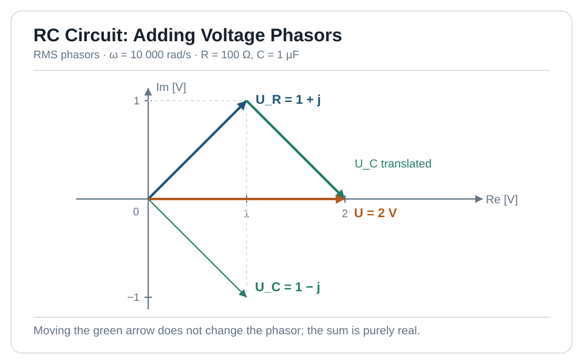

# M1-L6 – Sinusoidal Alternating Current and Complex Impedance {#L6}

**Course area:** M1 – Bachelor: Linear Electrical Networks and Circuit Theory

**Level:** Bachelor

**Prerequisites:** [Transient responses](M1-L5.md), sine and cosine, and arithmetic with complex numbers. If necessary, [review complex numbers in university mathematics](index.html?course=university_mathematics&module=M2&lesson=L5&syslang=en&doclang=en&theme=light).

**Learning objective:** Represent a sinusoidal voltage as an RMS phasor and calculate current and component voltages in a linear AC circuit.

## From Time-Domain Waveforms to Phasors {#S1}

A capacitor can transmit rapid voltage changes differently from slow ones. For the RC circuit in the [previous lesson](M1-L5.md), we investigated the time response following a step. Now the source remains sinusoidal indefinitely. In a stable linear network, the influence of initial conditions decays. What remains is the forced response at the same frequency. Its amplitude and phase may differ from those of the source.

With frequency $f$ in hertz and angular frequency $\omega=2\pi f$, we write a voltage as

$$
u(t)=\sqrt{2}\,U_\mathrm{eff}\cos(\omega t+\varphi_u),
\qquad
\underline U=U_\mathrm{eff}\,\mathrm e^{\mathrm j\varphi_u},
\qquad
u(t)=\sqrt{2}\,\operatorname{Re}\!\left(\underline U\,\mathrm e^{\mathrm j\omega t}\right).
$$

Here, $\mathrm j^2=-1$. The phasor $\underline U$ has the RMS value $U_\mathrm{eff}$ as its magnitude and the phase $\varphi_u$ as its angle. For current, we use $\underline I$ under the same convention. The peak value of a sinusoid is $\sqrt{2}$ times its RMS value, because the mean of $\cos^2$ over a period is $1/2$. In a calculation, all participating phasors share the factor $\mathrm e^{\mathrm j\omega t}$ and the same convention for magnitudes.

To convert between polar and Cartesian forms, use $A\mathrm e^{\mathrm j\varphi}=A\cos\varphi+\mathrm jA\sin\varphi$. Addition is convenient in Cartesian form. When dividing two phasors, divide their magnitudes and subtract their angles.

## Impedance of Resistors, Inductors and Capacitors {#S2}

Under the passive sign convention, positive current enters at the positive voltage terminal. Differentiation with respect to time corresponds to multiplying the phasor by $\mathrm j\omega$. This follows from differentiating the common exponential factor. The component laws thus become algebraic relations of the form $\underline U=Z\underline I$. Complex **impedance** $Z$ is measured in ohms, like resistance.

| Component | Time domain | Impedance for $\omega>0$ | Voltage phase relative to current |
| --- | --- | --- | --- |
| Resistor $R>0$ | $u=Ri$ | $Z_R=R$ | $0^\circ$ |
| Inductor $L>0$ | $u=L\,\mathrm di/\mathrm dt$ | $Z_L=\mathrm j\omega L$ | $+90^\circ$ |
| Capacitor $C>0$ | $i=C\,\mathrm du/\mathrm dt$ | $Z_C=1/(\mathrm j\omega C)=-\mathrm j/(\omega C)$ | $-90^\circ$ |

For $Z=R+\mathrm jX$, $X$ is called **reactance**. Its sign matters when adding impedances. In a series circuit, impedances add because the same current flows everywhere. If branches are connected in parallel, the reciprocals $Y=1/Z$, called **admittances**, add for finite nonzero impedances. This follows from the common voltage and the current law. Kirchhoff's original laws therefore also apply to both complex components of the phasors.

## An RC Circuit at Its Cutoff Frequency {#S3}

A source with $\underline U=2\,\mathrm V$ feeds a resistor $R=100\,\Omega$ and a capacitor $C=1\,\mu\mathrm F$ in series. As the phase reference, the source phasor has an angle of $0^\circ$. At $\omega=1/(RC)=10^4\,\mathrm{rad/s}$, or $f\approx1.59\,\mathrm{kHz}$, we have $Z_C=-\mathrm j100\,\Omega$. Thus,

$$
Z=(100-\mathrm j100)\,\Omega,
\qquad
\underline I=\frac{2\,\mathrm V}{Z}=(10+\mathrm j10)\,\mathrm{mA}.
$$

The current has an RMS value of approximately $14.14\,\mathrm{mA}$ and leads the source by $45^\circ$. Its time-domain waveform is

$$
i(t)=20\,\mathrm{mA}\cos(10^4\,\mathrm{rad/s}\cdot t+45^\circ).
$$

For the component voltages, we obtain $\underline U_R=(1+\mathrm j)\,\mathrm V$ and $\underline U_C=(1-\mathrm j)\,\mathrm V$. Their sum is $2\,\mathrm V$, although both RMS values are individually $\sqrt{2}\,\mathrm V$. Kirchhoff's voltage law applies to phasors. Adding their magnitudes separately would disregard the different phases.

{alt="Phasor diagram: resistor voltage one plus j volts, capacitor voltage one minus j volts, and a sum of two volts on the real axis."}

The capacitor-voltage phasor is also shown translated to the tip of the resistor-voltage phasor without changing its direction. This illustrates addition according to the voltage law; the two imaginary parts cancel.

## Self-assessment {#S4}

1. An ideal inductor with $L=20\,\mathrm{mH}$ and $\omega=500\,\mathrm{rad/s}$ has a voltage with RMS value $1\,\mathrm V$ and phase $0^\circ$. What are the magnitude and phase of the current?
2. In the RC example, what happens to the voltage across the capacitor when $f$ tends to zero? What happens when $f$ becomes very large?
3. Reconstruct the time-domain function for $\underline U=-\mathrm j3\,\mathrm V$ at $\omega=1000\,\mathrm{rad/s}$.

### Solutions

1. $Z_L=\mathrm j10\,\Omega$, so $\underline I=-\mathrm j0.1\,\mathrm A$. The RMS value is $100\,\mathrm{mA}$. The current phase lags the voltage by $90^\circ$.
2. At very low frequencies, $|Z_C|\gg R$. Almost the entire source voltage appears across the capacitor. At very high frequencies, $|Z_C|\ll R$. The capacitor voltage approaches zero. The output across the capacitor therefore acts as a low-pass filter.
3. The magnitude is $3\,\mathrm V$ and the angle is $-90^\circ$. This gives $u(t)=3\sqrt{2}\,\mathrm V\cos(1000\,\mathrm{rad/s}\cdot t-90^\circ)$.

## Scope and Further Learning {#S5}

Phasors at a fixed frequency describe sinusoidal steady state. For the switch-on transient, we still need initial conditions and time-domain equations. Several frequencies can be treated separately in a linear network and superposed in the time domain. Component construction and parasitic effects limit the applicability of ideal component models at high frequencies.

In the [next lesson](M1-L7.md), we use the same RMS phasors to calculate active power, reactive power and resonance.

## Sources {#S6}

- [MIT OpenCourseWare, 6.002 Circuits and Electronics – Lecture Notes](https://ocw.mit.edu/courses/6-002-circuits-and-electronics-spring-2007/pages/lecture-notes/) · Lectures 16–18 on sinusoidal steady state, impedance and filters · Last accessed: 2026-11-25
- [OpenStax, University Physics Volume 2, § 15.2 – Simple AC Circuits](https://openstax.org/books/university-physics-volume-2/pages/15-2-simple-ac-circuits) · Section 15.2 – individual components and phase relations · Last accessed: 2026-11-25
- [OpenStax, University Physics Volume 2, § 15.3 – RLC Series Circuits with AC](https://openstax.org/books/university-physics-volume-2/pages/15-3-rlc-series-circuits-with-ac) · Section 15.3 – impedance and phase relations in RLC series circuits · Last accessed: 2026-11-25
