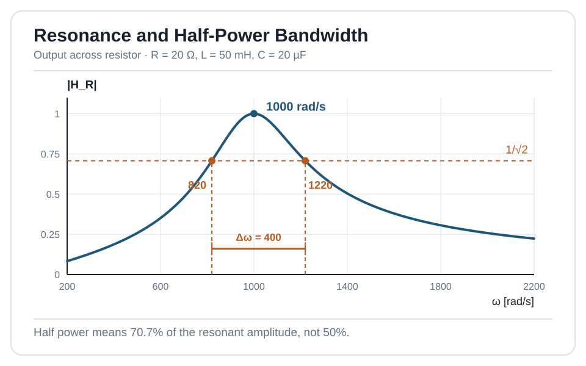

# M1-L7 – AC Power, Frequency Response and Resonance {#L7}

**Course area:** M1 – Bachelor: Linear Electrical Networks and Circuit Theory

**Level:** Bachelor

**Prerequisites:** [RMS phasors and impedances](M1-L6.md), [transient responses](M1-L5.md).

**Learning objective:** Distinguish active, reactive and apparent power, and determine the resonant frequency, frequency response and bandwidth of an idealised RLC series circuit.

## Power in Sinusoidal Operation {#S1}

The instantaneous power absorbed by a component is $p(t)=u(t)i(t)$ when the current is defined according to the passive sign convention. At the same angular frequency, we express voltage and current using their **RMS values** $U$ and $I$ and their phases $\varphi_u$ and $\varphi_i$. Let $\varphi=\varphi_u-\varphi_i$. The cosine product identity gives

$$
p(t)=UI\cos\varphi
+UI\cos\!\left(2\omega t+\varphi_u+\varphi_i\right).
$$

The second term averages to zero over one period. Thus the **active power** is $P=UI\cos\varphi$ in watts. Inductors and capacitors can temporarily absorb and return energy. Their active power is zero in ideal sinusoidal operation.

## Complex Power and Power Factor {#S2}

The RMS phasors from the previous lesson combine voltage, current and phase difference in

$$
\underline S=\underline U\,\underline I^{*}=P+\mathrm jQ,
\qquad P=UI\cos\varphi,\qquad Q=UI\sin\varphi.
$$

The asterisk denotes the complex conjugate of the current phasor. It reverses the phase angle, so the product contains the phase difference. **Reactive power** $Q$ is expressed in var. Under the passive sign convention it is positive for inductive loads and negative for capacitive loads. The magnitude $|\underline S|=UI$ is the **apparent power** in volt-amperes. In the sinusoidal operation considered here, the power factor is $P/|\underline S|=\cos\varphi$, provided $UI>0$.

A source with an RMS voltage of $5\,\mathrm V$ feeds a load with $Z=(40+\mathrm j30)\,\Omega$. We have $|Z|=50\,\Omega$ and $I=0.1\,\mathrm A$. Using $\underline S=Z|\underline I|^2$ gives $P=0.40\,\mathrm W$, $Q=0.30\,\mathrm{var}$ and $|\underline S|=0.50\,\mathrm{VA}$. The power factor is $0.8$.

## RLC Series Circuit and Frequency Response {#S3}

A sinusoidal source drives $R$, $L$ and $C$ in series. We consider the output **across the resistor**. For $R,L,C>0$,

$$
Z(\omega)=R+\mathrm j\left(\omega L-\frac{1}{\omega C}\right),
\qquad
H_R(\mathrm j\omega)=\frac{\underline U_R}{\underline U_\mathrm{in}}
=\frac{R}{Z(\omega)}.
$$

The magnitude of $H_R$ describes the ratio of RMS values. Its angle describes the phase shift of the output. At very low frequencies, the capacitor dominates the impedance. At very high frequencies, the inductor dominates. In both limits, the output amplitude tends to zero.

At $\omega_0=1/\sqrt{LC}$, the reactances cancel. The input then sees $Z=R$, the current is maximal, $|H_R|=1$, and input and output are in phase. The output phase leads below resonance and lags above it. The voltage phasors across $L$ and $C$ cancel in the loop sum. Their individual magnitudes can be substantial.

Multiplying the numerator and denominator of $H_R(\mathrm j\omega)$ by $\mathrm j\omega/L$ reveals the structure of the transfer function:

$$
H_R(s)=\frac{(R/L)s}{s^2+(R/L)s+1/(LC)},
\qquad s=\mathrm j\omega\text{ for the frequency response}.
$$

The quadratic denominator indicates a **second-order system**. The two independent storage variables are capacitor voltage and inductor current. The resistor damps the free response. The resonant frequency of the forced current identifies a point on the frequency response. The frequency of free damped oscillation additionally depends on damping and is defined only when the system can oscillate.

## Bandwidth in a Worked Example {#S4}

Let the source voltage have the same RMS value at all frequencies considered. At the two half-power frequencies, the active power across the resistor falls to half its resonant value. Since $P_R=I^2R$, this means $|H_R|=1/\sqrt{2}$ and therefore

$$
\left|\omega L-\frac{1}{\omega C}\right|=R.
$$

Dividing by $L$ and solving the two quadratic equations gives the positive solutions
$\omega_-=\sqrt{\omega_0^2+(R/(2L))^2}-R/(2L)$ and
$\omega_+=\sqrt{\omega_0^2+(R/(2L))^2}+R/(2L)$.
The bandwidth is $\Delta\omega=\omega_+-\omega_-=R/L$. A larger resistance broadens the passband of this model.

For $R=20\,\Omega$, $L=50\,\mathrm{mH}$ and $C=20\,\mu\mathrm F$, we obtain $\omega_0=1000\,\mathrm{rad/s}$ or $f_0\approx159.2\,\mathrm{Hz}$. With $U=2\,\mathrm V$, the resonant current is $0.1\,\mathrm A$ and the active power is $0.20\,\mathrm W$. The half-power frequencies are approximately $820$ and $1220\,\mathrm{rad/s}$. Both give $0.10\,\mathrm W$. The bandwidth is $400\,\mathrm{rad/s}$, or approximately $63.7\,\mathrm{Hz}$.

{alt="Magnitude response with resonance at 1000 radians per second and half-power limits at approximately 820 and 1220 radians per second."}

The frequency response makes the two half-power conditions visible. Bandwidth is measured between the two marked frequencies, with the input voltage held constant.

## Self-assessment {#S5}

1. Reverse the sign of the reactance of the load with $Z=(40+\mathrm j30)\,\Omega$. What changes if the RMS voltage remains constant?
2. For the RLC example, calculate the magnitude $|H_R|$ at $\omega=2000\,\mathrm{rad/s}$ and determine the sign of the phase shift.
3. How do the bandwidth and resonant current change if $R$ is doubled in the example?

### Solutions

1. $|Z|$, $I$, $P$, $|\underline S|$ and the power factor remain unchanged. The load becomes capacitive and $Q=-0.30\,\mathrm{var}$.
2. The inductor contributes $100\,\Omega$ and the capacitor $-25\,\Omega$ to the reactance. $|H_R|=20/\sqrt{20^2+75^2}\approx0.258$. The output voltage lags the source.
3. The bandwidth doubles to $800\,\mathrm{rad/s}$, and the resonant current falls to $50\,\mathrm{mA}$. $L$ and $C$ remain unchanged, so $\omega_0$ remains unchanged as well.

## Scope and Further Learning {#S6}

The power formulas use sinusoidal RMS phasors at **one frequency**. For distorted waveforms, for example, the time average of $p(t)$ and the actual RMS values must be determined. The band-pass response shown applies to the series circuit with output across the resistor and no additional load at that output. Other output points lead to different frequency responses. Losses and parasitic effects in real components alter the idealised curve.

The [study pathway](pages/study-path.md) lists the other course areas and their prerequisites.

## Sources {#S7}

- [MIT OpenCourseWare, 6.002 Circuits and Electronics – Lecture Notes](https://ocw.mit.edu/courses/6-002-circuits-and-electronics-spring-2007/pages/lecture-notes/) · Lectures 16–18 on sinusoidal steady state, impedances and filters · Last accessed: 2026-11-25
- [OpenStax, University Physics Volume 2, § 15.4 – Power in an AC Circuit](https://openstax.org/books/university-physics-volume-2/pages/15-4-power-in-an-ac-circuit) · Section 15.4 – average power and power factor · Last accessed: 2026-11-25
- [OpenStax, University Physics Volume 2, § 15.5 – Resonance in an AC Circuit](https://openstax.org/books/university-physics-volume-2/pages/15-5-resonance-in-an-ac-circuit) · Section 15.5 – series resonance and power curve · Last accessed: 2026-11-25
