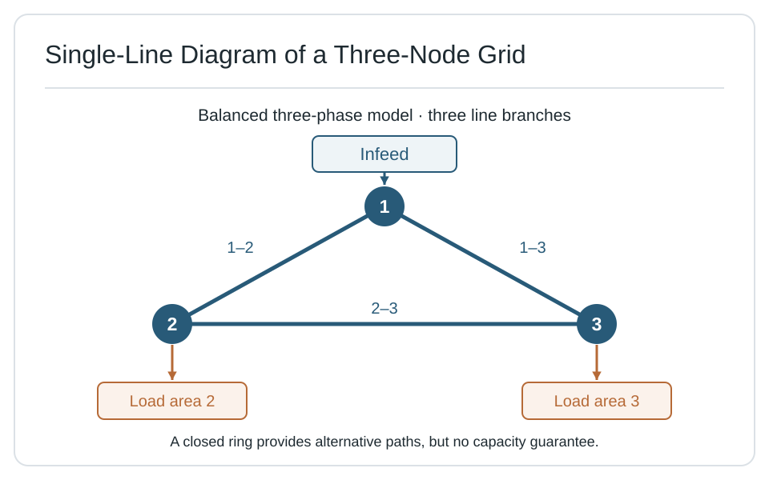

# M10-L1 – Grid Structure and Equipment {#L1}

**Course area:** M10 – Bachelor: Electrical Power Networks

**Level:** Bachelor · Elective

**Prerequisites:** [Three-phase systems](M7-L2.md), [Transformers](M7-L3.md), [Networks, lines and losses](M7-L5.md).

**Learning objective:** Convert a single-line diagram into a computational node-branch model and distinguish the functions of the equipment.

## From the interconnected grid to the single-line diagram {#S1}

An electricity grid connects generators, storage systems and consumers via lines and transformers. Transmission networks carry power over longer distances; distribution networks provide connections to regional and local consumers. Distribution networks also contain generators. The classification therefore does not necessarily describe the direction of power flow.

A single-line diagram represents the three conductors of a three-phase system as one connection. For balanced sinusoidal operation, a per-phase model using complex RMS values is sufficient; total power, by contrast, refers to all three phases. We use the line-to-line voltage $U_{LL}$ and the line current $I$. For balanced loads,

$$
|S|=\sqrt{3}U_{LL}I,\qquad P=|S|\cos\varphi,\qquad Q=|S|\sin\varphi.
$$

A node groups ideal electrical connection points. A branch connects two nodes via an item of equipment. Switching states determine which branches actually conduct. This distinction makes it possible to derive several operating states from the same network diagram.

## Equipment and equivalent models {#S2}

| Equipment | Function | Model for steady-state operation |
| --- | --- | --- |
| Infeed / generator | Supply power and voltage | Reference, PV or PQ node |
| Overhead line or cable | Transfer power | Series impedance and, if needed, shunt admittances |
| Transformer | Connect voltage levels | Turns ratio, leakage impedance, magnetisation if necessary |
| Busbar | Connect terminals | Common node |
| Circuit breaker | Switch operating and fault currents | Open or closed connection |
| Load | Draw active and, if applicable, reactive power | Constant power, current or impedance |

For a first approximation, shunt admittances may be neglected for short lines. This is not generally permissible for long lines and cables with substantial capacitance. In the later model, we use only series impedances $Z=R+jX$. The resistance $R$ causes active power losses, while the reactance $X$ particularly affects reactive power exchange and voltage variation.

{alt="A three-node grid with an infeed at node 1, two load nodes and three lines."}

The model shown reduces an upstream supply to node 1 and two load areas to nodes 2 and 3. The three lines form a closed ring. Power flow can be distributed along several paths. Line 2–3 may also carry almost no load even though it is relevant for an alternative supply.

## Voltage level and current demand {#S3}

At 10 MW of active power and a lagging power factor of 0.8, the apparent power is 12.5 MVA. At 20 kV, $I=360.8\,\mathrm A$. If the same power is ideally transmitted at 110 kV, it is only $65.6\,\mathrm A$. For hypothetical equal conductor resistances of 1 Ω per phase, $P_V=3RI^2$: approximately 390.6 kW versus 12.9 kW. The subscript V denotes losses. This is a comparison at equal resistances, not a design for real lines. Insulation, cross-section, construction, transformer losses and reactive power alter the overall balance.

## Topology and availability {#S4}

In a radial network there is exactly one path between the infeed and each load. An interrupted line may disconnect a downstream part of the network. A ring may provide additional paths. Initially, this redundancy says only something about connectivity. It does not guarantee that the remaining branches can carry the current or maintain voltages within the intended range.

An operating calculation therefore requires not only the connections but also the impedances, power data, reference voltage and limits. A single-line diagram alone determines neither power flow nor protection settings. Switching operations and work on real power networks are outside the scope of this learning model.

## Exercises with solutions {#S5}

1. A balanced load draws 6 MW at 10 kV and $\cos\varphi=0.9$. Determine the line current.  
   **Solution** $I=6\cdot10^6/(\sqrt3\cdot10^4\cdot0.9)=384.9\,\mathrm A$.
2. Which loads remain connected to node 1 after interruption of line 1–3 in the triangle shown?  
   **Solution** Both, via 1–2 and 1–2–3 respectively. Permissible currents and voltages must be checked separately.
3. Why can a short line branch be represented as a series impedance in a power-flow model, whereas a long cable often cannot?  
   **Solution** The capacitive charging current of a long line may be significant; the purely series model omits it completely.

**Further study:** [Equivalent parameters, base quantities and the nodal matrix](M10-L2.md)

## Sources {#S6}

- [KIT – Electrical Power Networks, lecture contents](https://www.ieh.kit.edu/2448_bee.php) · EEN syllabus, item 1: power supply structure; curriculum comparison. · Last accessed: 2026-11-25
- [IIT Kharagpur / NPTEL – Power System Analysis](https://onlinecourses-archive.nptel.ac.in/noc18_ee16/preview) · Course Layout, weeks 2–4: line parameters and per-unit system; lecture contents not reviewed. · Last accessed: 2026-11-25
