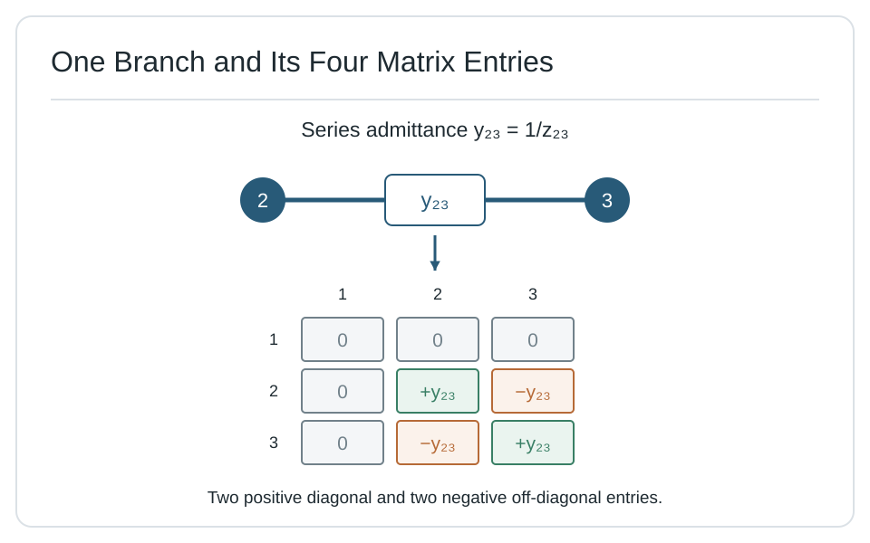

# M10-L2 – Equivalent Parameters, Base Quantities and the Nodal Matrix {#L2}

**Course area:** M10 – Bachelor: Electrical Power Networks

**Level:** Bachelor · Elective

**Prerequisites:** [Grid structure](M10-L1.md), [Complex impedance](M1-L6.md), [Systems of linear equations](M2-L2.md).

**Learning objective:** Define three-phase base quantities consistently and construct a complex nodal admittance matrix from line data.

## Per-unit as a dimensionless reference system {#S1}

Networks with multiple voltage levels can be simplified by using normalised quantities. We choose a common three-phase base power $S_B$ and a line-to-line base voltage $U_B$ for each voltage level. This gives

$$
I_B=\frac{S_B}{\sqrt3 U_B},\qquad Z_B=\frac{U_B^2}{S_B},\qquad Y_B=\frac1{Z_B}.
$$

The voltage of the per-phase model is normalised by $U_B/\sqrt3$, and the current by $I_B$. The complex total power is then $s=v i^*$; the factor of 3 is already accounted for by the choice of bases. Lower-case letters here denote dimensionless per-unit quantities (pu), and the asterisk denotes complex conjugation. Physical quantities are recovered by multiplying by their respective bases.

Example: $S_B=10\,\mathrm{MVA}$ and $U_B=20\,\mathrm{kV}$ give $I_B=288.675\,\mathrm A$ and $Z_B=40\,\Omega$. A line with $Z=0.8+j2\,\Omega$ therefore has $z=0.02+j0.05$. A voltage of 19.2 kV corresponds to a magnitude of 0.96 pu.

## Transformers and change of base {#S2}

If the voltage bases on both sides are chosen in the ratio of the ideal rated transformation, the ideal transformer has a transformation ratio of unity in the per-unit model (without phase shift). Its leakage impedance remains. Off-nominal tap positions or phase shifts must be modelled separately.

An impedance already expressed in per-unit is converted to a different base using

$$
z_\mathrm{neu}=z_\mathrm{alt}\frac{S_{B,\mathrm{neu}}}{S_{B,\mathrm{alt}}}\left(\frac{U_{B,\mathrm{alt}}}{U_{B,\mathrm{neu}}}\right)^2.
$$

The subscripts neu and alt denote the new and old bases respectively. Example: a transformer rated at 5 MVA has a leakage reactance of 0.06 pu on its own base. With the same voltage base and a 10 MVA system base, it becomes 0.12 pu. The physical impedance does not change.

## Constructing the nodal admittance matrix {#S3}

We use the three-node network from [M10-L1](M10-L1.md), with the following per-unit series impedances:

| Line | $z$ (pu) | $y=1/z$ (pu) |
| --- | --- | --- |
| 1–2 | 0.02 + j0.05 | 6.8966 − j17.2414 |
| 2–3 | 0.03 + j0.06 | 6.6667 − j13.3333 |
| 1–3 | 0.04 + j0.08 | 5 − j10 |

The current flowing from node $k$ into a line branch is $i_{km}=y_{km}(v_k-v_m)$. We count the resulting current injection $i_k$ as positive into the line network. Kirchhoff's current law gives

$$
\begin{pmatrix}i_1\\i_2\\i_3\end{pmatrix}=
\underbrace{\begin{pmatrix}
y_{12}+y_{13}&-y_{12}&-y_{13}\\
-y_{12}&y_{12}+y_{23}&-y_{23}\\
-y_{13}&-y_{23}&y_{13}+y_{23}
\end{pmatrix}}_{Y}
\begin{pmatrix}v_1\\v_2\\v_3\end{pmatrix}.
$$

{alt="Line 2–3 contributes +y23 to diagonal entries 22 and 33 and −y23 to off-diagonal entries 23 and 32 of the matrix."}

Each line adds $+y$ to two diagonal entries and $-y$ to two off-diagonal entries. Without shunt admittances, the rows sum to zero. It follows that $Y\mathbf 1=0$: the common additive offset of all complex node potentials is not determined by the specified branch currents alone. In this model we therefore fix $v_1=1+j0$ and, for known currents, solve only for the remaining nodes.

## From specified currents to specified powers {#S4}

The nodal matrix describes the linear line network. Loads with constant complex power, however, are nonlinear: $i_k=(s_k/v_k)^*$. A negative power value denotes net consumption here. As the voltage magnitude falls, the current magnitude rises for the same apparent power. An iterative power-flow calculation is therefore required. The nodal matrix remains constant as long as the topology is unchanged; the current injections are updated.

When a line is disconnected, its entire contribution must be removed from $Y$. If this creates an island without a reference node, the reduced equation of this model can no longer be solved using an invertible matrix. Such an island requires its own supply model; it is not represented by assigning it a numerical zero voltage.

## Exercises with solutions {#S5}

1. What is the base impedance at 100 MVA and 110 kV?  
   **Solution** $Z_B=(110\,\mathrm{kV})^2/(100\,\mathrm{MVA})=121\,\Omega$.
2. Determine $Y_{23}$ of the three-node network.  
   **Solution** $-y_{23}=-6.6667+j13.3333$ pu.
3. Which matrix entry changes if an additional shunt admittance $j0.02$ is connected at node 3?  
   **Solution** Only $Y_{33}$ increases by $j0.02$ pu; the sum of row 3 is then no longer zero.

**Further study:** [Steady-state power flow](M10-L3.md)

## Sources {#S6}

- [IIT Kharagpur / NPTEL – Power System Analysis](https://onlinecourses-archive.nptel.ac.in/noc18_ee16/preview) · Course Layout, weeks 5–6: load flow analysis; lecture contents not reviewed. · Last accessed: 2026-11-25
- [MATPOWER – Network Equations](https://matpower.app/manual/matpower/NetworkEquations.html) · MATPOWER manual §3.6, eqs. (3.8), (3.17): nodal admittance and AC power balance. · Last accessed: 2026-11-25
