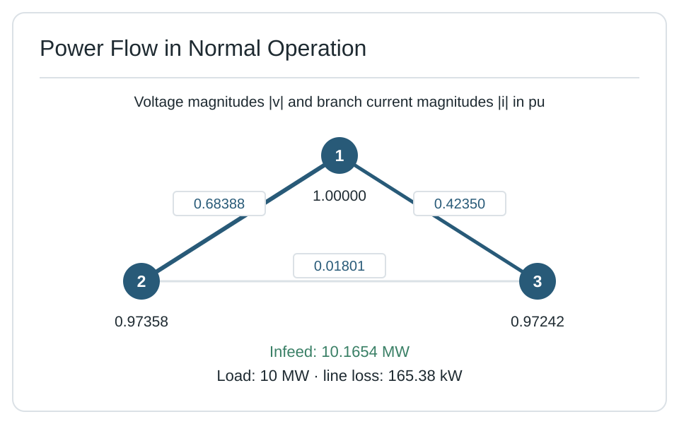

# M10-L3 – Steady-State Power Flow {#L3}

**Course area:** M10 – Bachelor: Electrical Power Networks

**Level:** Bachelor · Elective

**Prerequisites:** [Nodal matrix](M10-L2.md), [AC power](M1-L7.md).

**Learning objective:** Distinguish the node types of an AC power flow, formulate the power balance and solve a small power-flow problem iteratively.

## Node types and sign conventions {#S1}

In the balanced, steady-state AC model, the complex power injection at each node is

$$
s_k=p_k+jq_k=v_k\left(\sum_mY_{km}v_m\right)^*.
$$

Here, $p_k$ and $q_k$ denote generation minus consumption. Generally, two of the four quantities $p,q,|v|,\theta$ are specified; the remaining two follow from the network. The angle $\theta$ is relative to a common reference angle.

| Type | Specified | Calculated |
| --- | --- | --- |
| Reference node (slack) | $\lvert v\rvert,\theta$ | $p,q$ |
| PV node (voltage-controlled injection) | $p,\lvert v\rvert$ | $q,\theta$ |
| PQ node | $p,q$ | $\lvert v\rvert,\theta$ |

PV here denotes the node type, not photovoltaics. When a reactive power limit is reached, a PV node can be switched to fixed reactive power in the model. The voltage then becomes a calculated quantity. The slack node accounts mathematically for the remaining balance, including losses; this does not imply unlimited real generation capacity.

## Voltage drop and power flow {#S2}

For a line without shunt admittance, $i_{km}=(v_k-v_m)/z_{km}$. The powers at both ends are counted positive into the branch: $s_{km}=v_k i_{km}^*$ and $s_{mk}=v_m(-i_{km})^*$. Their sum is

$$
s_{km}+s_{mk}=z_{km}|i_{km}|^2.
$$

The real part is the active power loss. For small voltage changes and a receiving-end demand of $p_L+jq_L$, the difference in voltage magnitudes can be approximated as $(rp_L+xq_L)/|v_m|$. This follows from $v_k=v_m+zi$ and the projection onto the receiving-end voltage phasor. An inductive load can therefore increase the voltage drop even with unchanged active power.

## Worked example with two PQ nodes {#S3}

Use the lines from [M10-L2](M10-L2.md), $v_1=1+j0$, $s_2=-0.6-j0.25$ and $s_3=-0.4-j0.15$. Since nodes 2 and 3 are PQ nodes, we can use the reduced matrix $Y_{LL}$ formed by rows and columns 2 and 3. The column vector $Y_{L1}$ couples in the reference. From $Y_{LL}v_L+Y_{L1}v_1=i_L$ we obtain the fixed-point iteration

$$
v_L^{(n+1)}=Y_{LL}^{-1}\left[\left(\frac{s_L}{v_L^{(n)}}\right)^*-Y_{L1}v_1\right].
$$

The element-wise division represents the two separate PQ nodes. Start with $v_2=v_3=1+j0$. At each iteration, solve a system of linear equations and then check the complex power mismatch $\max_{k=2,3}|v_k(Yv)_k^*-s_k|$. The voltage change alone does not determine when to stop.

| Node | Magnitude (pu) | Angle | $p$ (pu) | $q$ (pu) |
| --- | ---: | ---: | ---: | ---: |
| 1 | 1.00000 | 0° | 1.01654 | 0.43775 |
| 2 | 0.97358 | −1.490° | −0.60000 | −0.25000 |
| 3 | 0.97242 | −1.508° | −0.40000 | −0.15000 |

{alt="Calculated voltage magnitudes of 1.00000, 0.97358 and 0.97242 pu and the magnitudes of the three branch currents in the base case."}

With a base power of 10 MVA, 10.1654 MW of injection supplies 10 MW of load. The loss of approximately 165.4 kW is independently checked using $\sum r|i|^2$. The reactive power requirement of the lines is around 0.3775 Mvar. The line currents in branches 1–2, 2–3 and 1–3 are 0.68388, 0.01801 and 0.42350 pu. With unrounded data, the solution reaches a power mismatch below $10^{-10}$ pu after seven iterations.

## Limitations of power-flow calculations {#S4}

A converged power flow is a mathematical solution of the steady-state equations. It does not automatically satisfy current, voltage or generation limits. Depending on the network and loading, the simple fixed-point iteration may converge slowly or fail. This does not prove that no solution exists. Newton–Raphson methods instead use a Jacobian matrix of the power mismatches and solve linearised correction equations. They too require sensible initial values and a model check.

The voltage angles of the example network are small. A DC power flow can provide a simplified active power flow under additional assumptions (small angles, nearly constant voltage magnitudes and negligible resistances). Here, however, it does not replace the AC calculation, because reactive power, voltage drop and losses are to be investigated.

## Exercises with solutions {#S5}

1. A load of 4 MW and a local generator of 3 MW are located at the same node. The load requires 1 Mvar, and the generator supplies no reactive power. What are the node data on a 10 MVA base?  
   **Solution** $s=-0.1-j0.1$ pu.
2. For $z=0.02+j0.05$ pu and $|i|=0.8$ pu, determine the active power losses on a 10 MVA base.  
   **Solution** $0.02\cdot0.8^2\cdot10\,\mathrm{MW}=128\,\mathrm{kW}$.
3. Why can node 1 not be modelled simultaneously with constant power injection and a specified complex voltage?  
   **Solution** Its power output must make up the difference between load, the other injections and losses; an additional fixed power would generally overdetermine the system of equations.

**Further study:** [Network faults and protection principles](M10-L4.md), [Reproducible power-flow calculation](M10-L5.md).

## Sources {#S6}

- [MATPOWER – AC Power Flow](https://matpower.app/manual/matpower/ACPowerFlow.html) · § 4.1: reference, PV and PQ buses in AC power flow. · Last accessed: 2026-11-25
- [MATPOWER – Network Equations](https://matpower.app/manual/matpower/NetworkEquations.html) · MATPOWER manual §3.6, eqs. (3.8), (3.17): nodal admittance and AC power balance. · Last accessed: 2026-11-25
- [IIT Kharagpur / NPTEL – Power System Analysis](https://onlinecourses-archive.nptel.ac.in/noc18_ee16/preview) · Course Layout, weeks 5–8: load flow and optimal operation; lecture contents not reviewed. · Last accessed: 2026-11-25
