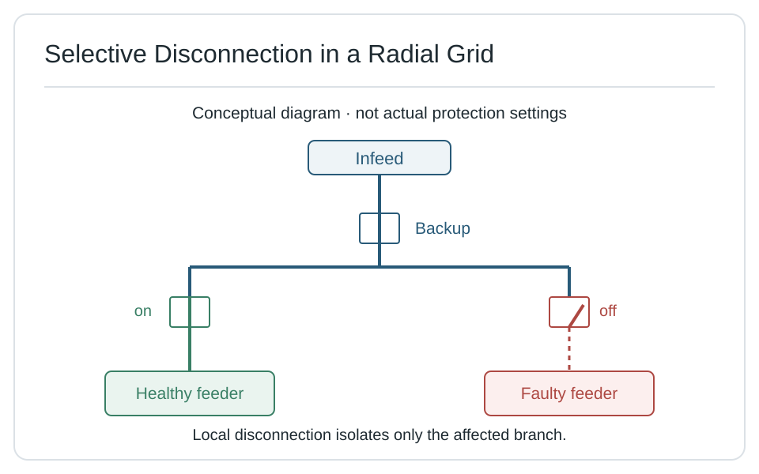

# M10-L4 – Grid Faults and Protection Principles {#L4}

**Course area:** M10 – Bachelor: Electrical Power Networks

**Level:** Bachelor · Elective

**Prerequisites:** [Equivalent circuits](M1-L4.md), [Three-phase systems](M7-L2.md), [Power flow](M10-L3.md).

**Learning objective:** Calculate a symmetrical three-phase short circuit using an equivalent model and distinguish the roles of fault detection, disconnection and selectivity.

## Normal and fault operation {#S1}

A short circuit arises from an unintended low-impedance connection. Compared with normal power flow, the network conditions change substantially. A symmetrical three-phase fault can be investigated using a single-phase equivalent circuit. Unbalanced faults (such as single-phase earth faults) require further models, for example positive-, negative- and zero-sequence networks with the appropriate neutral earthing arrangements. These are not calculated here.

In the simple fault-current model, the supplying network as seen from the fault location is represented by a Thévenin voltage $U_{\mathrm{Th}}$ and an internal impedance $Z_{\mathrm{Th}}$. The voltage is a per-phase RMS phasor; the fault resistance or fault impedance $Z_f$ is specified per phase. Thus

$$
\underline I_f=\frac{\underline U_{\mathrm{Th}}}{Z_{\mathrm{Th}}+Z_f}.
$$

Realistic initial short-circuit currents require appropriate source and machine models, the pre-fault operating state and assumptions consistent with relevant standards. The following numerical experiment assumes a prescribed ideal source behind a constant impedance. Neither the peak short-circuit current nor a time-dependent decay is calculated.

## Numerical example for a 20 kV network {#S2}

Choose $S_B=10\,\mathrm{MVA}$, $U_B=20\,\mathrm{kV}$, $v_\mathrm{Th}=1$ pu and $z_\mathrm{Th}=0.02+j0.10$ pu. This is an independent fault example, not a short-circuit calculation for the ideal slack model from M10-L3. For a bolted fault ($z_f=0$),

$$
i_f=\frac1{0.02+j0.10}=1.9231-j9.6154,\qquad |i_f|=9.8058.
$$

With $I_B=288.675\,\mathrm A$, we obtain $|I_f|\approx2.831\,\mathrm{kA}$. The conventional apparent short-circuit power referred to the nominal voltage is $\sqrt3 U_B|I_f|\approx98.06\,\mathrm{MVA}$. This is not the power dissipated in the ideal fault resistance: for $z_f=0$, the fault voltage is zero. If a real fault resistance of 0.10 pu is assumed, $|i_f|$ falls to $1/\sqrt{0.12^2+0.10^2}=6.4018$ pu (1.848 kA).

## Fault detection and selective disconnection {#S3}

A protection system combines measured quantities, decision logic and a switching device. Overcurrent protection responds to elevated currents. Differential protection compares the currents entering and leaving a defined zone, taking measurement and transformation ratios into account. Distance protection uses the apparent impedance derived from voltage and current measurements as an indication of the fault location. The function depends on network type, source configuration and measurement conditions.

{alt="Radial supply with an upstream backup circuit breaker and two outgoing feeders, of which only the faulty one is disconnected by its local breaker."}

Selectivity means isolating the affected area as precisely as possible. In a radial arrangement, downstream protection can operate first; upstream protection serves as backup. As a purely conceptual example, assume a clearing time of 0.15 s for the downstream device and 0.45 s for the upstream device. The time-grading interval is 0.30 s. These illustrative figures are not usable protection settings: actual protection characteristics, tolerances, breaker operating times and minimum fault currents must be assessed together. In a ring with supply from both sides, simple time grading is often insufficient.

## Limitations and safety function {#S4}

The maximum fault current is important for the stresses imposed on equipment. The minimum fault current, by contrast, is relevant to whether protection detects a fault at all. Current-limited power electronic converters can supply far less fault current than conventional synchronous machines; their fault response then depends on the control and protection design. A power-flow calculation with an ideal slack bus does not represent this behaviour.

The loss of a line branch after disconnection constitutes a new steady-state network case. The fault itself and the transients during disconnection are different modelling tasks. A simple short-circuit current calculation cannot establish authorisation to carry out work, select a real protection device or verify an installation against standards.

## Exercises with solutions {#S5}

1. Halve the entire Thévenin impedance in the bolted-fault example. What happens to the current?  
   **Solution** Its magnitude doubles to approximately 5.66 kA with the source voltage unchanged.
2. Why is a smaller fault current not advantageous in every respect?  
   **Solution** It reduces equipment stress but can fall below the pickup threshold of overcurrent protection.
3. Which part of the network does the downstream breaker disconnect in the radial system shown?  
   **Solution** Only the faulty feeder; the other feeder remains connected if selective disconnection succeeds. Backup disconnection would disconnect more loads.

**Further study:** [Network planning using a model example](M10-L5.md)

## Sources {#S6}

- [KIT – Electrical Power Networks, lecture contents](https://www.ieh.kit.edu/2448_bee.php) · EEN syllabus, item 5: network faults; curriculum comparison. · Last accessed: 2026-11-25
- [IIT Kharagpur / NPTEL – Power System Analysis](https://onlinecourses-archive.nptel.ac.in/noc18_ee16/preview) · Course Layout, weeks 9–11: short circuits and unbalanced faults; lecture contents not reviewed. · Last accessed: 2026-11-25
- [IIT Bombay / NPTEL – Power System Protection, modules 1 and 4–10](https://nptel.ac.in/courses/108101039) · Power System Protection course overview, IIT Bombay: topic classification; teaching materials and syllabus not reviewed. · Last accessed: 2026-11-25
