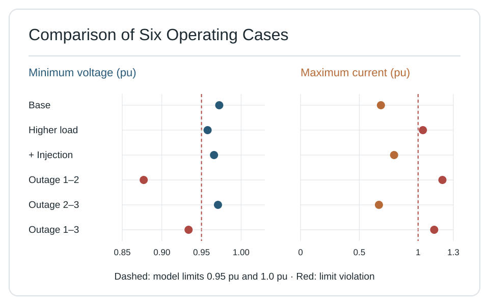

# M10-L5 – Network Planning Using a Model Example {#L5}

**Course area:** M10 – Bachelor: Electrical Power Networks

**Level:** Bachelor · Elective

**Prerequisites:** [Nodal matrix](M10-L2.md), [Power flow](M10-L3.md), [Grid faults](M10-L4.md), [Computational experiments](M2-L7.md).

**Learning objective:** Calculate the behaviour of a model network under changing load, local generation and individual line outages, and evaluate it against explicit operating limits.

## Planning question and model assumptions {#S1}

The three-node grid from the previous lessons is intended to supply both load areas even when demand changes. We distinguish power demand from available network capacity. A higher load current can exceed thermal limits, while unfavourable impedance can cause the voltage to become too low before that happens.

All quantities are referred to 10 MVA and 20 kV. The illustrative requirements chosen for this example are $0.95\le |v_k|\le1.05$ pu and $|i_{km}|\le1.0$ pu (equivalent to 288.7 A). These are neither a voltage band prescribed by a standard nor an actual line rating. Node 1 remains ideally fixed at 1 pu. All lines have only series impedances, and the loads are modelled as constant PQ nodes. There are no tap changers, source limits or dynamic processes.

| Branch | Impedance (pu) |
| --- | --- |
| 1–2 | 0.02 + j0.05 |
| 2–3 | 0.03 + j0.06 |
| 1–3 | 0.04 + j0.08 |

The initial loads are 6 MW and 2.5 Mvar at node 2 and 4 MW and 1.5 Mvar at node 3. The increased-load case raises both loads by 50%. An additional generator at node 3 injects 6 MW and 0 Mvar in the increased-load case. In the model it is a fixed PQ injection; consumption at the same node remains unchanged. The three outage scenarios each remove exactly one line from the original base operating case.

## Reproducible calculation {#S2}

The fixed-point iteration from [M10-L3](M10-L3.md) is implemented with Python and NumPy. Node numbers in the code start at zero. The power balance and the branch currents are calculated for each variant from the resulting network voltage; source power is not prescribed. The original German output labels are retained in the code: *Basis* denotes the base case, *Mehrlast* increased load, *Einspeisung* generation injection and *Ausfall* outage. The error messages indicate voltage near zero and failure to converge.

```python
import numpy as np

lines = [(0, 1, .02+.05j), (1, 2, .03+.06j),
         (0, 2, .04+.08j)]

def solve(branches, s, tol=1e-10):
    Y = np.zeros((3, 3), dtype=complex)
    for a, b, z in branches:
        y = 1/z
        Y[a, a] += y
        Y[b, b] += y
        Y[a, b] -= y
        Y[b, a] -= y
    s = np.array(s, dtype=complex)
    v = np.ones(2, dtype=complex)
    for n in range(1, 501):
        if np.any(abs(v) < 1e-12):
            raise ValueError("Spannung nahe null")
        v = np.linalg.solve(Y[1:, 1:],
                            np.conj(s/v)-Y[1:, 0])
        V = np.r_[1+0j, v]
        S = V*np.conj(Y@V)
        err = max(abs(S[1:]-s))
        if err < tol:
            break
    else:
        raise ValueError("Keine Konvergenz")
    I = [abs((V[a]-V[b])/z) for a, b, z in branches]
    loss = sum(z.real*i*i for (_, _, z), i in zip(branches, I))
    assert abs(S.real.sum()-loss) < 1e-9
    return V, S, I, loss, n, err

base = [-.6-.25j, -.4-.15j]
heavy = [-.9-.375j, -.6-.225j]
cases = [("Basis", lines, base),
         ("Mehrlast", lines, heavy),
         ("Einspeisung", lines, [heavy[0], -.225j])]
for k, name in enumerate(["1-2", "2-3", "1-3"]):
    cases.append(("Ausfall " + name,
                  [z for i, z in enumerate(lines) if i != k], base))
for name, branches, s in cases:
    V, S, I, loss, n, err = solve(branches, s)
    ok = min(abs(V)) >= .95 and max(abs(V)) <= 1.05 and max(I) <= 1
    print(name, abs(V), max(I), loss*10000, n, err, ok)
```

A singular matrix, for example if an isolated island has no reference node, raises an exception. A larger planning tool would need to check the connected components beforehand. The example covers connected networks only. The internal power residual bounds the numerical deviation, not the physical modelling error.

## Evaluation of the six operating cases {#S3}

With unrounded inputs, the calculation produces the following values. Losses are converted to kW. All solutions achieve a complex power residual smaller than $10^{-10}$ pu.

| Operating case | $\lvert v_2\rvert$ (pu) | $\lvert v_3\rvert$ (pu) | $\max \lvert i\rvert$ (pu) | Loss (kW) | Iter. | Limits |
| --- | ---: | ---: | ---: | ---: | ---: | --- |
| Base | 0.97358 | 0.97242 | 0.68388 | 165.38 | 7 | satisfied |
| Increased load | 0.95952 | 0.95773 | 1.04105 | 383.30 | 9 | current |
| Increased load + injection | 0.96581 | 0.97244 | 0.79600 | 188.40 | 8 | satisfied |
| Outage 1–2 | 0.87709 | 0.91529 | 1.20710 | 747.60 | 13 | voltage, current |
| Outage 2–3 | 0.97453 | 0.97080 | 0.66699 | 166.43 | 7 | satisfied |
| Outage 1–3 | 0.95642 | 0.93370 | 1.13712 | 321.41 | 9 | voltage, current |

{alt="Minimum voltage and maximum line current for six load and outage scenarios compared with the freely chosen limits."}

The increased-load case stays within the chosen voltage band but exceeds the current limit. Local generation improves both quantities even though it supplies no reactive power. This is due to the changed branch currents, not a fixed regulated node voltage. The slack bus still supplies about 9.1884 MW in this case; the net active power demand is 9 MW. With even greater generation injection, power-flow directions can reverse and voltages can become too high.

## Redundancy and qualitative robustness {#S4}

All three individual outages leave both load nodes connected to the reference. Nevertheless, two outage cases fail to satisfy the prescribed limits. The ring is therefore topologically redundant but is not adequately sized at this operating point to pass this simplified N-1 check. Here N-1 means the loss of an individual line branch with unchanged loads and no remedial actions; this is not a complete operational security analysis.

Possible planning variants include lower line impedances, higher permissible current through appropriate equipment, local reactive power provision or an alternative supply. Each variant changes the model in a different way and should first be tested individually, then in combination. Raising the current limit alone does not eliminate a violation of the voltage band. A new source also requires consideration of availability, protection functions and other operating cases. A time-dependent generation profile is covered in the planned module M11.

The investigation quantifies steady-state operating limits, not transient stability, protection coordination or actual outage probabilities. A real decision requires measurement data, equipment data, additional load and generation scenarios and applicable technical requirements.

## Exercises with solutions {#S5}

1. What minimum voltages occur in outage cases 1–2 and 1–3? Which branches carry the maximum current?  
   **Solution** 0.87709 pu at node 2, maximum current on 1–3; 0.93370 pu at node 3, maximum current on 1–2.
2. The increased-load case has a maximum current of 1.04105 pu. Approximately how many amperes is this?  
   **Solution** $1.04105\cdot288.675\,\mathrm A=300.5\,\mathrm A$, or about 11.9 A above the model limit.
3. Which conclusion changes if only the voltage band, but not the current limit, is checked?  
   **Solution** The increased-load case would incorrectly be rated acceptable. Even a steady-state mathematical solution with no residual error does not guarantee compliance with further operating requirements.
4. Run the base case with a stricter tolerance of $10^{-12}$ and compare the voltages and losses.  
   **Solution** The rounded values reported remain unchanged. The residual check becomes stricter and the number of iterations increases. Such a repetition investigates only the numerical error, not the quality of the input data.

**Further study:** [Study pathway and further elective modules](pages/study-path.md#S3).

## Sources {#S6}

- [KIT – Electrical Power Networks, lecture contents](https://www.ieh.kit.edu/2448_bee.php) · EEN syllabus, items 3 and 4: network calculation and optimal power flow; curriculum comparison. · Last accessed: 2026-11-25
- [MATPOWER – AC Power Flow](https://matpower.app/manual/matpower/ACPowerFlow.html) · Manual §4.1: AC power balance and bus types; limitations of ordinary power flow, methodological aspect. · Last accessed: 2026-11-25
- [MATPOWER – Standard AC OPF](https://matpower.app/manual/matpower/StandardACOPF.html) · § 6.1: optimization variables, cost function and power balance; further reading. · Last accessed: 2026-11-25
