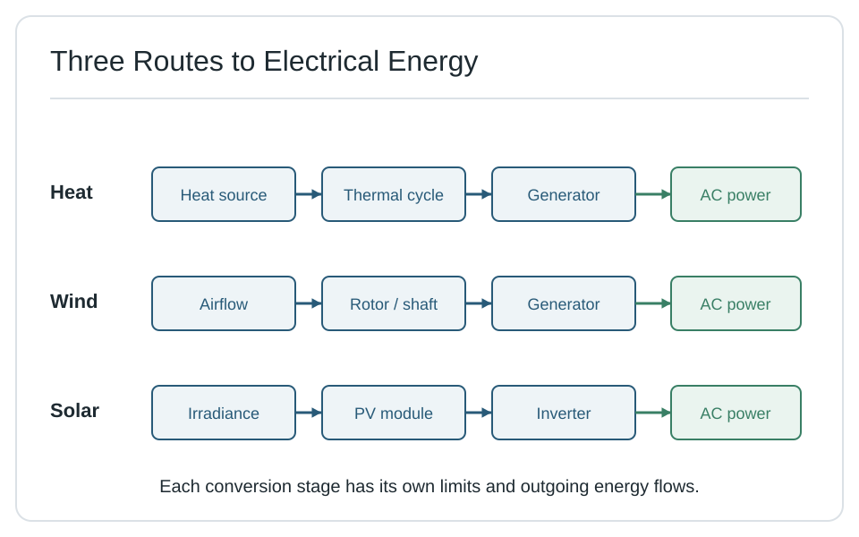

# M11-L1 – Conversion Chains and Power Profiles {#L1}

**Course area:** M11 – Bachelor: Energy Generation and Storage

**Level:** Bachelor · Elective

**Prerequisites:** [Energy balances](M2-L1.md), [Electrical power engineering](M7-L1.md), [Grid structure](M10-L1.md).

**Learning objective:** Establish balances for conversion chains, integrate generation profiles and distinguish energy yield from available power.

## System Boundary and Energy Balance {#S1}

Electrical energy is not a primary energy source but an energy carrier. A power plant converts energy from a resource and makes it available at a defined electrical connection point. We draw the system boundary around the entire installation, including its auxiliary consumption. In steady-state operation,

$$
P_\mathrm{ein}=P_\mathrm{el,netto}+P_\mathrm{ab},\qquad \eta_\mathrm{netto}=\frac{P_\mathrm{el,netto}}{P_\mathrm{ein}}.
$$

Here $P_\mathrm{ab}$ includes all other energy flows leaving the system, including useful heat where applicable. If the energy content of the system changes, the time derivative of the stored energy must also be included. Efficiencies can therefore only be compared when the system boundary and operating conditions are specified. For wind and PV, the reference quantity is the incident resource power, not fuel power.

{alt="Heat, wind and solar radiation are converted into electrical power through different conversion stages."}

## Thermal Power Plants {#S2}

In a steam power plant, combustion, nuclear fission or concentrated solar radiation, for example, heats a working fluid. Steam expands in the turbine, and the generator converts shaft power into electrical power. Condensation and pumping complete the cycle. The theoretical Carnot efficiency $1-T_\mathrm{kalt}/T_\mathrm{heiß}$ gives an upper bound for a reversible heat engine operating between two thermal reservoirs; temperatures must be expressed in kelvin. It is not a model of the actual steam power plant.

Example: With 100 MW of heat input, a thermal-to-mechanical cycle efficiency of 40%, a generator efficiency of 97% and 2 MW of electrical auxiliary consumption, gross and net power are 38.8 MW and 36.8 MW respectively. Under unchanged operating conditions over 6 h, this amounts to 220.8 MWh of net electrical energy. In practical models, efficiency, auxiliary consumption, minimum load and permissible power ramp rate depend on the operating point. Combined heat and power makes use of some of the heat that would otherwise be rejected; this is distinct from electrical efficiency.

## Wind, Hydropower and Photovoltaics {#S3}

Air mass $\rho A v$ flows per second through a rotor area $A$ perpendicular to the airflow. Using the specific kinetic energy $v^2/2$, we obtain

$$
P_\mathrm{Wind}=\frac12\rho A v^3,\qquad P_\mathrm{el}=\eta_\mathrm{Antrieb} c_P P_\mathrm{Wind}.
$$

The aerodynamic power coefficient is denoted by $c_P$. For an ideal isolated actuator disk, the Betz limit is 16/27; real rotors fall below it. With $A=100\,\mathrm{m^2}$, $\rho=1.225\,\mathrm{kg/m^3}$, $v=8\,\mathrm{m/s}$, $c_P=0.4$ and $\eta_\mathrm{Antrieb}=0.9$, the result is approximately 11.29 kW. In this model the cubic relationship applies only for constant coefficients, not above rated power or during shutdown. A realistic plant model uses a power curve including cut-in, rated-power and cut-out regions.

Hydropower uses a volumetric flow rate $Q$ at a hydraulic head $H$: $P_\mathrm{el}=\eta\rho_\mathrm{Wasser}gQH$. Photovoltaics convert light directly into DC electrical power. An inverter connects the installation to an AC grid. The corresponding characteristic curves are covered in [M11-L2](M11-L2.md).

## Profiles, Energy and Residual Load {#S4}

Energy is the time integral of power. For piecewise constant intervals,

$$
E=\int_0^T P(t)\,\mathrm dt=\sum_k P_k\Delta t_k,\qquad f_\mathrm{Auslastung}=\frac{E}{P_\mathrm{Nenn}T}.
$$

An illustrative four-hour experiment with a rated power of 4 kW:

| Hour | Generation (kW) | Load (kW) | Residual load (kW) |
| --- | ---: | ---: | ---: |
| 1 | 0 | 2 | 2 |
| 2 | 4 | 1 | −3 |
| 3 | 3 | 2 | −1 |
| 4 | 1 | 3 | 2 |

Generation and load each amount to 8 kWh, and the generating installation's capacity factor is 50%. Nevertheless, two intervals have a combined deficit of 4 kWh, while a surplus of 4 kWh occurs in the other intervals. Only 4 kWh is used directly. The residual demand and surplus must be balanced over time; the annual or daily average alone is insufficient. An ideal 4 kWh storage system could absorb the surplus from both hours, but could only supply the first hour if sufficient initial energy were available. Continuous supply also requires consideration of power, controllability and grid limits.

## Exercises with Solutions {#S5}

1. A generator delivers 12 MW for 3 h and 4 MW for another 2 h. Determine the energy and average power.  
   **Solution** 44 MWh and 8.8 MW.
2. How does wind power change when wind speed increases from 6 to 9 m/s with constant coefficients?  
   **Solution** Factor $(9/6)^3=3.375$; limits have not been taken into account.
3. Why can average wind power not generally be calculated from average wind speed?  
   **Solution** Because of nonlinearity, in general $\overline{v^3}\ne\overline v^3$. The frequency distribution and power curve are required.

**Further reading:** [Photovoltaics and Power Characteristics](M11-L2.md)

## Sources {#S6}

- [U.S. DOE – Concentrating Solar-Thermal Power: Power Cycles](https://www.energy.gov/cmei/systems/concentrating-solar-thermal-power-csp-power-cycles) · What are Power Cycles?: thermal-to-electric conversion. · Last accessed: 2026-11-25
- [U.S. DOE – Small Wind Guidebook](https://www.energy.gov/cmei/systems/windexchange/small-wind-guidebook) · Small Wind Guidebook, Introduction and How Do Wind Turbines Work? sections: conversion of wind energy; small wind systems as an example. · Last accessed: 2026-11-25
- [U.S. DOE – Solar Photovoltaic Technology Basics](https://www.energy.gov/cmei/systems/solar-photovoltaic-technology-basics) · What Is Photovoltaic Technology?: light-to-electricity conversion and module structure. · Last accessed: 2026-11-25
