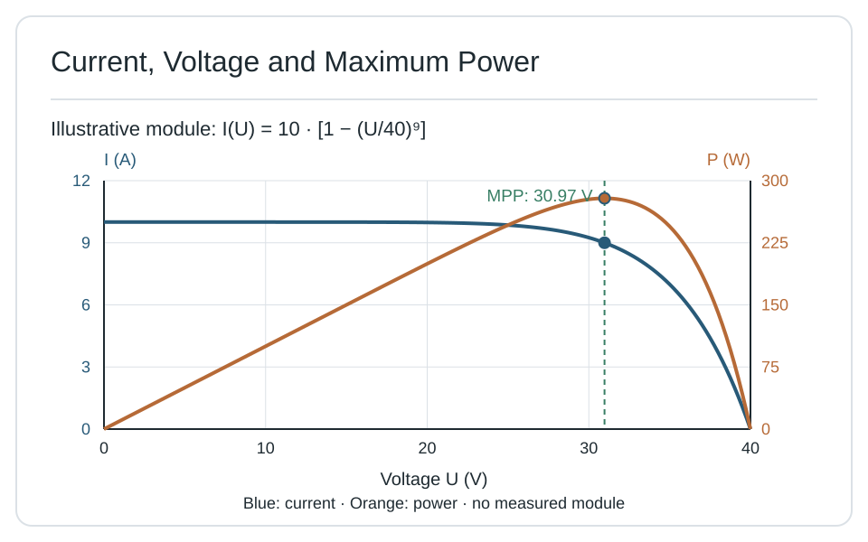

# M11-L2 – Photovoltaics and Power Characteristics {#L2}

**Course area:** M11 – Bachelor: Energy Generation and Storage

**Level:** Bachelor · Elective

**Prerequisites:** [Semiconductors](M3-L1.md), [Power](M1-L1.md), [Conversion chains](M11-L1.md), [DC/DC converters](M9-L3.md).

**Learning objective:** Interpret current-voltage characteristic curves and determine a simplified PV power profile including temperature and inverter limits.

## Photoelectric Conversion {#S1}

Absorbed photons can generate electron-hole pairs in a semiconductor. The solar cell structure promotes charge separation; electrical power can be delivered at the contacts when an external circuit is closed. Unlike a voltage source with an ohmic internal resistance, the output current does not depend linearly on terminal voltage. Current and voltage are specified as positive here using the generator sign convention.

A common steady-state single-diode model uses the photocurrent $I_\mathrm{ph}$, diode saturation current $I_0$, series resistance $R_s$ and shunt resistance $R_\mathrm{sh}$:

$$
I=I_\mathrm{ph}-I_0\left[\exp\left(\frac{U+IR_s}{nN_sV_T}\right)-1\right]-\frac{U+IR_s}{R_\mathrm{sh}},\qquad V_T=\frac{k_BT}{q}.
$$

$N_s$ is the number of identical cells connected in series, $n$ is the diode ideality factor, and $T$ is the absolute cell temperature. For $R_s\ne0$ the equation is implicit in $I$. Its parameters must be determined for a specific module. The model does not describe arbitrary partial shading without extensions for cell groups and bypass diodes.

## Characteristic Curve and Maximum Power Point {#S2}

Under short-circuit conditions, $U=0$ and $I=I_\mathrm{sc}$; under open-circuit conditions, $I=0$ and $U=U_\mathrm{oc}$. At both points, $P=UI=0$. At the maximum between these points (MPP), for a differentiable characteristic curve,

$$
\frac{\mathrm dP}{\mathrm dU}=I+U\frac{\mathrm dI}{\mathrm dU}=0.
$$

{alt="Schematic I-U characteristic curve and derived P-U curve with a common maximum power point."}

For illustration, we use the approximation $I(U)=10[1-(U/40)^9]$ A for $0\le U\le40$ V, explicitly not intended as a diode model. Differentiation gives $1-10(U/40)^9=0$; the MPP is at $U=40\cdot0.1^{1/9}\approx30.97$ V, $I=9$ A and $P\approx278.7$ W. The fill factor is $P_\mathrm{mp}/(U_\mathrm{oc}I_\mathrm{sc})\approx0.697$. An MPPT controller (Maximum Power Point Tracking) searches for a favourable operating point by means of a converter. Partial shading can produce several local maxima, so a simple search method does not necessarily find the global maximum.

## From Irradiance and Temperature to AC Power {#S3}

The reference power $P_\mathrm{STC}$ applies under standard test conditions (1000 W/m² irradiance in the module plane, 25 °C cell temperature, defined reference spectrum). As a simplified linear approximation inspired by PVWatts, we use

$$
P_\mathrm{DC}=\max\left(0,P_\mathrm{STC}\frac{G}{1000\,\mathrm{W/m^2}}[1+\gamma(T_c-25\,{}^\circ\mathrm C)]\right),
$$

with irradiance $G$, cell temperature $T_c$ and temperature coefficient $\gamma$. This is not a complete PVWatts model; in particular, low-light behaviour, spectral and optical losses and temperature dynamics are omitted. With fixed inverter efficiency and power limit,

$$
P_\mathrm{AC}=\min(P_\mathrm{AC,max},\eta_\mathrm{WR} P_\mathrm{DC}).
$$

For 6 kWp, $\gamma=-0.004\,\mathrm{K^{-1}}$, $G=800\,\mathrm{W/m^2}$ and $T_c=45\,{}^\circ\mathrm C$, the result is 4.416 kW DC and approximately 4.239 kW AC at 96% converter efficiency. At 1000 W/m² and 25 °C, the result would be 5.76 kW before power limiting; with a 5 kW inverter, 0.76 kW of potential AC power is lost through clipping in the simplified model. This difference is not equivalent to heat dissipated in the inverter.

## A Small Irradiance Profile {#S4}

| Quantity | Hour 1 | Hour 2 | Hour 3 |
| --- | ---: | ---: | ---: |
| Irradiance (W/m²) | 400 | 800 | 1000 |
| Cell temperature (°C) | 30 | 45 | 50 |
| DC power (kW) | 2.352 | 4.416 | 5.400 |
| AC power (kW) | 2.258 | 4.239 | 5.000 |

The three one-hour intervals deliver a total of approximately 11.497 kWh at the AC connection point. Actual irradiance values refer to the tilted module plane; horizontal weather data must be converted geometrically. Cell temperature is not the same as air temperature. Without this information, adding up module rated powers says little about the energy yield on a particular day.

## Exercises with Solutions {#S5}

1. Twelve identical 400 Wp modules in series, each at 32 V and 12.5 A at the MPP under STC. Determine string voltage, current and power.  
   **Solution** 384 V, 12.5 A and 4.8 kW. This is a calculation model, not design approval.
2. A 6 kWp installation operates at 1000 W/m² and 60 °C; $\gamma=-0.004\,\mathrm{K^{-1}}$. Determine the DC power.  
   **Solution** $6(1-0.004\cdot35)=5.16$ kW.
3. Why is an MPP controller not a substitute for safe plant operation?  
   **Solution** Power optimisation does not automatically account for cold-weather open-circuit voltage, current limits, insulation, arc protection or grid requirements. These must be addressed separately in the design.

**Further reading:** [Comparison of Storage Technologies](M11-L3.md)

## Sources {#S6}

- [U.S. DOE – Solar Photovoltaic Technology Basics](https://www.energy.gov/cmei/systems/solar-photovoltaic-technology-basics) · What Is Photovoltaic Technology?: cells, modules and arrays; partial scope. · Last accessed: 2026-11-25
- [Sandia PVPMC – PVWatts](https://pvpmc.sandia.gov/modeling-guide/2-dc-module-iv/point-value-models/pvwatts/) · PVWatts section, equation for irradiance >125 W/m²: MPP power and temperature coefficient; note scope limitations. · Last accessed: 2026-11-25
- [Sandia PVPMC – Array Utilization / MPPT](https://pvpmc.sandia.gov/modeling-guide/3-dc-array-iv/array-utilization/) · Array Utilization: maximum power point tracking and irradiance/cell temperature effects. · Last accessed: 2026-11-25
