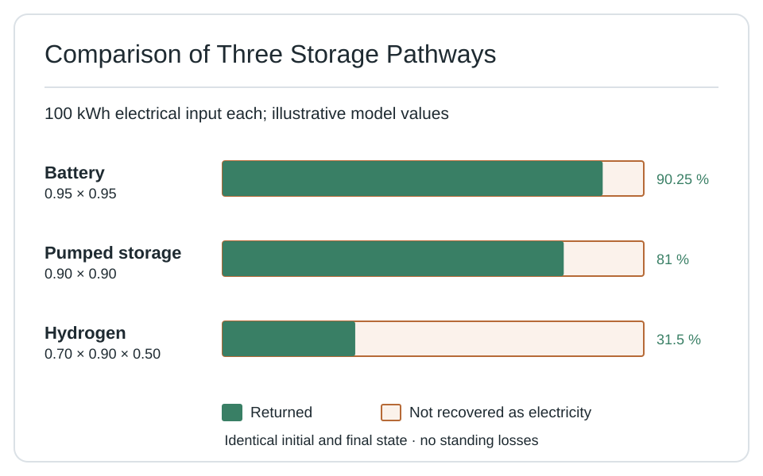

# M11-L3 – Comparison of Storage Technologies {#L3}

**Course area:** M11 – Bachelor: Energy Generation and Storage

**Level:** Bachelor · Elective

**Prerequisites:** [Energy balances](M2-L1.md), [Conversion chains](M11-L1.md).

**Learning objective:** Compare storage systems in terms of usable energy, power, efficiency and storage duration, explicitly stating the system boundaries.

## Energy, Power and Storage Duration {#S1}

Storage systems shift energy in time. They need a source for charging and, because of losses, return less energy than they previously absorbed. Rated energy $E_N$ and maximum charging and discharging powers $P_\mathrm{L,max}$ and $P_\mathrm{E,max}$ must be specified separately. Given the output-side usable energy $E_\mathrm{nutz,out}$, the ideal duration at constant maximum output power is $t_\mathrm{max}=E_\mathrm{nutz,out}/P_\mathrm{E,max}$. Usable energy may be lower than the rated value owing to temperature, ageing or a minimum reserve.

Electrical round-trip efficiency is

$$
\eta_\mathrm{RT}=\frac{E_\mathrm{ab,AC}}{E_\mathrm{zu,AC}}.
$$

It is defined for a complete charge/discharge sequence with the same initial and final state. Auxiliary energy and standing losses must be included if they fall within the system boundary under consideration. A high value alone determines neither economic viability nor suitability for long storage periods.

## Electrochemical Battery {#S2}

Electrochemical transformations take place at the electrodes during charging; electrical energy is recovered during discharge. In a simple model with an approximately constant mean terminal voltage $U$, $E\approx UQ$. A 48 V battery with 200 Ah therefore has about 9.6 kWh of rated energy. With a permissible state-of-charge window of 10 to 90%, 7.68 kWh is internally usable; at 95% discharge efficiency, 7.296 kWh reaches the AC connection. At an output power of 3 kW this corresponds to approximately 2.43 h. Voltage, current, cell temperatures and state of charge limit actual power; cell monitoring and protection systems remain essential. Capacity in Ah is electric charge, not a measure of energy without a voltage specification.

## Pumped Storage {#S3}

When there is surplus energy, water is pumped to an elevated reservoir. The potential energy available during discharge is, in simplified form, $E=\rho VgH$. With 1000 m³ of water, a head of 100 m, a density of 1000 kg/m³ and $g=9.81\,\mathrm{m/s^2}$, this amounts to 981 MJ or 272.5 kWh of mechanical energy. A pump efficiency of 90% and a turbine/generator efficiency of 90% together give a round-trip efficiency of 81%, without standing losses. Charging therefore requires 302.78 kWh, while discharging delivers 245.25 kWh. If the head varies, integration over the displaced volume is required. Site, reservoir volume, water flow and machine power, not just efficiency, limit the installation.

## Hydrogen as a Chemical Storage Pathway {#S4}

An electrolyser converts electrical energy into the chemical energy of hydrogen. Compression, storage and conversion back into electricity require further stages. The lower heating value (LHV) of approximately 33.3 kWh/kg can be used to estimate the chemically stored energy. All efficiencies used here are consistently based on the LHV. Example: 100 kWh of electrical input energy, 70% electrolysis efficiency, a 90% effective retained fraction after storage and conditioning (here represented as a stage in an energy-balance model), and a 50% electricity reconversion efficiency give $100\cdot0.70\cdot0.90\cdot0.50=31.5$ kWh of electrical energy returned. This is not a claim about specific installations. A detailed model accounts for compressor electricity separately, establishes a hydrogen mass balance and models pressure-dependent losses. Direct industrial use of hydrogen has a different useful energy output and is not equivalent to reconversion into electricity.

{alt="Illustrative electrical energy balance for 100 kWh input in each case and the selected round-trip efficiencies."}

## Comparison and Choice of System Boundary {#S5}

| Technology | Typical application (qualitative) | Storage size determined by | Power determined by |
| --- | --- | --- | --- |
| Battery | fast control, shifting energy by hours | cells and usable charge window | cells, converter, cooling |
| Pumped storage | multi-hour or longer grid energy shifting | reservoir volume and head | pumps, turbines, conduits |
| Hydrogen | longer-term storage or use as a feedstock | vessel/cavern and operating pressure | electrolysis and conversion back into electricity |

The comparison values in the figure are model assumptions (battery $0.95^2=90.25$%, pumped storage 81%, hydrogen 31.5%), not market averages. For US utility-scale storage in 2019, the EIA reported average monthly round-trip figures of 82% for batteries and 79% for pumped storage; these historical operating figures are not equivalent to specific component efficiencies. In addition to efficiency, storage time and power, system design considers cycle count, costs, space, safety and environmental impacts. Energy storage systems are also not automatically a substitute for all grid and frequency control functions.

## Exercises with Solutions {#S6}

1. A storage system delivers 40 kWh at 10 kW. For how long?  
   **Solution** 4 h at constant output; the specified 40 kWh must already represent usable output-side energy.
2. How much electrical energy must a storage system with 80% round-trip efficiency absorb to deliver 100 kWh?  
   **Solution** 125 kWh with identical initial and final states.
3. Why can hydrogen storage be of interest for long periods despite lower electrical energy recovery?  
   **Solution** Power conversion equipment and chemical storage volume can be scaled differently. Whether this is advantageous depends, among other factors, on site, storage losses, costs and intended use.

**Further reading:** [Storage Models and State of Charge](M11-L4.md)

## Sources {#S7}

- [U.S. DOE – Pumped Storage Hydropower](https://www.energy.gov/cmei/water/pumped-storage-hydropower) · What is Pumped Storage Hydropower?: charging and discharging principle. · Last accessed: 2026-11-25
- [U.S. DOE – Hydrogen Resources](https://www.energy.gov/cmei/fuels/hydrogen-resources) · Introduction and Natural Gas and Other Fossil Fuels: hydrogen production pathways; partial scope. · Last accessed: 2026-11-25
- [U.S. EIA – Utility-scale batteries and pumped storage (historical operating data, 2019)](https://www.eia.gov/todayinEnergy/detail.php?id=46756) · Article of 2021-02-12, paragraphs 1–2: average monthly round-trip efficiency of US utility-scale storage in 2019 (82% batteries, 79% pumped storage). · Last accessed: 2026-11-25 · Content verified: 2026-11-25
