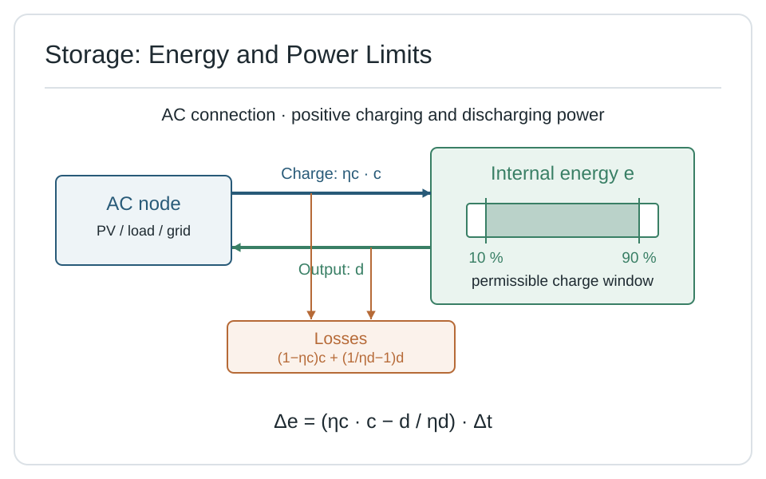

# M11-L4 – Storage Models and State of Charge {#L4}

**Course area:** M11 – Bachelor: Energy Generation and Storage

**Level:** Bachelor · Elective

**Prerequisites:** [Computational experiments](M2-L7.md), [Storage technologies](M11-L3.md).

**Learning objective:** Formulate a discrete storage balance, determine permissible charging and discharging power, and check losses without double counting.

## State variable and sign convention {#S1}

A battery system is described as an energy store with a lumped state $e(t)$ in kWh. The state does not represent the entire electrochemical dynamics. For the balance, we consider the power at the AC connection, including the simplified converter. Charging power $c$ and discharging power $d$ are individually non-negative quantities; the net injection at the AC node is $d-c$. For rated energy $E_N>0$, the dimensionless state of charge is $\mathrm{SOC}=e/E_N$. A window of 10 to 90% means $e_\mathrm{min}=0.1E_N$, $e_\mathrm{max}=0.9E_N$.

For a piecewise constant profile and without standing losses,

$$
e_{k+1}=e_k+\eta_c c_k\Delta t-\frac{d_k}{\eta_d}\Delta t.
$$

$\eta_c$ and $\eta_d$ lie in the interval $(0,1]$ and refer to the AC connection. With $\Delta t$ in hours and power in kW, the result is in kWh. Discharging requires more energy internally than reaches the connection. If an hourly retention factor $r$ (0 to 1) is used for standing losses, one possible discrete model is $e_{k+1}=r^{\Delta t/(1\,\mathrm h)}e_k+\eta_c c_k\Delta t-d_k\Delta t/\eta_d$; the standing losses are applied to the initial energy. For losses and energy flows distributed continuously over the interval, the exact differential equation model must be integrated. In the following example, $r=1$.

{alt="Energy flow at the AC node with charging and discharging efficiencies, state-of-charge window and loss paths."}

## Deriving power limits from energy bounds {#S2}

For charging only ($d=0$), $e_{k+1}\le e_\mathrm{max}$ must hold; for discharging only ($c=0$), $e_{k+1}\ge e_\mathrm{min}$ must hold. For $\Delta t>0$, this gives

$$
c\le\min\left(P_\mathrm{L,max},\frac{e_\mathrm{max}-e}{\eta_c\Delta t}\right),\qquad d\le\min\left(P_\mathrm{E,max},\frac{(e-e_\mathrm{min})\eta_d}{\Delta t}\right).
$$

The limit is applied before updating the state. Clipping the state afterwards would cause the energy not absorbed or not delivered to disappear without a corresponding balance entry. With standing losses, the limit must refer to the state remaining after those losses; if the minimum reserve is thereby breached, the model needs a reserve-maintenance strategy or an explicit constraint violation report. Below, we assume a permissible initial state and do not allow simultaneous charging and discharging ($cd=0$).

## Worked example at the consumer node {#S3}

Let $E_N=10$ kWh, $e_\mathrm{min}=1$ kWh, $e_\mathrm{max}=9$ kWh, both power limits be 3 kW and $\eta_c=\eta_d=0.95$. The initial energy is 6 kWh. First, there is a surplus of 4 kW for 2 h. Power is limited to 3 kW, while the available storage capacity further limits the average charging power to $3/(0.95\cdot2)=1.578947$ kW. Alternatively, with a time-constant connection model, charging at 3 kW can continue until the limit is reached and then stop. The energy absorbed remains 3.157895 kWh, with 4.842105 kWh of surplus remaining. The final state is 9 kWh.

A deficit of 4 kW for 3 h follows. Energy and power bounds give an average discharge power of $\min(3,8\cdot0.95/3)=2.533333$ kW. The store supplies 7.6 kWh, and 4.4 kWh must be supplied elsewhere. The final state is 1 kWh.

| Energy balance entry | Charging (kWh) | Discharging (kWh) |
| --- | ---: | ---: |
| AC energy | 3.157895 | 7.600000 |
| Change in internal energy | +3.000000 | −8.000000 |
| Loss | 0.157895 | 0.400000 |

The total energy loss is 0.557895 kWh. Since the initial energy is 5 kWh greater than the final energy, comparing input and output energy over this period does not yield the round-trip efficiency. The correct balance is $E_c-E_d=\Delta e+E_\mathrm{Verlust}$.

## Operating strategy and model limitations {#S4}

For a pure self-consumption strategy, directly available generation is used by the load first. Only the remaining surplus charges the store, and only the remaining deficit is supplied from it. The grid or another source covers the remainder. A predictive strategy might maintain a minimum reserve for later islanded operation or operate the store differently under dynamic tariffs. The energy balance is unchanged; only the choice of $c$ and $d$ changes. An electrical equivalent circuit with internal resistance, voltage dependence and ageing would be necessary to predict cell currents or thermal effects. For the operational planning in [M11-L5](M11-L5.md), the lumped model is sufficient.

## Exercises with solutions {#S5}

1. $e=8.5$ kWh, $e_\mathrm{max}=9$ kWh, $\eta_c=0.95$, $\Delta t=0.5$ h. What limits the average power?  
   **Solution** The energy bound gives 1.05263 kW; the hardware limit also applies.
2. With $e=2$ kWh, $e_\mathrm{min}=1$ kWh and $\eta_d=0.95$, 2 kW is requested for one hour. Determine the maximum energy delivered if sufficient discharge power is available.  
   **Solution** 0.95 kWh; 1.05 kWh remains unmet.
3. Why must a simulation not simply reset the state to within the permissible window?  
   **Solution** Excess energy must be accounted for as surplus not absorbed or demand not met; otherwise the calculation violates conservation of energy.

**Further reading:** [Case study: Electricity Supply with Storage](M11-L5.md)

## Sources {#S6}

- [PyPSA – Storage: Energy balance and storage bounds](https://docs.pypsa.org/latest/user-guide/optimization/storage/) · Storage Units, StorageUnit-energy_balance equation: state-of-charge balance. · Last accessed: 2026-11-25
- [U.S. EIA – Utility-scale batteries and pumped storage (historical operating data for 2019)](https://www.eia.gov/todayinEnergy/detail.php?id=46756) · Article of 2021-02-12, paragraphs 1–2: definition and historical operating values of round-trip efficiency; not a source for the specific state balance. · Last accessed: 2026-11-25
