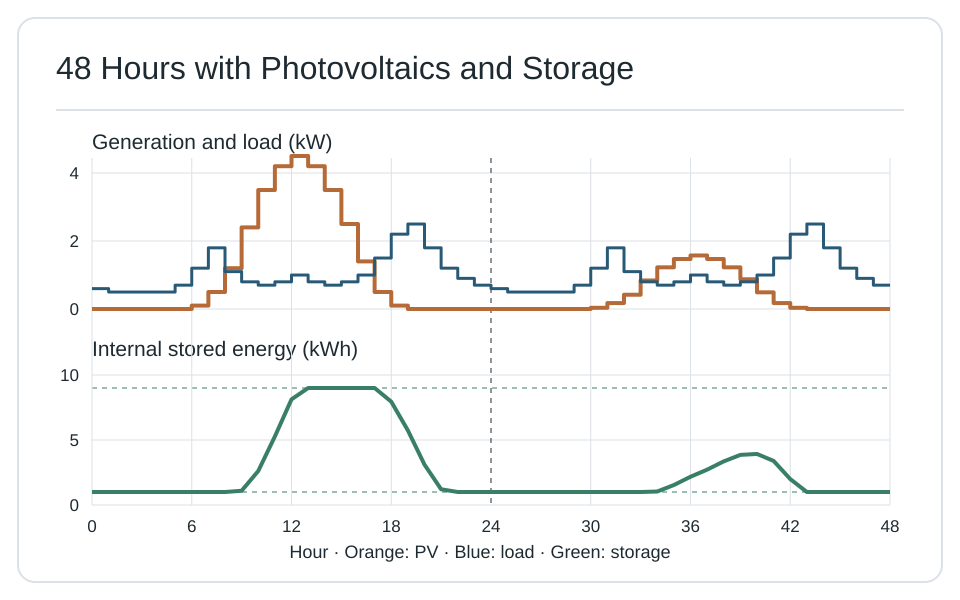

# M11-L5 – Case Study: Electricity Supply with Storage {#L5}

**Course area:** M11 – Bachelor: Energy Generation and Storage

**Level:** Bachelor · Elective

**Prerequisites:** [Photovoltaics](M11-L2.md), [Storage model](M11-L4.md), [Computational experiments](M2-L7.md).

**Learning objective:** Simulate a PV, load and storage system over 48 hours, compare variants on a consistent energy-balance basis, and explain the influence of energy and power bounds.

## Modelling question and boundary conditions {#S1}

A grid-connected consumer aims to increase the proportion of solar energy consumed locally. We investigate the effects of rated energy and charging/discharging power in an AC-coupled storage system. The two days are synthetic, not measured weather or household data. Day 1 is sunny; day 2 has the same profile shape with 35% of the generation power. The load is the same on both days. The PV values already refer to the AC side, so no additional inverter efficiency is applied. Storage losses are included in $\eta_c=\eta_d=0.95$. The grid is available without limits in both directions. Standby consumption, ageing, costs, reactive power, temperature and grid dynamics are neglected. All stores start at a state of charge of 10% and may be charged to 90%. The case without storage has $E_N=0$; a percentage SOC is undefined in that case.

The operating rule in each interval is to supply the load directly from PV, store surplus up to the energy or power limit, and export the remainder. If there is a deficit, supply it from the store and import the remaining load from the grid.

$$
P_\mathrm{direkt}=\min(P_\mathrm{PV},P_\mathrm{Last}),\qquad
P_\mathrm{Netzbezug}=P_\mathrm{Last}-P_\mathrm{direkt}-d,
$$

$$
P_\mathrm{Export}=P_\mathrm{PV}-P_\mathrm{direkt}-c.
$$

The limits from M11-L4 determine $c$ and $d$. Since charging uses only surplus generation, all delivered energy above the initial reserve in this experiment comes from PV. We define the energy-balance degree of self-sufficiency as $a=1-E_\mathrm{Netzbezug}/E_\mathrm{Last}$. The PV self-consumption fraction $b=1-E_\mathrm{Export}/E_\mathrm{PV}$ also includes storage losses and any PV energy remaining in the store. The two metrics are therefore different.

## Reproducible simulation {#S2}

The hourly values in kW are given in full in the following code. It requires only Python 3; the 15-minute variant repeats each hourly value four times. Positive power quantities avoid changing sign conventions for import and export. In each interval, the stored energy is updated and then the energy quantities are summed.

```python
load = [.6,.5,.5,.5,.5,.7,1.2,1.8,1.1,.8,.7,.8,1.0,.8,.7,.8,1.0,1.5,2.2,2.5,1.8,1.2,.9,.7]
solar = [0,0,0,0,0,0,.1,.5,1.2,2.4,3.5,4.2,4.5,4.2,3.5,2.5,1.4,.5,.1,0,0,0,0,0]
pv = solar + [0.35*p for p in solar]
load = load*2

def simulate(cap, limit, dt=1):
    eta_c = eta_d = .95
    lo, hi = .1*cap, .9*cap
    e = e0 = lo
    totals = dict(pv=0., load=0., direct=0., charge=0., discharge=0., grid=0., export=0., loss=0.)
    trace = [e]
    for g, l in zip(pv, load):
        for _ in range(round(1/dt)):
            direct = min(g,l)
            c = min(g-direct, limit, max(0.,(hi-e)/(eta_c*dt)))
            d = min(l-direct, limit, max(0.,(e-lo)*eta_d/dt))
            e += (eta_c*c-d/eta_d)*dt
            values = dict(pv=g, load=l, direct=direct, charge=c, discharge=d,
                          grid=l-direct-d, export=g-direct-c,
                          loss=(1-eta_c)*c+(1/eta_d-1)*d)
            for key, val in values.items():
                totals[key] += val*dt
            assert lo-1e-9 <= e <= hi+1e-9 and c*d < 1e-9
            trace.append(e)
    totals['delta'] = e-e0
    assert abs(totals['pv']+totals['grid']-totals['load']-totals['export']-totals['loss']-totals['delta']) < 1e-9
    return totals, trace

for cap, limit in [(0,0),(5,3),(10,3),(15,3),(10,1)]:
    s, trace = simulate(cap,limit)
    fine, _ = simulate(cap,limit,.25)
    assert all(abs(s[k]-fine[k]) < 1e-9 for k in s)
    print(cap,limit, {k:round(v,4) for k,v in s.items()}, round(100*(1-s['grid']/s['load']),2))
```

## Results and balance check {#S3}

Over 48 hours, the load consumes 49.60 kWh and PV generation amounts to 38.61 kWh. Of this, 15.83 kWh is used directly. During the first night before sunrise, no storage system can supply energy from PV already generated in this experiment. All variants finish at their initial energy, making the cases directly comparable.

| Rated energy (kWh) | Limit (kW) | Grid import (kWh) | Export (kWh) | Loss (kWh) | Self-sufficiency (%) |
| ---: | ---: | ---: | ---: | ---: | ---: |
| 0 | 0 | 33.77 | 22.78 | 0 | 31.92 |
| 5 | 3 | 27.19 | 15.49 | 0.71 | 45.18 |
| 10 | 3 | 23.39 | 11.28 | 1.12 | 52.84 |
| 15 | 3 | 19.59 | 7.07 | 1.53 | 60.50 |
| 10 | 1 | 24.22 | 12.20 | 1.03 | 51.17 |

{alt="Hourly PV generation and load values and the state of charge of the 10 kWh store with a 3 kW power limit."}

For 10 kWh / 3 kW, the unrounded calculation gives 11.5010526316 kWh of charging energy and 10.3797 kWh of discharging energy; the actual round-trip efficiency is 90.25%. A total of 27.3311 kWh of PV energy remains behind the grid connection (used directly or charged into the store). The corresponding PV self-consumption fraction is approximately 70.79%, but the degree of self-sufficiency is only 52.84%. The two-sided balance check is

$$
E_\mathrm{PV}+E_\mathrm{Netzbezug}=E_\mathrm{Last}+E_\mathrm{Export}+E_\mathrm{Verlust}+\Delta e.
$$

Using rounded table values: $38.61+23.39=49.60+11.28+1.12=62.00$ kWh. The calculation checks the equation before rounding. The total energy supplied by PV and storage to the load is $15.83+10.3797=26.2097$ kWh. The 15-minute calculation gives the same energy totals in this piecewise constant model; this demonstrates consistency of the interval model but does not prove the physical validity of the hourly profile.

## Interpretation and extension {#S4}

In the example, the 15 kWh store increases self-sufficiency compared with 10 kWh, but even this store does not achieve complete autonomy. Even without exports and losses, with identical initial and final stored energy, the deficit is at least the difference between consumption and generation: 10.99 kWh. Greater storage capacity alone cannot close this energy gap. The 1 kW variant can shift less power during surplus and deficit hours; despite the same rated energy, grid import increases. A genuinely optimal size depends on many longer profiles, weather, usage behaviour, tariffs, investment and ageing costs. Grid connection power and the ability to operate in island mode are separate requirements, not consequences of the degree of self-sufficiency calculated here alone.

As a project task, add a week with widely varying generation, introduce a retention factor for standing losses and investigate a range of capacities. Choose comparable initial and final states or explicitly account for the state change. Document the model assumptions, energy bounds and metrics in accordance with [M8-L5](M8-L5.md). The temporal resolution must be justified using the actual power profiles, not merely convergence when hourly values are repeated.

## Exercises with solutions {#S5}

1. How much grid import does the 10 kWh / 3 kW variant save compared with the case without storage?  
   **Solution** 10.3797 kWh; this corresponds to the energy delivered by the store because direct use does not change.
2. Why does export decrease by more energy than import?  
   **Solution** 11.5011 kWh is charged, but only 10.3797 kWh is discharged. The difference of 1.1214 kWh is lost.
3. Can the system with 15 kWh of storage operate autonomously if the grid connection is removed?  
   **Solution** No. For the selected profiles and identical initial and final states, there is a fundamental shortfall of at least 10.99 kWh; charging and discharging power are also limited. Without the grid, unmet load must be reported explicitly as such.

**Further reading:** [Study pathway – further modules](pages/study-path.md#S3)

## Sources {#S6}

- [U.S. DOE – Solar Photovoltaic System Design Basics](https://www.energy.gov/cmei/systems/solar-photovoltaic-system-design-basics) · Solar Photovoltaic System Design Basics, introduction and Mounting Structures: system components and generation conditions; further reading. · Last accessed: 2026-11-25
- [PyPSA – Storage: Energy balance and storage bounds](https://docs.pypsa.org/latest/user-guide/optimization/storage/) · Storage Units, StorageUnit-energy_balance equation: storage balance in the case model. · Last accessed: 2026-11-25
- [Sandia PVPMC – PVWatts](https://pvpmc.sandia.gov/modeling-guide/2-dc-module-iv/point-value-models/pvwatts/) · PVWatts section: irradiance and cell temperature as inputs to a PV power model; further reading, not the origin of synthetic AC profiles. · Last accessed: 2026-11-25
