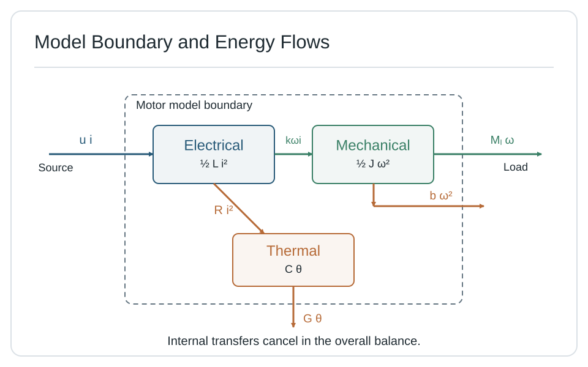

# M12-L1 – Model Boundaries, Quantities and Physical Domains {#L1}

**Course area:** M12 – Bachelor: Modelling and Simulation of Complex Systems

**Level:** Bachelor · Elective

**Prerequisites:** [Physical balances](M2-L1.md), [Differential equations](M2-L3.md), [Systems](M5-L1.md).

**Learning objective:** Define the boundary of a physical multi-domain system, identify states and interfaces, and formulate a consistent energy balance.

## From the engineering question to the model boundary {#S1}

A model is a purpose-specific abstraction, not a complete copy of an object. To determine the speed a motor reaches under a given load, an electromechanical model is often sufficient. To assess heating over two minutes, at least one thermal state must also be included. For the spatial distribution of winding temperature, however, a single temperature value would often be too coarse. Before choosing the equations, specify the quantities of interest, time interval, inputs, desired accuracy and permissible simplifications.

Consider an idealised permanent-magnet DC motor. The supply and driven machine are outside the model boundary; the rotor, winding and its lumped thermal mass are inside. For simplicity, frictional heat is released directly into the environment; brush losses, magnetic saturation and separate housing temperatures are omitted. The model boundary determines whether an energy flow appears as an internal exchange or an external outflow.

{alt="Electrical, mechanical and thermal model boundaries, power flows and stored quantities."}

## Physical domains and power quantities {#S2}

| Domain | Pair of quantities | Instantaneous power | Storage in the model |
| --- | --- | --- | --- |
| Electrical | Voltage $u$, current $i$ | $ui$ | $Li^2/2$ |
| Mechanical, translation | Force $F$, velocity $v$ | $Fv$ | $mv^2/2$ |
| Mechanical, rotation | Torque $M$, angular velocity $\omega$ | $M\omega$ | $J\omega^2/2$ |
| Thermal | Temperature $T$, heat flow rate $\dot Q$ | $\dot Q$ | $C(T-T_a)$ relative to the environment |

The products of the first three pairs of quantities yield watts. In conventional heat-transfer modelling, by contrast, the heat flow rate is already a power; $T\dot Q$ would not be a meaningful power expression. A thermodynamic port representation can use temperature and entropy flow rate; this is a different modelling convention. We use a constant thermal storage coefficient $C$ in J/K.

A signal port carries an information value (for example, the measured speed as an input to a controller). It is not automatically a physical power port. For ideal physical connections, common potential quantities must be compatible and the algebraic sum of the flow quantities directed towards the connection point must be zero. A model must apply this convention consistently in all components.

## States, parameters and algebraic quantities {#S3}

A state carries the system history necessary for subsequent evolution. In the chosen motor, these states are winding current $i$, angular velocity $\omega$ and temperature rise $\theta=T-T_a$. For constant $T_a$, the temperature difference in K is sufficient. If position is also to be tracked, $\dot\varphi=\omega$ is required as an additional state equation; this is unnecessary for the speed question.

Parameters include inductance $L$, moment of inertia $J$, thermal capacitance $C$ and thermal conductance $G$ in W/K. Winding resistance $R(\theta)=R_0(1+\alpha\theta)$ is an algebraic function of the state in the model, not an independent storage element. Input $u(t)$ and load $M_L(t)$ are prescribed. Outputs can be calculated from states and inputs, for example $P_\mathrm{in}=ui$ or winding temperature $T_a+\theta$.

The energy relative to the reference level is

$$
E=\frac12 Li^2+\frac12 J\omega^2+C\theta.
$$

With $b\omega$ as the viscous friction torque, the verifiable balance is

$$
\dot E=ui-M_L\omega-b\omega^2-G\theta.
$$

The Joule losses $Ri^2$ are an internal transfer to the thermal store here; they must not also be subtracted as an external outflow. By contrast, with a boundary enclosing only the electrical and mechanical parts, they would have to appear as an outflow. The sign $-G\theta$ also allows heat input from the environment when the temperature difference is negative.

## Worked example and model selection {#S4}

For $L=0.1$ H, $J=0.02$ kg m², $C=40$ J/K, $i=5$ A, $\omega=30$ rad/s and $\theta=20$ K, the magnetic energy is 1.25 J, the kinetic energy 9 J and the thermal energy relative to the environment 800 J. Total: 810.25 J. With $u=24$ V, $M_L=0.5$ Nm, $b=0.02$ Nm s/rad and $G=2$ W/K,

$$
\dot E=120-15-18-40=47\,\mathrm W.
$$

The positive balance does not mean that all states increase: mechanical and thermal stores may release or absorb energy simultaneously. The timescales differ; a large amount of stored energy is not the same as high instantaneous power. The complete dynamic model follows in the next lesson.

## Exercises with solutions {#S5}

1. A 200 µF capacitor is at 24 V. Determine the stored energy.  
   **Solution** $Cu^2/2=0.0576$ J.
2. A thermal store with 40 J/K receives a net 30 W. How quickly is its temperature changing at that instant?  
   **Solution** $\dot T=30/40=0.75$ K/s.
3. Is the motor model intended to predict the highest temperature within a winding?  
   **Solution** The single-node model provides only a representative temperature; spatial gradients require additional thermal nodes or a field model.

**Further reading:** [Coupled models and state space](M12-L2.md)

## Sources {#S6}

- [Modelica Standard Library – Overview of physical domains](https://doc.modelica.org/om/Modelica.UsersGuide.Overview.html) · Library overview: analog electrical components and machines; further reading. · Last accessed: 2026-11-25
- [Modelica – Second-order thermal motor model](https://doc.modelica.org/Modelica%204.0.0/Resources/helpWSM/Modelica/Modelica.Thermal.HeatTransfer.Examples.Motor.html) · Information: second-order motor thermal model with losses and heat capacities. · Last accessed: 2026-11-25
