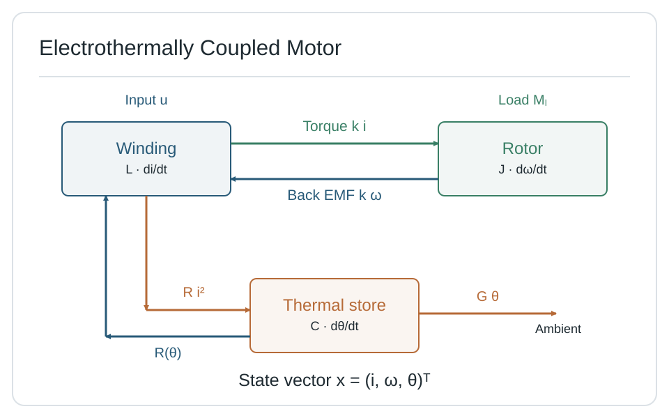

# M12-L2 – Coupled Models and State Space {#L2}

**Course area:** M12 – Bachelor: Modelling and Simulation of Complex Systems

**Level:** Bachelor · Elective

**Prerequisites:** [Model boundaries](M12-L1.md), [Matrices](M2-L2.md), [Feedback](M6-L3.md).

**Learning objective:** Develop a nonlinear state-space model from energy and force balances and determine its local linearisation.

## Three coupled storage equations {#S1}

The electrical loop includes the back EMF $k\omega$, the temperature-dependent voltage drop $R(\theta)i$ and the inductance. The electromagnetic torque $ki$, friction $b\omega$ and prescribed load torque $M_L$ act on the rotor. In consistent SI units, the ideal electromechanical coupling has the same numerical value $k$ for both relationships ($\mathrm{V\,s/rad}$ and Nm/A, respectively). This follows from lossless conversion $k\omega i=ki\omega$.

$$
L\dot i=u-R(\theta)i-k\omega,
$$

$$
J\dot\omega=ki-b\omega-M_L,
$$

$$
C\dot\theta=R(\theta)i^2-G\theta,\qquad R(\theta)=R_0(1+\alpha\theta).
$$

Heat is produced in the winding; frictional heat is an external outflow, as in [M12-L1](M12-L1.md). The model applies only over a temperature range where resistance is positive and can be described approximately by a linear relationship. It assumes a constant magnetic field, a constant ambient temperature and an ideal voltage source.

{alt="Coupled motor model with back EMF, torque, heat losses and temperature-dependent resistance."}

Multiplying the first equation by $i$, the second by $\omega$ and adding the thermal equation yields the energy balance from L1. The back EMF and driving torque exchange power between domains, and ohmic losses become heat. This identity provides an independent invariant check for the subsequent computation.

## Nonlinear state space and operating point {#S2}

With $x=(i,\omega,\theta)^\mathsf T$ and $v=(u,M_L)^\mathsf T$, we obtain $\dot x=f(x,v)$; an output $y=g(x,v)$ could be the rotational speed, for example. The products $\theta i$ and $i^2$ make the model nonlinear. Superposition therefore does not apply to arbitrary operating states.

A steady state $x_*$ satisfies $f(x_*,v_*)=0$. For a constant input and $b>0$,

$$
\omega_*=(ki_*-M_L)/b,\qquad G\theta_*=R(\theta_*)i_*^2.
$$

The electrical equation closes the system. If $\alpha=0$, temperature is decoupled in the sense that it has no feedback effect, and the steady-state values can be determined directly:

$$
i_*=\frac{u+kM_L/b}{R_0+k^2/b},\qquad \theta_*=R_0i_*^2/G.
$$

With $u=24$ V, $M_L=0.5$ Nm, $R_0=2$ Ω, $k=0.2$, $b=0.02$ and $G=2$ W/K, we obtain $i_*=7.25$ A, $\omega_*=47.5$ rad/s and $\theta_*=52.5625$ K. The input power of 174 W splits into 23.75 W of load power, 45.125 W of frictional power and 105.125 W of heat dissipation. The model with $\alpha\ne0$ leads to different operating points.

## Linearisation for small deviations {#S3}

For a fixed operating point, approximately $\delta\dot x=A\delta x+B\delta v$, with the derivatives of $f$ evaluated at that point. Write $R_*=R(\theta_*)$, $R'=R_0\alpha$. Then

$$
A=\begin{pmatrix}
-R_*/L & -k/L & -R'i_*/L\\
k/J & -b/J & 0\\
2R_*i_*/C & 0 & (R'i_*^2-G)/C
\end{pmatrix},\qquad
B=\begin{pmatrix}1/L&0\\0&-1/J\\0&0\end{pmatrix}.
$$

For speed measurement alone, $y=\omega$ and $\delta y=(0,1,0)\delta x$. The eigenvalues of $A$ provide information about local dynamics; negative real parts of all eigenvalues imply local asymptotic stability of a smooth autonomous model at the operating point. The statement is not automatically global and does not apply unchanged at a switching instant in a hybrid system.

## Timescales and choice of coupling {#S4}

With $L=0.1$ H, $J=0.02$ kg m² and $C=40$ J/K, the uncoupled indicative values are $L/R_0=0.05$ s, $J/b=1$ s and $C/G=20$ s. The actual modes are coupled. A long-term thermal model could replace the fast states with algebraic steady-state relationships, provided the load and supply vary slowly enough and start-up currents are not of interest. Depending on the formulation, this produces a reduced or differential-algebraic model. Such a reduction is unsuitable for start-up; the inductance enforces a continuous current under finite voltage.

## Exercises with solutions {#S5}

1. What is the initial rate of increase of current at $u=24$ V, $i=\omega=0$ and $L=0.1$ H?  
   **Solution** $\dot i=240$ A/s.
2. Determine $R$ for $R_0=2$ Ω, $\alpha=0.004$ K⁻¹ and $\theta=50$ K.  
   **Solution** 2.4 Ω.
3. How does rising temperature immediately affect the current derivative when current is positive?  
   **Solution** The partial derivative $-R'i/L$ is negative; over the longer term, speed and back EMF also change.

**Further reading:** [Numerical integration](M12-L3.md), [Case study](M12-L5.md)

## Sources {#S6}

- [Modelica Standard Library 4.0.0 – DCMachines](https://doc.modelica.org/Modelica%204.0.0/Resources/helpDymola/Modelica_Electrical_Machines_BasicMachines_DCMachines.html) · DC_PermanentMagnet, Information and Parameters: armature resistance, inductance, temperature-dependent losses and model limitations; version 4.0.0. · Last accessed: 2026-11-25
- [Modelica – Motor cooling example](https://doc.modelica.org/Modelica%204.0.0/Resources/helpWSM/Modelica/Modelica.Electrical.Machines.Examples.DCMachines.DCPM_Cooling.html) · Information: DC motor with cooling circuit and thermal capacities; model example. · Last accessed: 2026-11-25
