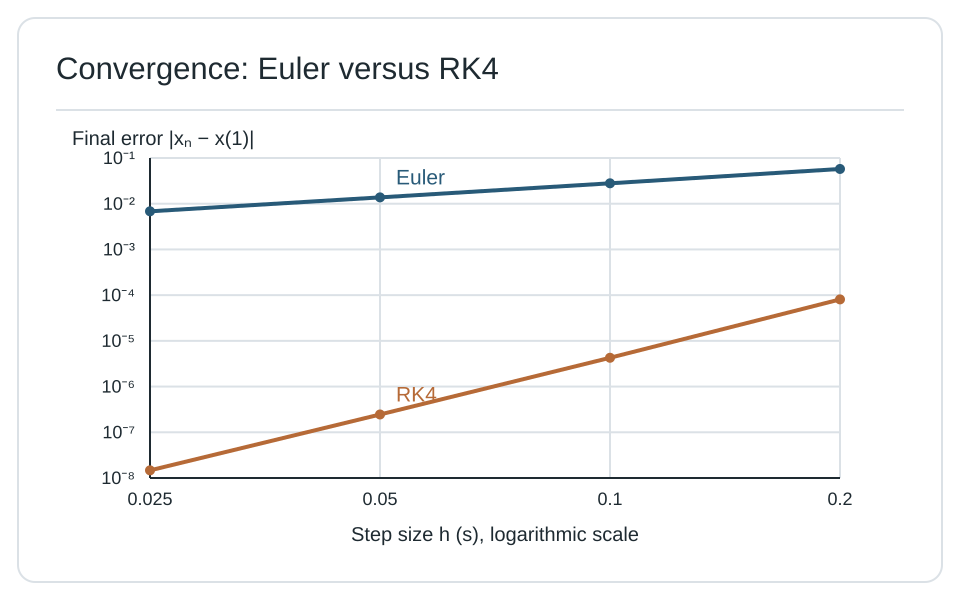

# M12-L3 – Numerical Integration and Convergence {#L3}

**Course area:** M12 – Bachelor: Modelling and Simulation of Complex Systems

**Level:** Bachelor · Elective

**Prerequisites:** [Differential equations](M2-L3.md), [Computational experiments](M2-L7.md), [State space](M12-L2.md).

**Learning objective:** Implement Euler's method and classical RK4, determine error orders experimentally, and distinguish numerical stability from physical stability.

## Discretisation of an initial-value problem {#S1}

We seek the solution of $\dot x=f(t,x)$ with $x(t_0)=x_0$. With step size $h>0$, set $t_n=t_0+nh$ and calculate approximations $x_n$. The explicit Euler method uses the slope at the start:

$$
x_{n+1}=x_n+h f(t_n,x_n).
$$

It follows from the first-order Taylor expansion. For sufficiently smooth solutions and stable error propagation, the local step error is $O(h^2)$ and the global error at a fixed final time is $O(h)$. The formula applies to vectors as well as scalars. A step is not necessarily a physical sampling operation; it may serve only for numerical integration.

## Classical fourth-order Runge–Kutta method {#S2}

The four slopes are

$$
\begin{aligned}
k_1&=f(t_n,x_n),\\
k_2&=f(t_n+h/2,x_n+hk_1/2),\\
k_3&=f(t_n+h/2,x_n+hk_2/2),\\
k_4&=f(t_n+h,x_n+hk_3).
\end{aligned}
$$

$$
x_{n+1}=x_n+\frac h6(k_1+2k_2+2k_3+k_4).
$$

With sufficient smoothness and suitable stability, the global error is $O(h^4)$, at the cost of four function evaluations per step. Discontinuities in inputs or model equations must be handled separately; otherwise the expected order may be lost. Events are the subject of [M12-L4](M12-L4.md).

## Reference experiment: exponential decay {#S3}

For $\dot x=-2x$ and $x(0)=1$, the exact solution is $x(t)=e^{-2t}$. We compare the absolute final error at $t=1$ s. The observed order for two step sizes $h$ and $h/2$ is $p=\log_2(e_h/e_{h/2})$, provided neither error is zero. The following code requires only the Python standard library.

```python
from math import exp, log2

def integrate(h, rk):
    x = 1.0
    for _ in range(round(1/h)):
        k1 = -2*x
        if rk:
            k2 = -2*(x+h*k1/2)
            k3 = -2*(x+h*k2/2)
            k4 = -2*(x+h*k3)
            x += h*(k1+2*k2+2*k3+k4)/6
        else:
            x += h*k1
    return abs(x-exp(-2))

last = None
for h in (.2, .1, .05, .025):
    err = [integrate(h, rk) for rk in (False, True)]
    order = [] if last is None else [log2(a/b) for a,b in zip(last,err)]
    print(h, err, order)
    last = err
```

| $h$ (s) | Euler final error | RK4 final error |
| ---: | ---: | ---: |
| 0.2 | 5.75753 · 10⁻² | 8.07314 · 10⁻⁵ |
| 0.1 | 2.79611 · 10⁻² | 4.26519 · 10⁻⁶ |
| 0.05 | 1.37586 · 10⁻² | 2.45185 · 10⁻⁷ |
| 0.025 | 6.82313 · 10⁻³ | 1.46976 · 10⁻⁸ |

{alt="Calculated final errors for Euler and RK4 on logarithmic axes."}

The last halving yields an observed order of about 1.01 for Euler and about 4.06 for RK4. The theoretical values of 1 and 4 apply asymptotically; for larger steps, the ratios may differ. With very small steps, rounding errors may dominate.

## Stability limits and stiff systems {#S4}

For the test problem $\dot x=\lambda x$ with real $\lambda<0$, Euler yields the amplification factor $1+h\lambda$. Decay requires $|1+h\lambda|<1$, hence $0<h<2/|\lambda|$. With $\lambda=-2$ s⁻¹ and $h=1.1$ s, the result is $-1.2$: alternating signs and increasing magnitude, although the exact solution remains positive and decreases. RK4 has the factor $1+z+z^2/2+z^3/6+z^4/24$ for $z=h\lambda$; on the negative real axis its stability interval extends approximately to $z=-2.785$.

When timescales differ greatly, an explicit method may require very small steps even though only slow results are of interest. This is a typical situation for stiff problems. Implicit methods such as backward Euler or BDF, and adaptive step-size control, are possible alternatives. An adaptive solver controls a numerical error estimate using absolute and relative tolerances; it does not verify whether the physical parameters are correct. For states with different scales, component-wise tolerances are useful.

## Exercises with solutions {#S5}

1. Euler with $\lambda=-10$ s⁻¹ and $h=0.25$ s: stable?  
   **Solution** No, amplification factor $-1.5$.
2. An RK4 result has an error smaller by a factor of 16 when the step size is halved. What order does this indicate?  
   **Solution** $\log_2(16)=4$.
3. Why is a result obtained with two almost identical step sizes not yet physical evidence?  
   **Solution** It indicates numerical consistency, but alone says nothing about model assumptions, parameters or measurement data.

**Further reading:** [Hybrid models](M12-L4.md), [Model validation](M12-L5.md)

## Sources {#S6}

- [Persson/Franco/Sweeney Blanco – Programming for Mathematical Applications, Chapter 14](https://persson.berkeley.edu/Programming_for_Mathematical_Applications/content/Differential_Equations/Chapter_Intro.html) · Chapter 14, introduction: initial value problems, Euler and RK4; further-reading overview, subsection 14.1 not retrieved. · Last accessed: 2026-11-25
- [SciPy – solve_ivp: Methods and tolerances](https://docs.scipy.org/doc/scipy/reference/generated/scipy.integrate.solve_ivp.html) · solve_ivp function description: numerical solution of an initial value problem. · Last accessed: 2026-11-25
