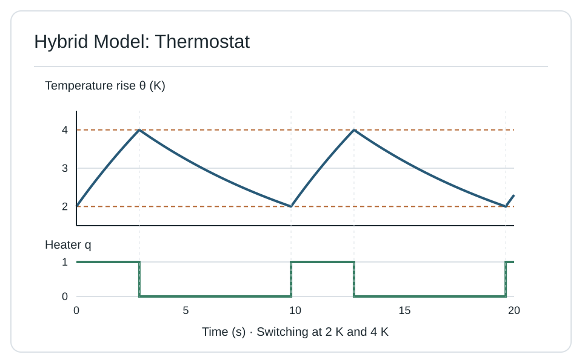

# M12-L4 – Discrete Events and Hybrid Models {#L4}

**Course area:** M12 – Bachelor: Modelling and Simulation of Complex Systems

**Level:** Bachelor · Elective

**Prerequisites:** [State machines](M3-L6.md), [Temperature control](M6-L3.md), [Numerical integration](M12-L3.md).

**Learning objective:** Combine the continuous states and discrete modes of a system and determine the error associated with discrete-time switching detection.

## Continuous Dynamics and Discrete Logic {#S1}

A hybrid model combines real-valued states $x(t)$ and discrete modes $q\in Q$. Between events, $\dot x=f_q(t,x)$ applies; a transition is triggered by a condition (guard). During a transition, the mode and, where physically justified, the states can change. A reset $x^+=r(x^-)$ is useful, for example, in an idealised impact involving an abrupt change in velocity. With finite heating power, however, temperature cannot jump.

A time event occurs at a known time, such as a scheduled load step. In a state event, a threshold is reached during integration. A sampled-data controller, by contrast, is designed to make decisions only at sampling instants. These three cases must not be confused during implementation.

## Example: Thermostat with Hysteresis {#S2}

A heater with power $P=10$ W supplies a lumped thermal mass $C=10$ J/K. The thermal conductance to the surroundings is $G=1$ W/K. The temperature rise $\theta=T-T_a$ follows

$$
C\dot\theta=qP-G\theta,\qquad q\in\{0,1\}.
$$

At $\theta\le2$ K, the heater is switched on; at $\theta\ge4$ K, it is switched off. Between these thresholds, the preceding mode is retained. Initially, $\theta=2$ K and $q=1$. For ideally smooth signals, hysteresis prevents immediate back-and-forth switching at a single threshold. Real sensors may nevertheless require filtering or additional minimum switching intervals.

For a constant mode, with $\tau=C/G=10$ s and $\theta_\infty=qP/G$, the exact solution is

$$
\theta(t)=\theta_\infty+(\theta_0-\theta_\infty)e^{-t/\tau}.
$$

The heating phase from 2 to 4 K lasts $10\ln(8/6)=2.87682$ s, and the cooling phase from 4 to 2 K lasts $10\ln(4/2)=6.93147$ s. The period is 9.80829 s. The heating duty cycle is approximately 29.33%, and the mean heating power is about 2.93 W. Since the state is identical after a full period, the mean heat dissipation equals the mean heating power.

{alt="Temperature trajectory and switching state of an ideal thermostat with hysteresis."}

## Stepwise versus Event-Accurate Switching {#S3}

Even exact integration within a step detects the threshold event too late if the condition is checked only at the end of the step. The following comparison calculates the first switch-off time; the temperature trajectory between sampling instants is analytically exact.

```python
from math import exp, log, ceil
exact = 10*log(8/6)
for h in (1.0, .5, .25, .1):
    n = ceil(exact/h)
    t = n*h
    theta = 10-8*exp(-t/10)
    print(h, t, theta, t-exact)
```

| Checking interval (s) | First switch-off (s) | Temperature rise at switch-off (K) |
| ---: | ---: | ---: |
| 1.00 | 3.00 | 4.07345 |
| 0.50 | 3.00 | 4.07345 |
| 0.25 | 3.00 | 4.07345 |
| 0.10 | 2.90 | 4.01389 |

For an ideal continuous-time thermostat, the root of $g(\theta)=\theta-4$ must be located in heating mode. For general models, the root of the continuous approximation can be located using interpolation or bisection. At the event, integration proceeds up to the threshold, the mode changes, and the remainder of the time step is calculated in the new mode. For cooling mode, the relevant function is $g(\theta)=\theta-2$ with a downward crossing direction. Solvers that only look for sign changes within each step can miss multiple crossings in the same step; an appropriate maximum step size and event logic are necessary.

## Robust Mode Logic {#S4}

An algorithm requires an unambiguous initial mode and consistent handling of simultaneous events. In the thermostat, the state is continuous; only $q$ changes abruptly. For known time events, the integration interval is split exactly at the specified time. In [M12-L5](M12-L5.md), load and voltage steps are handled in this way; the right-hand side remains smooth within each interval. Ever smaller step sizes are no substitute for properly formulated event logic.

## Exercises with Solutions {#S5}

1. At $\theta=3$ K, what is the mode?  
   **Solution** It cannot be determined without knowing the preceding mode; hysteresis has discrete memory.
2. How does the cooling time change when the thermal capacity is doubled?  
   **Solution** With unchanged thermal conductance, it doubles to 13.86294 s.
3. Which states of the motor from M12-L2 jump in response to a finite voltage step?  
   **Solution** None of the three stored states; their derivatives may change. An algebraic output can jump immediately.

**Further reading:** [Parameters, sensitivity and model validation](M12-L5.md)

## Sources {#S6}

- [Modelica by Example – Discrete Behavior](https://mbe.modelica.university/behavior/discrete/) · Chapter introduction Discrete Behavior: discrete behavior versus continuous models. · Last accessed: 2026-11-25
- [Modelica 3.6 – Equations and Events](https://specification.modelica.org/maint/3.6/equations.html) · Chapter 8, §8.3.5: when-equations; partial scope. · Last accessed: 2026-11-25
- [SciPy – solve_ivp: event functions](https://docs.scipy.org/doc/scipy/reference/generated/scipy.integrate.solve_ivp.html) · Parameters events, terminal and direction: event detection and termination; partial scope. · Last accessed: 2026-11-25
