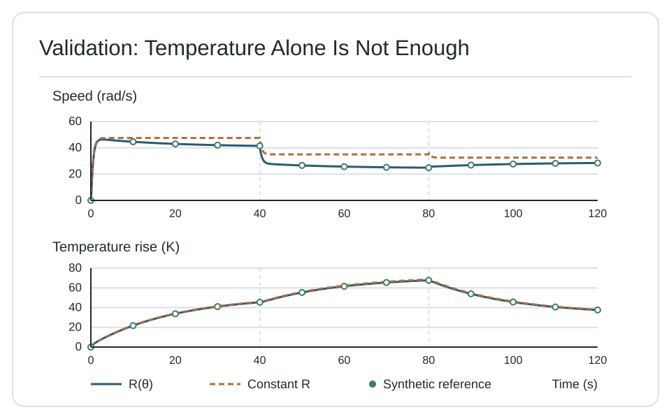

# M12-L5 – Parameters, Sensitivity and Model Validation {#L5}

**Course area:** M12 – Bachelor: Modelling and Simulation of Complex Systems

**Level:** Bachelor · Elective

**Prerequisites:** [Coupled model](M12-L2.md), [Integration](M12-L3.md), [Events](M12-L4.md), [Measurement uncertainty](M6-L2.md).

**Learning objective:** Verify an electrothermal multi-component model using two step sizes, compare two model variants against synthetic reference data and quantify parameter sensitivity.

## Research Question and Test Criteria {#S1}

We ask whether temperature-dependent winding resistance is necessary to predict the speed and temperature of an idealised drive over 120 s. The equations are taken from [M12-L2](M12-L2.md). The initial conditions are $i=\omega=\theta=0$, with an ambient temperature of 20 °C. This is purely a simulation example, with no real machine or measured values. The parameters are educational model values, not a design or operating approval.

| Parameter | Value | Unit |
| --- | ---: | --- |
| $R_0$ | 2 | Ω |
| $L$ | 0.1 | H |
| $J$ | 0.02 | kg m² |
| $b$ | 0.02 | Nm s/rad |
| $k$ | 0.2 | Nm/A (SI-consistent back-EMF constant) |
| $C$ | 40 | J/K |
| $G$ | 2 | W/K |
| $\alpha$ | 0.004 | K⁻¹ |

| Time interval (s) | Voltage (V) | Load torque (Nm) |
| --- | ---: | ---: |
| 0 to 40 | 24 | 0.5 |
| 40 to 80 | 24 | 1.0 |
| 80 to 120 | 18 | 0.5 |

Input steps are treated as segment boundaries. The three states remain continuous. The solution of the same nonlinear model using a different integration method (DOP853, strict tolerances) serves as the synthetic reference. This enables practice in numerical and model comparison; since the reference comes from a model rather than measurements, this is not empirical validation. For the exercise, limits of 0.2 rad/s for speed RMSE and 1 K for temperature RMSE are specified before comparison. For the numerical calculation, halving the step size must result in endpoint differences of at most 0.001 A, 0.001 rad/s and 0.001 K, as well as a maximum energy-balance residual below 0.01 J. These tolerances apply only to this exercise.

## Reproducible Calculation {#S2}

The additional state $E_B$ integrates the net boundary power $ui-M_L\omega-b\omega^2-G\theta$. It does not influence the other three equations. Thus, the energy-balance residual $Li^2/2+J\omega^2/2+C\theta-E_B$ is evaluated at every calculation point (zero initial energy). The code uses Python, NumPy and SciPy. Both step sizes align exactly with the segment boundaries and reference times.

```python
import numpy as np
from scipy.integrate import solve_ivp

# Zustand: i [A], omega [rad/s], theta [K], Nettoenergie [J].
R0, L, J, b, k, C = 2., .1, .02, .02, .2, 40.
segments = [(0, 40, 24., .5), (40, 80, 24., 1.), (80, 120, 18., .5)]

def rhs(x, u, load, alpha, G):
    i, w, th, E = x
    R = R0*(1+alpha*th)
    return np.array([(u-R*i-k*w)/L,
                     (k*i-b*w-load)/J,
                     (R*i*i-G*th)/C,
                     u*i-load*w-b*w*w-G*th])

def rk4(h, alpha=.004, G=2.):
    x = np.zeros(4)
    out = [x.copy()]
    for a, z, u, load in segments:
        f = lambda x: rhs(x, u, load, alpha, G)
        for n in range(round((z-a)/h)):
            q1 = f(x); q2 = f(x+h*q1/2)
            q3 = f(x+h*q2/2); q4 = f(x+h*q3)
            x = x+h*(q1+2*q2+2*q3+q4)/6
            out.append(x.copy())
    return np.array(out)

def reference():
    x = np.zeros(4)
    rows = [x.copy()]
    for a,z,u,load in segments:
        sol = solve_ivp(lambda t,x: rhs(x,u,load,.004,2.),
                        (a,z), x, method='DOP853', rtol=1e-11,
                        atol=1e-12, t_eval=np.arange(a+10,z+1,10))
        assert sol.success
        rows.extend(sol.y.T)
        x = sol.y[:,-1]
    return np.array(rows)

def balance(x):
    return .5*L*x[:,0]**2+.5*J*x[:,1]**2+C*x[:,2]-x[:,3]

if __name__ == '__main__':
    ref = reference()
    for t,r in zip(range(0,121,10),ref): print(t,*[round(v,6) for v in r[:3]])
    for h in [.02,.01]:
        for alpha,G in [(.004,2.),(0,2.),(.004,1.8),(.004,2.2)]:
            x=rk4(h,alpha,G); y=x[::round(10/h)]
            print(h,alpha,G,'end',x[-1,:3], 'rmse',np.sqrt(np.mean((y[:,:3]-ref[:,:3])**2,axis=0)), 'max energy residual',max(abs(balance(x))), 'peak temp',max(x[:,2]))
```

## Reference Values and Verification {#S3}

| Time (s) | Current (A) | Speed (rad/s) | Temperature rise (K) |
| ---: | ---: | ---: | ---: |
| 0 | 0.000 | 0.000 | 0.000 |
| 10 | 6.938 | 44.590 | 21.761 |
| 20 | 6.786 | 42.979 | 33.776 |
| 30 | 6.697 | 42.041 | 41.040 |
| 40 | 6.644 | 41.486 | 45.426 |
| 50 | 7.648 | 26.595 | 55.337 |
| 60 | 7.564 | 25.709 | 61.648 |
| 70 | 7.515 | 25.186 | 65.439 |
| 80 | 7.485 | 24.875 | 67.715 |
| 90 | 5.194 | 26.838 | 53.995 |
| 100 | 5.272 | 27.652 | 45.672 |
| 110 | 5.319 | 28.156 | 40.640 |
| 120 | 5.349 | 28.465 | 37.597 |

The table is rounded for presentation; the code compares against unrounded reference values. For the nonlinear model, RK4 produces the following metrics:

| Step size (s) | Final speed (rad/s) | Final temperature rise (K) | Max. energy-balance residual (J) |
| ---: | ---: | ---: | ---: |
| 0.02 | 28.46533816 | 37.59736237 | 0.0056041 |
| 0.01 | 28.46533835 | 37.59736046 | 0.0003080 |

The final current also differs by only about 2 · 10⁻⁸ A. The criteria are satisfied. The energy check is complementary, not sufficient: even an incorrect resistance model can conserve energy. Small differences at the endpoint could conceal errors in the trajectory, so reference values are additionally checked every 10 s and the maximum balance deviation across all steps is considered.

## Model Comparison and Sensitivity {#S4}

The root mean square error (RMSE) for an output $y$ at $N=13$ reference instants is

$$
\operatorname{RMSE}(y)=\sqrt{\frac1N\sum_{j=1}^N(y_j-y_{\mathrm{ref},j})^2}.
$$

The full model, a simplified model with constant resistance ($\alpha=0$), and two variants of the thermal conductance are compared. All use $h=0.01$ s and the same input trajectory.

| Variant | Speed RMSE (rad/s) | Temperature RMSE (K) | Maximum temperature rise (K, computational grid) |
| --- | ---: | ---: | ---: |
| Full model | 0.00000020 | 0.00000148 | 67.715 |
| Constant $R$ | 6.45331 | 0.47226 | 68.584 |
| $G=1.8$ W/K | 0.51530 | 4.51427 | 73.950 |
| $G=2.2$ W/K | 0.44917 | 3.83290 | 62.367 |

{alt="Synthetic motor reference and predictions with constant and temperature-dependent winding resistance."}

The constant-resistance model meets the temperature criterion but falls well short of the speed criterion. A good prediction for a single output is not sufficient. At 120 s, its speed is 32.5 rad/s rather than 28.465 rad/s. In the full model, the maximum winding temperature is about 87.7 °C (20 °C ambient temperature plus the temperature rise). The maxima are determined on the computational grid and are not precisely located extrema.

For sensitivity with respect to the thermal conductance $G$, a centred difference quotient can be used. From the two variants, the maximum temperature rise yields approximately

$$
\frac{\partial\theta_\mathrm{max}}{\partial G}\approx\frac{62.367-73.950}{2.2-1.8}=-28.96\,\frac{\mathrm K^2}{\mathrm W}.
$$

The normalised sensitivity at the nominal value is approximately $(-28.96)\cdot2/67.715=-0.855$. The spread represents a local single-parameter investigation, not a probability distribution or a prediction interval for a real system. The ±10% is a chosen variation, not measured uncertainty. Nonlinearity is evident in the fact that the two temperature changes are not precisely symmetrical.

## Verification, Calibration and Empirical Validation {#S5}

Verification checks whether the model equations have been implemented correctly and solved with sufficient accuracy. Calibration estimates unknown model parameters using data. Empirical validation assesses the suitability of the model for its intended purpose using appropriate real reference data, preferably independent of the data used for fitting. A real investigation would require voltage, current, speed and temperature measurements with measurement uncertainty, a documented load profile and separate calibration and test runs. The sensor position and the meaning of a single winding temperature would need clarification. If only temperature were known, the error of the constant-resistance model might not be visible. Accordingly, the choice of measured quantities must match the actual decision question.

## Exercises with Solutions {#S6}

1. Why can the two temperature-calculation variants not be made identical by halving the step size again?  
   **Solution** The deviation caused by changing $G$ is a parameter or model difference, not a discretisation error.
2. By how many kelvins does the temperature maximum increase at $G=1.8$ rather than 2 W/K?  
   **Solution** About 6.235 K.
3. Is the constant-resistance model acceptable for a temperature RMSE alone below 1 K in this example?  
   **Solution** Yes, for this single criterion in the synthetic reference case. This does not establish acceptability for speed or other operating profiles.
4. Design an additional reference run.  
   **Solution** For example, an independent load profile with several temperature measurement points and measured speed; define error limits in advance to suit the intended use, and do not readjust parameters using the test run.

**Further reading:** [Study pathway](pages/study-path.md)

## Sources {#S7}

- [NASA – NASA-STD-7009B, Standard for Models and Simulations (PDF)](https://standards.nasa.gov/sites/default/files/standards/NASA/B/1/NASA-STD-7009B-Final-3-5-2024.pdf) · Definitions, Domain of Verification and Empirical Validation; § 4.2.5.2–4.2.6: empirical validation and reference data. · Last accessed: 2026-11-25
- [NASA – NASA-STD-7009B, Standard for Models and Simulations](https://standards.nasa.gov/node/263) · Document Scope: credibility, model life cycle and acceptance criteria; standard overview only, not full-text evidence. · Last accessed: 2026-11-25
- [SciPy – solve_ivp](https://docs.scipy.org/doc/scipy/reference/generated/scipy.integrate.solve_ivp.html) · solve_ivp function description and method, rtol, atol parameters: numerical integration and comparison of solvers. · Last accessed: 2026-11-25
