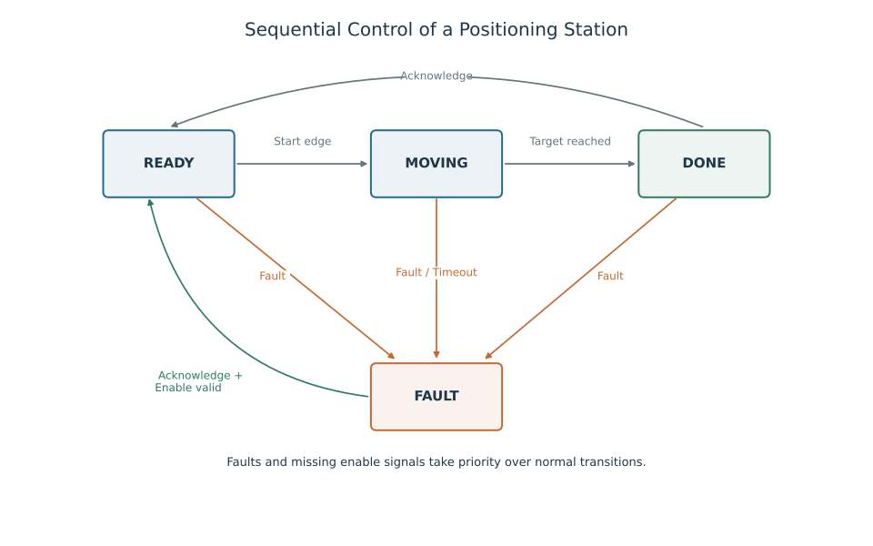

# M13-L1 – Automation Structures and Sequential Control {#L1}

**Course area:** M13 – Bachelor: Automation, Control and Robotics

**Level:** Bachelor · Elective

**Prerequisites:** [Finite state machines](M3-L6.md), [Control loops](M6-L4.md), [Hybrid models](M12-L4.md).

**Learning objective:** Break down an automation task into discrete operating states, continuous control loops and verifiable transition conditions.

## Levels of an Automated Plant {#S1}

An industrial plant must do more than stabilise a physical quantity. It must also decide when a subprocess is enabled, which setpoint applies and how to handle a fault. An automated positioning drive, for example, consists of a position sensor, a drive controller, a motor with power electronics and a supervisory sequential controller. The drive controller generates a manipulated variable from the desired and actual positions; the sequential controller determines when the drive controller may request movement in the first place. A user interface displays the operating state, commands and diagnostics. It need not be part of the fast control loop.

| Level | Example task | Typical signal in the teaching model |
| --- | --- | --- |
| Field level | Measurement and actuation | Angle, speed, torque |
| Feedback control | Limit the deviation | Setpoint, commanded torque |
| Sequential control | Determine steps and enables | State, start, done |
| Supervision | Logging and operation | Fault code, event time |

These tasks may have different execution periods. In the example, the axis controller is called every 5 ms, the sequential controller every 20 ms and the display every 200 ms. These times are purely design assumptions, not product specifications. A fast sensor is of little use if an outdated value is passed to the controller unnoticed.

## Sequential Control of a Positioning Station {#S2}

{alt="Four operating states with normal transitions and a prioritised fault path."}

The station starts in READY (`BEREIT`). With a valid enable signal and a new rising start edge, it changes to MOVING (`FAHREN`); the target angle is stored when the command is accepted. After reaching the tolerance window (position and velocity thresholds), it enters DONE (`FERTIG`). Acknowledgement returns it to READY. A fault or missing enable signal takes priority over normal transitions. A timeout is also monitored in MOVING. The FAULT state (`FEHLER`) is latched: a fault can only be acknowledged once the enable signal is valid again and the cause of the fault has disappeared. A new start edge must occur separately.

| State | Action in the abstract model | Normal transition |
| --- | --- | --- |
| READY | No motion command | Start edge → MOVING |
| MOVING | Output the target trajectory | Target reached → DONE |
| DONE | Hold position | Acknowledge edge → READY |
| FAULT | Motion command inhibited | Enable valid, cause resolved, acknowledge edge → READY |

This is a **functional teaching model**, not a safety controller. Inhibiting a motion command guarantees neither standstill nor the holding of a vertical load. For a real plant, risks, braking distance, stored energy and appropriate independent safety functions must be considered separately.

## Cyclic Execution and Priority {#S3}

In a simplified cyclic controller, input data are acquired at the start of a cycle, the logic is evaluated and output data are updated. A short pulse appearing between two samples can go undetected. Input filters, buffered events or edge-capture hardware are possible countermeasures; these themselves change the timing conditions. Sequential Function Chart (SFC) according to IEC 61131-3 provides steps and transitions for structuring sequences; our Python example represents only a deterministic state machine, not a standards-compliant PLC runtime. The original code retains the German state names listed above.

```python
# Zeitueberschreitung und Flanken werden vom aufrufenden Zeitmodell geliefert.
def step(s, ready=True, fault=False, timeout=False,
         start=False, done=False, ack=False):
    if fault or not ready or (s == 'FAHREN' and timeout):
        return 'FEHLER'
    if s == 'FEHLER':
        return 'BEREIT' if ack else s
    if s == 'BEREIT' and start:
        return 'FAHREN'
    if s == 'FAHREN' and done:
        return 'FERTIG'
    if s == 'FERTIG' and ack:
        return 'BEREIT'
    return s

s = step('BEREIT', start=True)
assert s == 'FAHREN'
assert step(s, done=True, fault=True) == 'FEHLER'
assert step(s, timeout=True) == 'FEHLER'
assert step('FEHLER', ack=True, ready=False) == 'FEHLER'
assert step('FEHLER', start=True) == 'FEHLER'
assert step('FEHLER', ack=True, start=True) == 'BEREIT'
assert step(step(s, done=True), ack=True) == 'BEREIT'
```

The simultaneous occurrence of a fault and the done signal is deliberately tested. The order of the conditions is part of the specification. For cyclic execution, the caller must detect edges using the stored previous input, for example $s_k\land\neg s_{k-1}$. If start remains active, this prevents a second command from being issued upon acknowledgement. A timeout monitor counts from entry into MOVING; the counter is not reset every time that state is output again.

## Timing Budget and Test Design {#S4}

For a cycle of 20 ms and an event that remains stable at the input, waiting for the next sample alone can take almost 20 ms. Filtering, execution, bus transmission and updating the output add further delays. With an assumed filter delay of 3 ms, a logic budget of 4 ms and an output transport delay of 5 ms, a simplified upper response bound of 32 ms results, provided no cycle is missed. For an axis cycle of 5 ms, this slow sequential controller must not be mistaken for the immediate speed control loop.

A test plan includes normal cases, boundary cases and timing faults: double clicks, a held start button, missing feedback, a fault coinciding with target attainment, and acknowledgement without an enable signal. An observation point must distinguish physical standstill from a logical state indication.

## Exercises with Solutions {#S5}

1. A button is active for 8 ms between two samples, and the cycle lasts 20 ms. Is detection guaranteed?  
   **Solution** No. The pulse can fall entirely between samples.
2. In MOVING, `done` and `timeout` are true simultaneously. Which state follows?  
   **Solution** FAULT, because monitoring has priority.
3. A sensor has frozen after a communication failure and displays the target angle. What additional check is necessary?  
   **Solution** Check measurement quality and age as well as velocity; an outdated position value is not a valid done indication.

**Further reading:** [Digital control and saturation](M13-L2.md)

## Sources {#S6}

- [PLCopen – Status of IEC 61131-3 and SFC](https://www.plcopen.org/standards/logic/iec-61131-3/status-iec-61131-3-standard/) · The 4th Edition section: controller languages ST, LD, FBD and SFC structure; public overview, not full standard. · Last accessed: 2026-11-25
- [PLCopen – Introductions and downloads on sequential control languages](https://www.plcopen.org/downloads/) · Downloads: SFC textual (DE/EN), introduction to SFC (German); listing only, files not opened. · Last accessed: 2026-11-25
