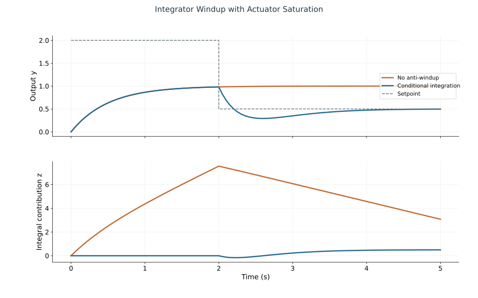

# M13-L2 – Digital Control and Saturation {#L2}

**Course area:** M13 – Bachelor: Automation, Control and Robotics

**Level:** Bachelor · Elective

**Prerequisites:** [z-transform](M5-L4.md), [Sampling](M5-L5.md), [Stability and an introduction to controller design](M6-L5.md).

**Learning objective:** Develop a discrete-time PI controller and quantitatively assess the effects of actuator saturation with and without integrator limiting.

## From the Continuous to the Sampled Model {#S1}

A digital controller reads the measured value at discrete times $t_k=kT_s$. In the simplest case, its control signal remains constant between updates (zero-order hold). The delay and frequency response of this hold element form part of the plant. An excessively long sampling period can degrade an originally stable design; however, a short period alone does not guarantee stability when computation and communication delays are also present.

We use a normalised first-order plant with time constant $\tau=0.5$ s:

$$
\tau\dot y+y=u,\qquad |u|\le1.
$$

The state solution for a constant held input $u_k$ produces the exact discrete equation

$$
y_{k+1}=ay_k+(1-a)u_k,\qquad a=e^{-T_s/\tau}.
$$

At $T_s=0.05$ s, $a\approx0.90484$. An Euler step would give $a=0.9$ and would be an approximation. Here, the exact sampled model separates the control effect from integration errors.

## PI Controller and Windup {#S2}

We store the integral contribution $z_k$ directly in units of the manipulated variable. The setpoint is $r_k$, and the error is $e_k=r_k-y_k$. With $K_P=1.5$, $K_I=3\,\mathrm{s}^{-1}$, we have

$$
v_k=K_Pe_k+z_k,\qquad u_k=\operatorname{clip}(v_k,-1,1),\qquad z_{k+1}=z_k+T_sK_Ie_k.
$$

If the setpoint is 2 but the plant can only reach values up to 1, the error remains positive. Without limiting the integral contribution, $z_k$ continues to grow. When the setpoint later becomes attainable again, the manipulated variable often remains at its limit for quite some time. This behaviour is called integrator windup.

With conditional integration, $z_k$ is updated only when the error does not reinforce saturation. At the upper limit, integration is disabled for a positive error; at the lower limit it is disabled for a negative error. An alternative, back-calculation, adds $T_sK_b(u_k-v_k)$ to the integrator equation; the gain $K_b$ has units of 1/s. Like other controller parameters, it must be tested rather than chosen arbitrarily large.

{alt="Setpoint change at two seconds: conditional integration shortens recovery after actuator saturation; the integral contributions and outputs of both controllers are shown."}

## Stability without Saturation {#S3}

For a constant setpoint, deviations from the equilibrium are considered. If the control signal is not limited and conditional integration is inactive, the linear state model is

$$
\begin{bmatrix}\delta y_{k+1}\\\delta z_{k+1}\end{bmatrix}=
\begin{bmatrix}a-(1-a)K_P&1-a\\-T_sK_I&1\end{bmatrix}
\begin{bmatrix}\delta y_k\\\delta z_k\end{bmatrix}.
$$

At 50 ms, the eigenvalues are approximately 0.881 ± 0.011 i (both magnitudes less than 1). This applies locally around an unsaturated operating point; it does not prove global stability of the switched system. Design variants must also be tested with load changes, actuator limits and measurement errors.

## Numerical Experiment {#S4}

The setpoint is initially 2 and changes to 0.5 after 2 s. The initial values are $y=z=0$. The following Python code uses the exact plant solution.

```python
import math

def pi(T=0.05, aw=True):
    y=z=0.0
    a=math.exp(-T/0.5)
    out=[]
    for k in range(round(5/T)+1):
        t=k*T
        r=2.0 if t<2 else .5
        e=r-y
        v=1.5*e+z
        u=max(-1.,min(1.,v))
        out.append((t,r,y,u,z))
        if not aw or not ((v>1 and e>0) or (v<-1 and e<0)):
            z+=T*3*e
        y=a*y+(1-a)*u
    return out

for T in (0.05, 0.025):
    for aw in (False, True):
        d = pi(T, aw)
        assert all(abs(v[3]) <= 1 for v in d)
        print(T, aw, d[round(2/T)], d[-1])
```

| Sampling period | Conditional integration | Integral contribution at 2 s | Output at 5 s |
| ---: | --- | ---: | ---: |
| 50 ms | no | 7.54738 | 0.99995 |
| 50 ms | yes | 0 | 0.49692 |
| 25 ms | no | 7.50965 | 0.99995 |
| 25 ms | yes | 0 | 0.49617 |

At 50 ms, the variant with conditional integration first comes within 0.025 of the new setpoint at 2.20 s. This must not be equated with a permanent settling time. The variant without limiting does not reach the band at all by the end of the experiment at 5 s. Repeating the experiment with half the sampling period confirms the qualitative behaviour, although the numerical values vary slightly. Even with anti-windup, the controller cannot achieve the physically impossible first target; it simply recovers after returning to the feasible range.

In real systems, limits may apply not only to amplitude but also to actuator slew rate, current, temperature and voltage. If the effective manipulated variable is subject to downstream limits, the anti-windup logic must know about them. In a cascade controller, for example, the outer position loop may request a speed target that the inner loop cannot deliver.

## Exercises with Solutions {#S5}

1. At $y=0$, $r=2$, $z=0$, the value of $v=3$. What is stored under conditional integration?  
   **Solution** $u=1$ and $z_{k+1}=0$, because the error is positive and the upper limit has been reached.
2. At $v=1.2$ with a negative error, is integration disabled?  
   **Solution** No. A negative contribution can bring the integrator back out of upper saturation.
3. Why is an eigenvalue magnitude below one insufficient for all operating conditions?  
   **Solution** The matrix describes the unsaturated linear case. Switching logic, delays and other limits change the dynamics.

**Further reading:** [Robot kinematics and coordinate systems](M13-L3.md)

## Sources {#S6}

- [MathWorks – Discrete PID Controller and anti-windup](https://www.mathworks.com/help/simulink/slref/discretepidcontroller.html) · Anti-Windup Control Using PID Controller Block example: saturation and integrator windup. · Last accessed: 2026-11-25
- [MathWorks – PI Controller: Clamping and Back-calculation](https://www.mathworks.com/help/mcb/ref/picontroller.html) · Description section: discrete PI/PID controller structure. · Last accessed: 2026-11-25
