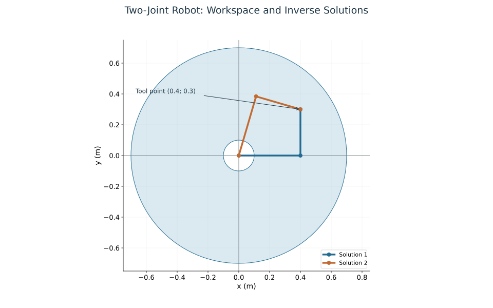

# M13-L3 – Robot Kinematics and Coordinate Systems {#L3}

**Course area:** M13 – Bachelor: Automation, Control and Robotics

**Level:** Bachelor · Elective

**Prerequisites:** [Vectors and systems of linear equations](M2-L2.md), [Differential equations](M2-L3.md).

**Learning objective:** Determine the position and velocity of a planar robot from its joint angles, distinguish inverse solutions and recognise singularities.

## Joint Space and Workspace {#S1}

An articulated robot can reach the same tool point with different joint configurations. Joint space describes the independent drive coordinates. The workspace denotes the reachable positions (and, for more general robots, orientations). We restrict ourselves to a planar robot with two ideal revolute joints and rigid links of lengths $l_1=0.4$ m and $l_2=0.3$ m. The axes are perpendicular to the plane. Angles are positive anticlockwise and are expressed in radians in the equations. $q_2$ is defined relative to the first link; the absolute orientation of the second link is $q_1+q_2$.

{alt="Annular ideal workspace and two joint configurations for the same tool point at x = 0.4 and y = 0.3 metres."}

The rotation of a planar coordinate follows from

$$
R(q)=\begin{bmatrix}\cos q&-\sin q\\\sin q&\cos q\end{bmatrix}.
$$

The forward kinematics is the sum of the two rotated link vectors:

$$
x=l_1\cos q_1+l_2\cos(q_1+q_2),\qquad
y=l_1\sin q_1+l_2\sin(q_1+q_2).
$$

Without joint limits or collisions, the geometric workspace is an annulus with radii $|l_1-l_2|=0.1$ m and $l_1+l_2=0.7$ m. A real robot cannot reach every position in this ideal region because of mechanical stops, obstacles and self-collisions.

## Inverse Kinematics {#S2}

For a desired position $(x,y)$, the law of cosines gives

$$
c_2=\frac{x^2+y^2-l_1^2-l_2^2}{2l_1l_2},\quad
q_2=\operatorname{atan2}(\pm\sqrt{1-c_2^2},c_2).
$$

If $|c_2|>1$, there is no real solution. Small numerical overshoots due to rounding can be clipped to the interval $[-1,1]$ after checking a tolerance. A genuinely unreachable point, however, must not be silently moved into the workspace. For each of the two possible sign choices, we determine

$$
q_1=\operatorname{atan2}(y,x)-\operatorname{atan2}(l_2\sin q_2,l_1+l_2\cos q_2).
$$

With $x=0.4$ m and $y=0.3$ m, we obtain $c_2=0$. One solution is $q_1=0$, $q_2=\pi/2$. The other is $q_1=2\operatorname{atan2}(0.3,0.4)\approx1.287$ rad and $q_2=-\pi/2$. Both lead to the same tool point but to different orientations and joint configurations. Along a continuous path, a feasible family of solutions is selected and followed as continuously as possible.

## Differential Kinematics and Singularities {#S3}

The time derivative of the position vector gives $\dot p=J(q)\dot q$. The Jacobian matrix contains the derivatives with respect to the joint angles:

$$
J=\begin{bmatrix}
-l_1\sin q_1-l_2\sin(q_1+q_2)&-l_2\sin(q_1+q_2)\\
l_1\cos q_1+l_2\cos(q_1+q_2)&l_2\cos(q_1+q_2)
\end{bmatrix}.
$$

Its determinant is $l_1l_2\sin q_2$. When the arm is fully extended or folded, the matrix is singular. In these configurations, the tool point cannot be moved arbitrarily in two independent Cartesian directions. Near a singularity, moderate tool velocities may require very high joint velocities. A practical path planner therefore checks not only reachability but also the conditioning of the mapping, joint limits and the required dynamics.

At the point $q=(0,\pi/2)$, we obtain $J=\begin{bmatrix}-0.3&-0.3\\0.4&0\end{bmatrix}$. For $\dot p=(0.03,0.04)$ m/s, we obtain $\dot q_1=0.1$ rad/s and $\dot q_2=-0.2$ rad/s. The static force mapping is also relevant: equality of virtual power $F^T\dot p=M^T\dot q$ gives $M=J^TF$, provided that no other loads are considered. For $F=(10,0)$ N at this point, we obtain $M=(-3,-3)$ Nm for the corresponding tool force.

## Computational Experiment {#S4}

```python
from math import sin, cos, atan2, sqrt, pi, hypot
l1, l2 = .4, .3

def forward(q1, q2):
    return (l1*cos(q1)+l2*cos(q1+q2),
            l1*sin(q1)+l2*sin(q1+q2))

def inverse(x, y):
    c = (x*x+y*y-l1*l1-l2*l2)/(2*l1*l2)
    if abs(c) > 1+1e-12:
        raise ValueError('ausserhalb des Arbeitsraums')
    c = min(1.,max(-1.,c))
    sols = []
    for sign in (1,-1):
        q2 = atan2(sign*sqrt(1-c*c),c)
        q1 = atan2(y,x)-atan2(l2*sin(q2),l1+l2*cos(q2))
        sols.append((q1,q2))
    return sols

for x,y in ((.4,.3),(.5,.1),(.7,0),(.1,0)):
    for q1,q2 in inverse(x,y):
        X,Y = forward(q1,q2)
        assert hypot(X-x,Y-y) < 1e-10
        print(x,y,q1,q2)
try:
    inverse(.8,0)
except ValueError:
    pass
else:
    raise AssertionError('unerreichbarer Punkt akzeptiert')
```

The check substitutes the angles obtained from inverse kinematics back into the forward kinematics. It also detects a point outside the annulus. At its boundaries, the two solutions may coincide up to angle periodicity. Passing a geometric test does not yet demonstrate that an axis controller can implement the trajectory.

## Exercises with Solutions {#S5}

1. Is $(0,0)$ reachable?  
   **Solution** No, the minimum radius is 0.1 m.
2. Calculate $p$ for $q_1=\pi/2$, $q_2=0$.  
   **Solution** $(0,0.7)$ m. The configuration is singular.
3. Can a Cartesian straight line be followed without checking intermediate points if both endpoints are reachable?  
   **Solution** No. The straight line may pass through the inner unreachable region or through obstacles. Joint limits and velocities must also be checked.

**Further reading:** [Trajectories and axis control](M13-L4.md)

## Sources {#S6}

- [Lynch and Park – Modern Robotics, Chapter 5: Velocity Kinematics and Statics](https://modernrobotics.northwestern.edu/chapters/chapter5/) · Chapter 5: velocity kinematics; video index, videos not reviewed. · Last accessed: 2026-11-25
- [Lynch and Park – Modern Robotics, Chapter 6: Inverse Kinematics](https://modernrobotics.northwestern.edu/chapters/chapter6/) · Chapter 6: inverse kinematics; video index, videos not reviewed. · Last accessed: 2026-11-25
