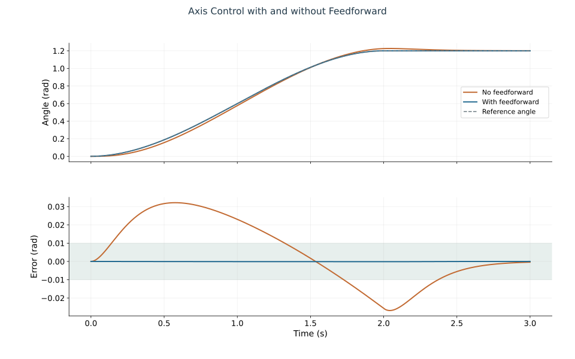

# M13-L4 – Trajectories and Axis Control {#L4}

**Course area:** M13 – Bachelor: Automation, Control and Robotics

**Level:** Bachelor · Elective

**Prerequisites:** [Motor operating point](M9-L1.md), [Coupled models](M12-L2.md), [Robot kinematics](M13-L3.md).

**Learning objective:** Design a time-parameterised joint motion, account for axis dynamics and verify the achievable positioning accuracy using a simulation.

## Path and Trajectory {#S1}

A path specifies the geometric sequence of configurations. A trajectory additionally specifies when they are reached. In joint space, the path can be specified as $q(s)=q_A+s(q_B-q_A)$ with $0\le s\le1$. A straight-line connection in joint space does not generally yield a straight line in Cartesian space. If the tool is to travel along a straight line, the Cartesian path must be converted into joint coordinates and checked for singularities (see [M13-L3](M13-L3.md)).

For a single axis with an initial angle of zero and a target angle of $Q=1.2$ rad, we use $T=2$ s and the normalised time $s=t/T$. The cubic time function is

$$
q_r=Q(3s^2-2s^3),\quad
\dot q_r=\frac{Q}{T}(6s-6s^2),\quad
\ddot q_r=\frac{Q}{T^2}(6-12s).
$$

Outside the motion interval, we hold the respective end positions with zero velocity and acceleration. At both ends the velocity is continuous; acceleration has discontinuities. A quintic function $10s^3-15s^4+6s^5$ could also bring acceleration continuously to zero at the endpoints. For cubic motion, the peak values are $1.5Q/T=0.9$ rad/s and $6Q/T^2=1.8$ rad/s². For limits $v_\max$ and $a_\max$, we therefore require $T\ge1.5|Q|/v_\max$ and $T\ge\sqrt{6|Q|/a_\max}$. This check concerns the reference trajectory; the actual system must be checked separately.

## Axis Model, Feedforward and Feedback {#S2}

We use an ideal rotary axis with $J=0.2$ kg m² and $b=0.1$ Nm s/rad. The electrical dynamics are represented by an ideal inner torque controller. The model equations are

$$
\dot q=\omega,\qquad J\dot\omega=M-b\omega.
$$

A PD position controller compares the angle and velocity with the reference trajectory. With feedforward,

$$
M_v=J\ddot q_r+b\dot q_r+K_P(q_r-q)+K_D(\dot q_r-\omega),
\qquad M=\operatorname{clip}(M_v,-2,2)\,\mathrm{Nm}.
$$

The saturation limits are numerical values in Nm; $K_P=8$ Nm/rad and $K_D=2.4$ Nm s/rad. Feedforward supplies the torque required for the ideal reference motion. Feedback compensates for deviations from the model. Without feedforward, feedback must first detect an error before torque is generated. With an exact continuous-time model, no saturation and instantaneous feedback, the error equation is $J\ddot e+(b+K_D)\dot e+K_Pe=0$. The poles are $-6.25\pm0.968i$ 1/s; both real parts are negative. This conclusion does not directly apply to delayed digital feedback.

## Reproducible Axis Simulation {#S3}

For constant torque within a sampling step, the mechanical differential equation is integrated exactly. With $a=e^{-bT_s/J}$ and $\omega_\infty=M/b$, we obtain

$$
\begin{aligned}
q_{k+1}&=q_k+\omega_\infty T_s+(\omega_k-\omega_\infty)(1-a)J/b,\\
\omega_{k+1}&=\omega_\infty+(\omega_k-\omega_\infty)a.
\end{aligned}
$$

The code already includes an optional measurement delay in whole sampling steps, which will be used in the next lesson. If no prior history is available, the initial state is used. Changing the sampling period changes the physical duration of a delay specified in steps.

```python
import math

def axis(Ts=.005, ff=True, delay=0):
    J,b,Kp,Kd=0.2,.1,8.,2.4
    q=w=0.
    data=[]
    for k in range(round(3/Ts)+1):
        t=k*Ts
        s=min(t/2,1.)
        r=1.2*(3*s*s-2*s**3)
        vr=1.2*(6*s-6*s*s)/2
        ar=1.2*(6-12*s)/4 if t<2 else 0.
        m=J*ar+b*vr if ff else 0.
        j=max(0,len(data)-delay)
        qm,wm=(q,w) if delay==0 or not data else data[min(j,len(data)-1)][2:4]
        raw=m+Kp*(r-qm)+Kd*(vr-wm)
        u=max(-2.,min(2.,raw))
        data.append((t,r,q,w,u,raw))
        # Exact solution under constant torque over one sample.
        a=math.exp(-b*Ts/J)
        w_inf=u/b
        q+=w_inf*Ts+(w-w_inf)*(1-a)*J/b
        w=w_inf+(w-w_inf)*a
    return data

def stats(data):
    return max(abs(x[1]-x[2]) for x in data),abs(data[-1][1]-data[-1][2]),max(abs(x[3]) for x in data),max(abs(x[4]) for x in data)

for Ts in (.005,.0025):
    for ff in (False,True):
        d=axis(Ts,ff)
        assert all(abs(row[4])<=2 for row in d)
        print(Ts,ff,stats(d))
```

{alt="Cubic reference trajectory, angular error of the axis with and without feedforward, and the limits of plus and minus 0.01 rad."}

## Results and Assessment {#S4}

| Sampling period | Feedforward | Max. angular error (rad) | Max. velocity (rad/s) | Max. torque (Nm) |
| ---: | --- | ---: | ---: | ---: |
| 5 ms | no | 0.032146 | 0.93532 | 0.35808 |
| 5 ms | yes | 0.000150 | 0.90006 | 0.36000 |
| 2.5 ms | no | 0.032130 | 0.93527 | 0.35712 |
| 2.5 ms | yes | 0.000075 | 0.90003 | 0.36000 |

The assessment covers the motion up to 2 s and a holding phase up to 3 s. For the idealised teaching model, we specify acceptable model limits of 0.01 rad maximum angular error, 1 rad/s actual velocity and 2 Nm torque. With feedforward, all three targets are met at the simulated sampling instants; without feedforward, the error target is missed. When the sampling step is halved, the residual error with feedforward falls to about half its original value. Mechanical state integration is exact within each step, but the digital control input remains constant between samples. Halving the step is no substitute for a global convergence or stability analysis.

A real robot joint may exhibit backlash, elastic deformation, dry friction, gravity and mechanical coupling with other axes. Torque feedforward would then need to be derived from a complete multibody model. A target of 0.01 rad corresponds to approximately 4 mm of tangential position error for a 0.4 m lever arm at small angles; an actual Cartesian tolerance would have to be determined from the entire joint configuration.

## Exercises with Solutions {#S5}

1. What minimum duration results from $Q=1.2$ rad and $v_\max=0.6$ rad/s?  
   **Solution** $T\ge3$ s from the velocity limit. The acceleration limit must also be checked.
2. What ideal feedforward torque does an axis require at $\dot q_r=0.9$ rad/s and $\ddot q_r=0$?  
   **Solution** $b\dot q_r=0.09$ Nm.
3. Why is feedforward without feedback problematic when the model is inaccurate?  
   **Solution** Incorrect mass or friction produces a motion error that pure feedforward does not correct using measurements.

**Further reading:** [Industrial communication and system integration](M13-L5.md)

## Sources {#S6}

- [Lynch and Park – Modern Robotics, Chapter 9: Trajectory Generation](https://modernrobotics.northwestern.edu/chapters/chapter9/) · Chapter 9: trajectory generation; video index, videos not reviewed. · Last accessed: 2026-11-25
- [Lynch/Park – Modern Robotics, Chapter 11: Robot Control](https://modernrobotics.northwestern.edu/chapters/chapter11/) · Section overview 11.3–11.4: motion control with velocity and torque inputs; videos not reviewed. · Last accessed: 2026-11-25
