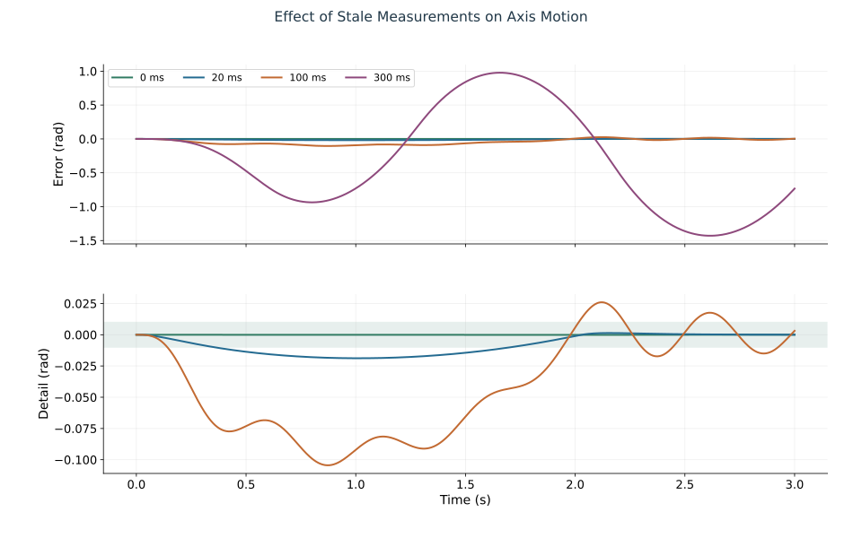

# M13-L5 – Industrial Communication and System Integration {#L5}

**Course area:** M13 – Bachelor: Automation, Control and Robotics

**Level:** Bachelor · Elective

**Prerequisites:** [Sampling and digital filters](M5-L5.md), [Sequential control](M13-L1.md), [Axis control](M13-L4.md).

**Learning objective:** Exchange measurement data, control inputs and command information through suitable interfaces, distinguish latency from data age and assess an integrated robot-axis simulation.

## Communication as Part of the Dynamics {#S1}

This elective focuses on timing in electrical measurement and actuation chains. A digital process word encodes a measurement or command; the models below require only sampling time, payload size, timestamps and validity. A separate modulation or channel coding course is not required.

A communication system connects the sensor, controller, actuator and supervisory control system. Transmitting process values is not merely a question of bit rate: the timing and validity of a value affect the control loop. Here, the time between acquisition and processing is called data age $A=t_\mathrm{use}-t_\mathrm{capture}$ (with a common time reference). Transmission latency is only one component of this age. Variations in delay are known as jitter; a recurring data stream can have high bandwidth and yet provide inadequate timing guarantees.

| Data type | Example | Design requirements |
| --- | --- | --- |
| Cyclic process data | Position, rotational speed | Known update period, validity and data age |
| Events | Fault report, target reached | Ordering, acknowledgement or recovery |
| Command data | Target, motion duration, command ID | Unambiguous association, no duplicate execution |
| Diagnostics | History, temperature, statistics | Analysis without blocking the axis cycle |

Cyclic and event-driven describe the temporal organisation, not necessarily the network used. Publish/subscribe describes a communication relationship: a published data set can be consumed by multiple recipients without a direct request for each individual message. OPC UA PubSub, for example, is described in Part 14 of the OPC UA specification. Real-time capability, however, does not follow from the name of a protocol alone; transport, topology, scheduling and end systems must meet the required bounds.

## Interface Contract in the Teaching System {#S2}

The axis from M13-L4 receives a command from the sequential controller containing `command_id`, `q_target_rad` and `duration_s`. The timing model of the axis generates the reference trajectory locally. The sensor supplies `q_rad`, `omega_rad_s`, `sample_time_s`, `seq` and `valid`. The controller output is `torque_Nm`; a status message contains `command_id`, `state`, `in_position` and `fault_code`. Clear units prevent confusion between degrees and radians, for example. The receiver checks the value range, time reference, sequential numbering (accounting for possible wraparound) and validity; a valid but stale measurement is inadequate.

For the teaching model, we use the following assumptions: axis cycle 5 ms, sequential control cycle 20 ms, target position 1.2 rad in 2 s. The assumed freshness limit for the axis controller is 10 ms. A target-reached indication is valid only after 2 s of motion and when $|q-Q|\le0.01$ rad and $|\omega|\le0.02$ rad/s. If it is still absent after 3 s, the sequential controller signals a timeout. In the model, invalid or stale data cause a fault to be reported and block a new motion command. How a real axis is safely brought to a stop following communication loss must not be inferred from this abstract state transition.

## Delay Experiment and System Test {#S3}

We deliberately allow the controller to use stale measurement data. This is **fault injection without effective freshness monitoring**, intended to show why such monitoring is necessary. The timestamp of the reference trajectory remains current; only angle and velocity measurements are delayed. A delay of $d$ steps corresponds to $dT_s$. We use the same ideal axis as in [M13-L4](M13-L4.md): no new mechanical parameterisation, no packet loss and no random jitter.

```python
import math

def axis(Ts=.005, ff=True, delay=0):
    J,b,Kp,Kd=0.2,.1,8.,2.4
    q=w=0.
    data=[]
    for k in range(round(3/Ts)+1):
        t=k*Ts
        s=min(t/2,1.)
        r=1.2*(3*s*s-2*s**3)
        vr=1.2*(6*s-6*s*s)/2
        ar=1.2*(6-12*s)/4 if t<2 else 0.
        m=J*ar+b*vr if ff else 0.
        j=max(0,len(data)-delay)
        qm,wm=(q,w) if delay==0 or not data else data[min(j,len(data)-1)][2:4]
        raw=m+Kp*(r-qm)+Kd*(vr-wm)
        u=max(-2.,min(2.,raw))
        data.append((t,r,q,w,u,raw))
        # Exact solution under constant torque over one sample.
        a=math.exp(-b*Ts/J)
        w_inf=u/b
        q+=w_inf*Ts+(w-w_inf)*(1-a)*J/b
        w=w_inf+(w-w_inf)*a
    return data

def stats(data):
    return max(abs(x[1]-x[2]) for x in data),abs(data[-1][1]-data[-1][2]),max(abs(x[3]) for x in data),max(abs(x[4]) for x in data)

for D in (0,4,20,60):
    d=axis(delay=D)
    print(D,stats(d))
    end=d[-1]
    print('Ziel am Ende:',abs(end[2]-1.2)<=.01 and abs(end[3])<=.02)

def freshness(now, stamp, valid):
    return valid and 0 <= now-stamp <= .010+1e-12

assert freshness(1.010,1.,True)
assert not freshness(1.020,1.,True)
assert not freshness(1.,1.,False)
assert not freshness(1.,1.001,True)
```

{alt="Simulated angular errors for four fixed measurement delays, with a detail panel showing the smaller deviations."}

| Measurement delay | Max. angular error (rad) | Max. velocity (rad/s) | Max. torque (Nm) | Error target 0.01 rad |
| ---: | ---: | ---: | ---: | --- |
| 0 ms | 0.000150 | 0.90006 | 0.36000 | met |
| 20 ms | 0.018813 | 0.90082 | 0.44480 | missed |
| 100 ms | 0.104466 | 1.04054 | 0.82793 | missed |
| 300 ms | 1.429460 | 4.71180 | 2.00000 | missed |

All four variants use the same 2 Nm limit. At 300 ms, the deviation grows so much during the observation window that the control input limit is reached. This demonstrates unacceptable behaviour in the scenario under investigation; it is not a mathematical proof of asymptotic instability. Even a 20 ms delay is sufficient for the ideal model to miss the path error target. With active freshness checks, measurements delayed by 20, 100 or 300 ms would not be treated as valid data. Whether 10 ms is a sufficient limit for all disturbances remains to be investigated separately.

## Integration, Timing Budget and Acceptance {#S4}

For an axis cycle of 5 ms, suppose the timing budget allows at most 1.0 ms for measurement acquisition, 0.7 ms for transmission, 0.8 ms for computation and 0.5 ms for delivery of the control input. This totals 3.0 ms, leaving 2.0 ms of margin within the cycle. Such a sum is an upper bound only if the individual values are genuine worst-case bounds and there are no additional waiting times, queueing delays or clock errors. With independently clocked systems, an additional waiting time of up to one cycle may occur. The freshness limit is therefore no substitute for timing analysis.

The module project consists of three interconnected levels of testing: the discrete sequential controller (M13-L1), the locally controlled axis (M13-L4) and the validated measurement data contract. The preceding tests demonstrate the respective properties at component level, not the operation of an actual PLC or fieldbus. A complete acceptance procedure additionally needs the following integration tests:

| Test stimulus | Expected behaviour |
| --- | --- |
| Valid start, fresh data | MOVING (`FAHREN`); generate the trajectory exactly once |
| Position reached, rotational speed too high | No completion indication |
| Same command ID repeated | No second command |
| Data age above freshness limit | Fault indication; no completion indication based on stale values |
| Fault simultaneous with target being reached | FAULT (`FEHLER`) takes priority |
| Fault resolved, new acknowledgement edge | READY (`BEREIT`); new start edge required |

A key design decision is to execute fast control loops locally wherever possible and transmit supervisory commands at a slower rate. This reduces time-critical dependencies. The actual benefit must be measured in the particular system or demonstrated by a sound worst-case analysis. An interface model with artificial delays allows testing before a physical system is built.

## Exercises with Solutions {#S5}

1. A measurement was generated at 0.100 s and used at 0.114 s. How old is it?  
   **Solution** 14 ms; it is not acceptable under the 10 ms freshness limit of the teaching system.
2. A cyclic data stream contains 40 payload bytes every 5 ms. What is the payload bit rate alone?  
   **Solution** $40\cdot8/0.005=64\,000$ bit/s. Frames, protocol headers and other network traffic are not included.
3. Why is an `in_position` Boolean variable insufficient as acceptance information?  
   **Solution** It needs validity, a time reference, a command reference and a defined basis in the angle and velocity thresholds.

**Further reading:** [Study pathway](pages/study-path.md#S3) and [Model validation](M12-L5.md).

## Sources {#S6}

- [OPC Foundation – OPC UA Part 14: PubSub](https://reference.opcfoundation.org/specs/OPC-10000-14/4) · Part 14, §4: PubSub overview and middleware abstraction; partial scope. · Last accessed: 2026-11-25
- [PLCopen – IEC 61131-3](https://www.plcopen.org/standards/logic/iec-61131-3/status-iec-61131-3-standard/) · The 4th Edition section: controller configuration and communication; public overview. · Last accessed: 2026-11-25
