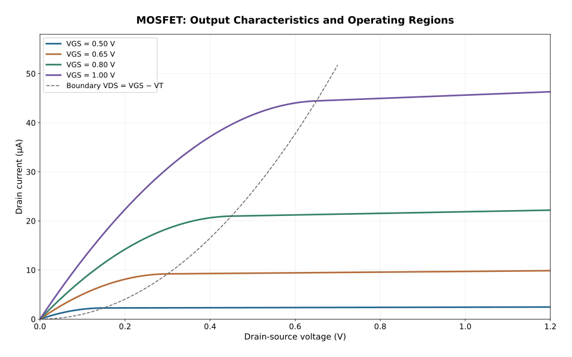

# M14-L1 – MOSFET Models for Circuit Design {#L1}

**Course area:** M14 – Bachelor: Microelectronic Circuits and Systems

**Level:** Bachelor · Elective

**Prerequisites:** [Transistors](M3-L3.md), [Semiconductors](M3-L1.md), [Network analysis](M1-L3.md).

**Learning objective:** Evaluate a large-signal MOSFET model, identify its regions of operation and derive a local small-signal model.

## The MOSFET as a Controllable Channel {#S1}

In an integrated circuit, the gate controls the conductivity of a channel between source and drain by means of an electric field. In an n-channel enhancement-mode MOSFET, a conducting electron channel forms when the gate-source voltage is sufficiently positive. The ideally insulated gate electrode draws no steady-state current; current nevertheless flows when its capacitances are charged or discharged. A p-channel transistor operates with reversed polarities; for it, we use the positive magnitudes $V_{SG}$, $V_{SD}$ and $|V_{Tp}|$.

The fourth terminal is the bulk, or body. In the simple model, it is connected to the source. At a different bulk voltage, the body effect changes the threshold voltage; the junctions to the substrate also form pn diodes. A transistor therefore cannot be used arbitrarily as an ideal bidirectional switch in every circuit.

## Large-Signal Model {#S2}

For a long n-channel device, we use $V_{DS}\ge0$, $V_T=0.35$ V and $\beta=\mu_n C_{ox}W/L=200$ µA/V². The overdrive is $q=V_{GS}-V_T$. In the idealised model,

$$
I_D=\begin{cases}
0 & q\le0\\
\beta(q V_{DS}-V_{DS}^2/2) & 0<V_{DS}<q,\ q>0\\
\beta q^2/2 & V_{DS}\ge q,\ q>0.
\end{cases}
$$

In the linear (triode) region, at very small $V_{DS}$, the approximate resistance is $R_{DS}=1/(\beta q)$. At the boundary $V_{DS}=q$, the two equations agree. In saturation, the channel is pinched off at the drain end; this does not mean that the current is zero. Integrated amplifiers exploit this region precisely because the drain voltage has a relatively small influence on the current.

As a simple extension, we multiply the current in the conducting regions by $(1+\lambda V_{DS})$, here with $\lambda=0.08$ V$^{-1}$. This is a smooth instructional model for output conductance, not a complete compact process model.

{alt="nMOS output characteristics for four gate voltages, with a dashed boundary between the triode region and saturation."}

## Operating Point and Small-Signal Model {#S3}

For $V_{GS}=0.8$ V and $V_{DS}=0.6$ V, $q=0.45$ V; the transistor is in saturation. Without the correction, it delivers 20.25 µA; with the correction, 21.222 µA. At constant bulk voltage and for small variations about this operating point,

$$
\delta i_d\approx g_m\delta v_{gs}+g_{ds}\delta v_{ds},\quad
g_m=\beta q(1+\lambda V_{DS}),\quad g_{ds}=\lambda\beta q^2/2.
$$

This gives $g_m=94.32$ µS, $g_{ds}=1.62$ µS and $r_o=1/g_{ds}\approx617$ kΩ. $g_m$ is not a dimensionless gain but a transconductance. Voltage gain only arises in conjunction with an output resistance or load.

Example: a 1.2 V supply and a 20 kΩ drain resistor give the saturation load line $V_{DS}=1.2-R_D I_D$ at fixed $V_{GS}=0.8$ V. Substitution of the extended model yields $V_{DS}=(1.2-0.405)/(1+0.0324)\approx0.770$ V. Checking the region afterwards, $0.770>0.45$, confirms the assumed equation. Without this check, a formally correct equation could yield a physically unsuitable solution.

## Model Selection and Limitations {#S4}

The square-law model assumes, among other things, a sufficiently long channel and constant effective mobility. Subthreshold current, velocity saturation, temperature, device variation, and gate and junction capacitances are not included. Real CMOS processes therefore use process-specific models (such as BSIM) and a symbol library with layout rules. The simplified model suffices for an initial functional design; it cannot establish manufacturing yield, absolute speed or permissible operating voltages.

A numerical test compares the analytical derivatives with central differences:

```python
beta, vt, lam = 200., .35, .08

def ids(vg, vd):
    q = max(vg-vt, 0.)
    return beta*(q*vd-vd**2/2 if vd<q else q*q/2)*(1+lam*vd)

h = 1e-5
vg, vd = .8, .6
gm = (ids(vg+h,vd)-ids(vg-h,vd))/(2*h)
gds = (ids(vg,vd+h)-ids(vg,vd-h))/(2*h)
assert abs(gm-94.32)<1e-6 and abs(gds-1.62)<1e-6
print(ids(vg,vd), gm, gds)
```

The current values are in µA, so the derivatives are in µS. Agreement between the derivatives checks the implementation, not agreement with silicon.

## Exercises with Solutions {#S5}

1. Identify the region for $V_{GS}=0.55$ V and $V_{DS}=0.1$ V.  
   **Solution** $q=0.20$ V, triode region; without the output correction, $I_D=200(0.02-0.005)=3$ µA.
2. How does $\beta$ change if $W$ is doubled and $L$ is unchanged?  
   **Solution** It doubles; the gate capacitance also increases in the simple area model. More current comes at the cost of chip area and charging energy.
3. Is a low $R_{DS}$ automatically advantageous for a high-impedance amplifier output?  
   **Solution** No. The switch model applies near $V_{DS}=0$; in amplifier operation, a high output resistance in saturation is often desirable.

**Further reading:** [CMOS inverters and static logic](M14-L2.md)

## Sources {#S6}

- [MIT OCW 6.012 – Lectures 10–12: MOSFET models](https://ocw.mit.edu/courses/6-012-microelectronic-devices-and-circuits-fall-2009/pages/lecture-notes/) · Lectures 10–12: MOSFET operating regions and drain-current models; lecture table only. · Last accessed: 2026-11-25
