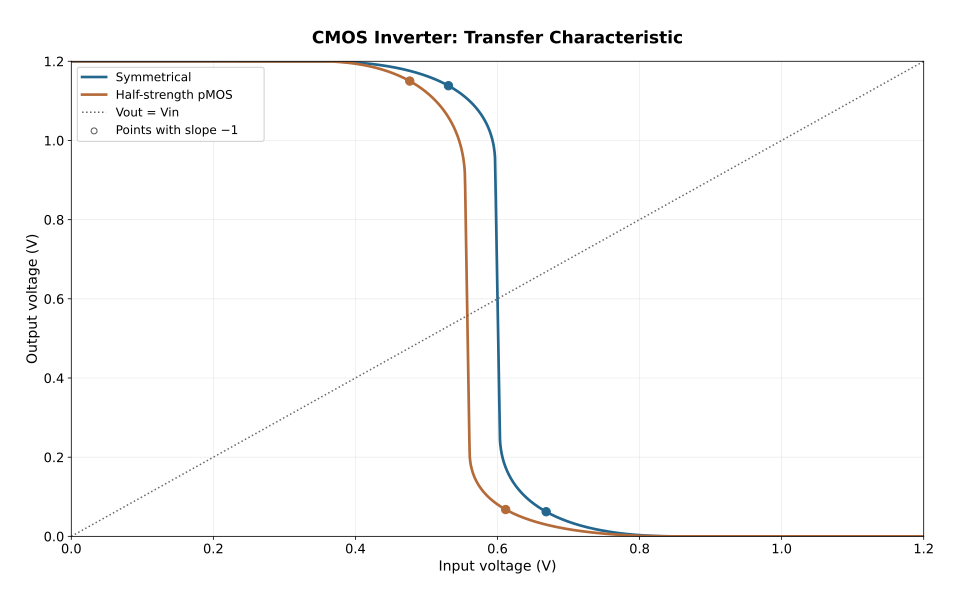

# M14-L2 – CMOS Inverters and Static Logic {#L2}

**Course area:** M14 – Bachelor: Microelectronic Circuits and Systems

**Level:** Bachelor · Elective

**Prerequisites:** [Boolean logic](M3-L5.md), [MOSFET models](M14-L1.md).

**Learning objective:** Determine the static transfer characteristic of a CMOS inverter and explain the switching threshold, noise margins and logic gate networks.

## Complementary Pull-up and Pull-down Networks {#S1}

A CMOS inverter has a pMOS between $V_{DD}$ and the output, and an nMOS between the output and ground. Their gates are connected to the same input. When the input is low, the pMOS conducts and the nMOS is off; the output is charged to the supply voltage. When the input is high, their roles are reversed. In the ideal static model, the gate of a subsequent logic gate does not place a DC current load on the output.

Logical inversion is not equivalent to linear amplification. Between the two states, both transistors may conduct. In this region, the output depends on the current balance. In real transistors, leakage currents remain even outside the transition region.

## Transfer Characteristic and Switching Threshold {#S2}

We use $V_{DD}=1.2$ V, $V_{Tn}=|V_{Tp}|=0.35$ V and $\beta_n=\beta_p=200$ µA/V². The characteristic is obtained by solving

$$
I_n(V_{in},V_{out})=I_p(V_{DD}-V_{in},V_{DD}-V_{out}).
$$

The pMOS current is defined as a positive magnitude flowing towards the output. At the intersection $V_{out}=V_{in}=V_M$, both transistors are in saturation for positive overdrives. Neglecting output conductance, the equation can be solved for $V_M$:

$$
V_M=\frac{\sqrt{\beta_p}(V_{DD}-|V_{Tp}|)+\sqrt{\beta_n}V_{Tn}}{\sqrt{\beta_p}+\sqrt{\beta_n}}.
$$

The symmetrical model gives $V_M=0.6$ V. If $\beta_p$ is halved, the transition moves towards lower input voltages ($V_M\approx0.557$ V without the correction). Transistor drive strength is not determined by geometrical width alone: pMOS and nMOS have different mobilities in many processes.

{alt="Static output voltage versus input voltage for both inverters, with the slope criterion points and diagonal marked."}

## Noise Margins {#S3}

The points $V_{IL}$ and $V_{IH}$ are determined on the falling transfer characteristic where the slope is $dV_{out}/dV_{in}=-1$. For compatible identical inverters, we conservatively set $V_{OH}=V_{out}(V_{IL})$ and $V_{OL}=V_{out}(V_{IH})$. The static noise margins are

$$
NM_L=V_{IL}-V_{OL},\qquad NM_H=V_{OH}-V_{IH}.
$$

Using the extended MOS model from L1 ($\lambda=0.08$/V) gives approximately the following values. The conservative output levels are not the ideal supply rails.

| Model | $V_{IL}$ | $V_{IH}$ | $V_{OL}$ | $V_{OH}$ | $NM_L$ | $NM_H$ |
| --- | ---: | ---: | ---: | ---: | ---: | ---: |
| Symmetrical | 0.531 V | 0.669 V | 0.062 V | 1.138 V | 0.469 V | 0.469 V |
| Weaker pMOS | 0.477 V | 0.612 V | 0.067 V | 1.150 V | 0.409 V | 0.538 V |

Static noise margins concern DC voltage deviations, not brief noise pulses, coupling or timing. A smaller low-level noise margin cannot automatically be compensated for by a larger high-level noise margin.

## From the Inverter to NAND and NOR {#S4}

For a two-input NAND, two nMOS devices are connected in series and two pMOS devices in parallel. A conducting path to ground exists only when both inputs are high. For a NOR, two nMOS devices are connected in parallel and two pMOS devices in series. The complementary networks implement De Morgan's laws; an AND can be constructed using a NAND and an inverter.

| A | B | NAND | NOR |
| ---: | ---: | ---: | ---: |
| 0 | 0 | 1 | 1 |
| 0 | 1 | 1 | 0 |
| 1 | 0 | 1 | 0 |
| 1 | 1 | 0 | 0 |

In a real cell, the series connection may limit the current and therefore increase delay. Intermediate nodes have their own capacitances and voltages, so simply adding constant channel resistances is only an approximation. Gate libraries therefore characterise each input and transition direction for several load and edge conditions. A truth table alone is insufficient for clock planning.

## Exercises with Solutions {#S5}

1. Why does doubling both $\beta$ values leave the static characteristic unchanged in the symmetrical model?  
   **Solution** Both currents scale equally. Their equality condition is unchanged; dynamic currents and capacitances may change.
2. A receiving gate guarantees a low input up to 0.45 V. A driver guarantees a low output of at most 0.12 V. What low-level noise margin is available?  
   **Solution** 0.33 V. The limits must be appropriate for the connected logic family and the operating range under consideration.
3. Why is an output voltage of 0.6 V not a valid logic level in the symmetrical model?  
   **Solution** It lies between $V_{IL}$ and $V_{IH}$; there is no guaranteed logical interpretation. Both transistors may conduct.

**Further reading:** [Dynamics and power requirements of integrated circuits](M14-L3.md)

## Sources {#S6}

- [MIT OCW 6.012 – Lectures 14–15: Inverters and CMOS](https://ocw.mit.edu/courses/6-012-microelectronic-devices-and-circuits-fall-2009/pages/lecture-notes/) · Lectures 14–15: CMOS inverter analysis and switching; lecture table only. · Last accessed: 2026-11-25
- [Computation Structures – CMOS, static behaviour](https://computationstructures.org/notes/cmos/notes.html) · Chapter 6: CMOS NAND and NOR circuits; partial scope. · Last accessed: 2026-11-25
