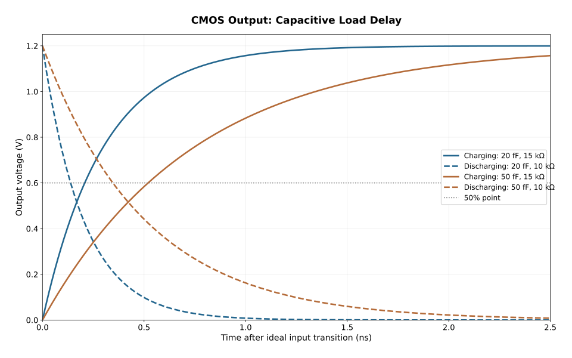

# M14-L3 – Dynamics and Power Requirements of Integrated Circuits {#L3}

**Course area:** M14 – Bachelor: Microelectronic Circuits and Systems

**Level:** Bachelor · Elective

**Prerequisites:** [RC transients](M1-L5.md), [CMOS logic](M14-L2.md).

**Learning objective:** Distinguish and estimate capacitive delays and the dynamic, static and short-circuit power components of a CMOS circuit.

## Charging and Discharging an Output Node {#S1}

The static equivalent circuit is extended to include the load capacitance $C_L$. It comprises the input capacitances of subsequent gates, junction capacitances and interconnect contributions. For fast input switching, we first approximate the conducting transistors by separate resistances $R_p$ and $R_n$. For charging from zero and discharging from $V_{DD}$,

$$
V_{out,\uparrow}(t)=V_{DD}(1-e^{-t/(R_p C_L)}),\qquad
V_{out,\downarrow}(t)=V_{DD}e^{-t/(R_n C_L)}.
$$

The delay between the 50% point of the ideal input transition and the 50% point of the output is approximately $t_{pLH}=\ln(2)R_p C_L$ or $t_{pHL}=\ln(2)R_n C_L$, respectively. The rise time from 10 to 90% is $\ln(9)R_p C_L$. A propagation delay is therefore not the same as a transition time.

Example: $C_L=20$ fF, $R_n=10$ kΩ and $R_p=15$ kΩ. Then $\tau_n=0.2$ ns and $\tau_p=0.3$ ns; $t_{pHL}=0.139$ ns and $t_{pLH}=0.208$ ns. The longer 10–90% rise time is 0.659 ns. If the capacitance doubles while the resistances remain unchanged, these times double.

{alt="RC charging and discharging curves for 20 and 50 fF, with the 50% point and different channel resistances."}

## Energy Balance of a Complete Charge Cycle {#S2}

When charging from 0 to $V_{DD}$, the supply delivers the energy

$$
E_{source}=\int V_{DD}i(t)dt=C_L V_{DD}^2,
$$

of which $C_L V_{DD}^2/2$ is stored in the capacitor's electric field. The other half is converted into heat in the charging path. During discharge, the discharge path dissipates the stored half. Over a complete voltage swing, the net change in stored energy is zero. The energy demand per 0–1–0 cycle is $C_L V_{DD}^2$, independently of the chosen constant resistance, provided that full charging and discharging are achieved and there is no energy recovery.

At 1.2 V and 20 fF, this amounts to 28.8 fJ per cycle. A periodic signal at 100 MHz has exactly one charging event per period: the average ideal capacitive power is 2.88 µW. At 0.8 V with the same load, it would be 1.28 µW. However, the lower voltage can substantially reduce transistor currents and hence switching speed.

## Activity Factor and Other Power Components {#S3}

In a synchronous system, let $\alpha_i$ denote the mean number of 0–1 transitions at node $i$ per clock period. With this unambiguous convention and full voltage swings,

$$
P_{dyn}=V_{DD}^2 f_{clk}\sum_i\alpha_i C_i.
$$

If both edges are counted instead of only the charging edges, a factor of 1/2 is needed for equal numbers of rising and falling edges. Glitches can increase activity beyond the number expected from the functional logic alone.

Example: 1000 nodes of 20 fF each, $\alpha=0.1$, $f=100$ MHz and 1.2 V: $P_{dyn}=288$ µW. In addition, short-circuit currents occur when pMOS and nMOS conduction overlaps during finite transition times, and leakage currents cause static power consumption. An ideal static CMOS gate state is therefore not equivalent to a real lossless chip.

## Loads, Interconnects and Design Budget {#S4}

For example, a gate drives a fixed interconnect capacitance of 8 fF and three identical inputs of 4 fF each. This results in 20 fF. If six inputs rather than three are connected, the load is 32 fF; the RC delay increases by a factor of 1.6. In the actual layout, interconnect resistance, coupling and distributed capacitances may also dominate. A long conductor can then no longer be usefully modelled as a single capacitor.

A simple timing budget for a synchronous register chain is $T_{clk}\ge t_{CQ}+t_{comb}+t_{setup}+t_{reserve}$. With 0.3 ns, 2 ns, 0.2 ns and 0.5 ns, the chain requires at least 3 ns (at most approximately 333 MHz under the model assumptions). A separate hold-time check for the shortest path is also required. Clock skew and jitter cannot be accounted for solely by an average delay.

## Exercises with Solutions {#S5}

1. What is $t_{pHL}$ at 50 fF and 10 kΩ?  
   **Solution** $\tau=0.5$ ns; $t_{pHL}=0.347$ ns.
2. By how much does $P_{dyn}$ decrease if the voltage changes from 1.2 to 0.9 V while activity, capacitance and frequency remain unchanged?  
   **Solution** Factor $(0.9/1.2)^2=0.5625$; 43.75% lower. Whether the original frequency remains achievable must be checked separately.
3. Why must $C_L V_{DD}^2 f$ not be used as an exact result for an incomplete voltage swing?  
   **Solution** The actual change in charge is smaller and short-circuit current may flow at the same time; the energy must be obtained by integrating the product of supply voltage and supply current.

**Further reading:** [Basic on-chip analogue building blocks](M14-L4.md)

## Sources {#S6}

- [MIT OCW 6.012 – Lectures 15–16: Inverter switching delay](https://ocw.mit.edu/courses/6-012-microelectronic-devices-and-circuits-fall-2009/pages/lecture-notes/) · Lectures 15–16 (index): switching delay, power and leakage. · Last accessed: 2026-11-25
- [Computation Structures – CMOS, dynamic behaviour](https://computationstructures.org/notes/cmos/notes.html) · Chapter 6 CMOS, introduction: parasitic capacitances, switching and power consumption; qualitative relevance. · Last accessed: 2026-11-25
