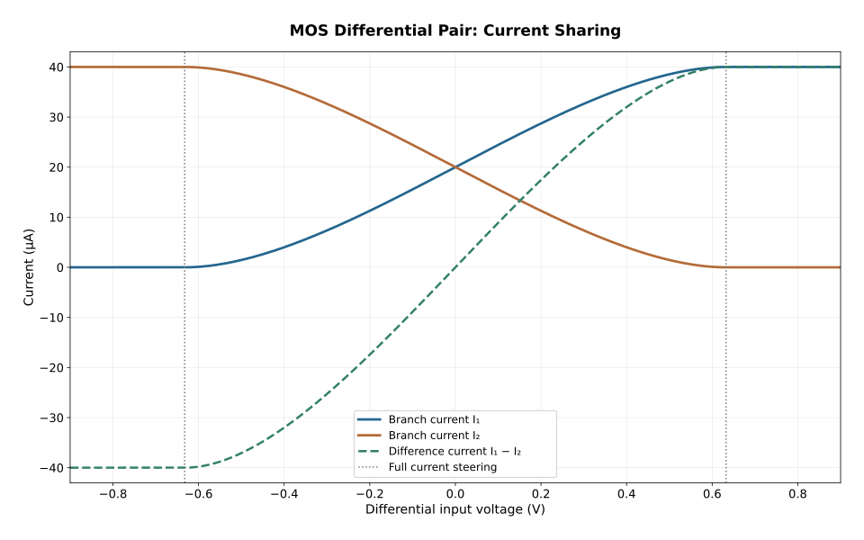

# M14-L4 – Basic Analogue Building Blocks at Chip Level {#L4}

**Course area:** M14 – Bachelor: Microelectronic Circuits and Systems

**Level:** Bachelor · Elective

**Prerequisites:** [Analogue signal conditioning](M3-L4.md), [MOSFET models](M14-L1.md).

**Learning objective:** Size current mirrors and differential stages, verify operating regions and assess the trade-offs between gain, voltage swing and current consumption.

## Current Mirrors and Biasing {#S1}

In its simplest form, an nMOS current mirror consists of a transistor with its gate and drain connected and a second transistor at the same gate potential. The source terminals are grounded. The reference current sets the gate-source voltage. For both transistors in saturation, neglecting output conductance and assuming equal threshold voltages,

$$
\frac{I_{out}}{I_{ref}}=\frac{\beta_2}{\beta_1}=\frac{(W/L)_2}{(W/L)_1}.
$$

With $I_{ref}=20$ µA and $\beta_1=200$ µA/V², the ideal overdrive is $q=\sqrt{2 I_{ref}/\beta_1}=0.447$ V and $V_{GS}=0.797$ V. A second transistor with twice the width-to-length ratio ideally mirrors 40 µA. It requires a drain voltage of at least $q$ to do so. Below this voltage it leaves saturation and the current falls. This minimum voltage headroom is referred to as the compliance voltage.

Including output conductance, the mirror ratio is corrected for a known common gate voltage and equal $\lambda$ values:

$$
\frac{I_{out}}{I_{ref}}=\frac{\beta_2}{\beta_1}\frac{1+\lambda V_{DS2}}{1+\lambda V_{DS1}}.
$$

With $V_{GS}=0.8$ V, $V_{DS1}=0.8$ V, $V_{DS2}=0.5$ V and $\lambda=0.08$/V, the ratio for twice the width is approximately 1.955 rather than 2. Here the gate voltage is prescribed and the reference current follows from the model. Small geometry and threshold-voltage mismatches further reduce mirror accuracy. Cascoding improves output resistance but requires additional voltage headroom.

## Differential Amplifier {#S2}

Two identical nMOS transistors with connected source terminals share an ideal tail current $I_T$. Let the gate voltages be $V_{G1}=V_{CM}+v_d/2$ and $V_{G2}=V_{CM}-v_d/2$. At $v_d=0$, each transistor carries $I_T/2$. An increasing differential signal raises one branch current and lowers the other; the sum remains constant. We assume identical transistors in saturation and initially set $\lambda=0$.

With $q$ denoting the mean of the two overdrive voltages, the sum of the square-law currents gives

$$
I_T=\beta(q^2+v_d^2/4),\qquad q=\sqrt{I_T/\beta-v_d^2/4}.
$$

As long as both transistors conduct and remain in saturation,

$$
I_1-I_2=\beta v_d\sqrt{I_T/\beta-v_d^2/4}.
$$

At $|v_d|=\sqrt{2I_T/\beta}$, one of the branch currents reaches zero. Beyond this point the entire current flows through the other branch, provided its saturation condition still holds. A differential pair limits large input differences rather than amplifying them linearly without bound.

{alt="Idealised branch currents of a differential pair and their difference at a total current of 40 µA, including the full current-steering limits."}

## Gain and Voltage Headroom {#S3}

Let $I_T=40$ µA and $\beta=200$ µA/V² per branch. At the symmetrical operating point, $q=\sqrt{I_T/\beta}=0.447$ V and $g_m=\beta q=89.44$ µS. Two equal drain resistors $R_D=10$ kΩ connected to $V_{DD}=1.2$ V each yield $V_D=1.0$ V. With $V_{CM}=0.95$ V, the common source is at 0.153 V in the ideal model. At $v_d=0$, the input MOSFETs are in saturation with $V_{DS}=0.847$ V. A real tail current source would, however, have to operate at just 0.153 V; this is precisely one of the design challenges at low supply voltages.

For the differential output signal $v_{od}=v_{o1}-v_{o2}$, the approximate gain is

$$
A_d=\frac{v_{od}}{v_d}\approx -g_mR_D=-0.894.
$$

A single-ended output taken from one branch would ideally have half the magnitude of the differential gain. At $v_d=50$ mV, the large-signal formula gives currents of approximately 22.233 µA and 17.767 µA; the output difference is −44.65 mV. This agrees closely with the small-signal calculation. The formal current distribution for large $v_d$ does not yet guarantee that both drain voltages remain within the permissible range.

## Interface Between Analogue and Digital Circuits {#S4}

A differential stage is at the heart of many input amplifiers and comparators. A precision linear amplifier requires sufficient loop gain, bandwidth and suitable negative feedback. A comparator, by contrast, is usually designed for rapid decisions and defined output levels; it cannot be used as an operational amplifier without verification.

Active loads can provide high output resistance with a smaller static voltage drop. Higher output impedance and node capacitance, however, produce a longer time constant. Increasing transistor area can reduce random mismatch but increases capacitances. A higher bias current increases $g_m$ at the same $\beta$ but consumes more power. The idealised pair above draws $1.2\cdot40$ µA = 48 µW from the supply (excluding separate reference branches).

## Exercises with Solutions {#S5}

1. How can an ideal mirror produce 10 µA from 20 µA?  
   **Solution** The ratio $(W/L)_2/(W/L)_1$ is 0.5. The output still requires sufficient drain voltage.
2. Determine the differential current at $v_d=0$ and $I_T=40$ µA.  
   **Solution** Zero; both branches carry 20 µA each.
3. What differential small-signal gain would result from 20 kΩ instead of 10 kΩ?  
   **Solution** Formally −1.789. However, the quiescent drain voltage drops to 0.8 V; output headroom and saturation conditions must be checked again.

**Further reading:** [Design and simulation case study](M14-L5.md)

## Sources {#S6}

- [MIT OCW 6.012 – Lectures 17 and 19–20: current mirrors, differential amplifiers, active loads](https://ocw.mit.edu/courses/6-012-microelectronic-devices-and-circuits-fall-2009/pages/lecture-notes/) · Lectures 17–21 (index): analog amplifier stages and current mirrors. · Last accessed: 2026-11-25
