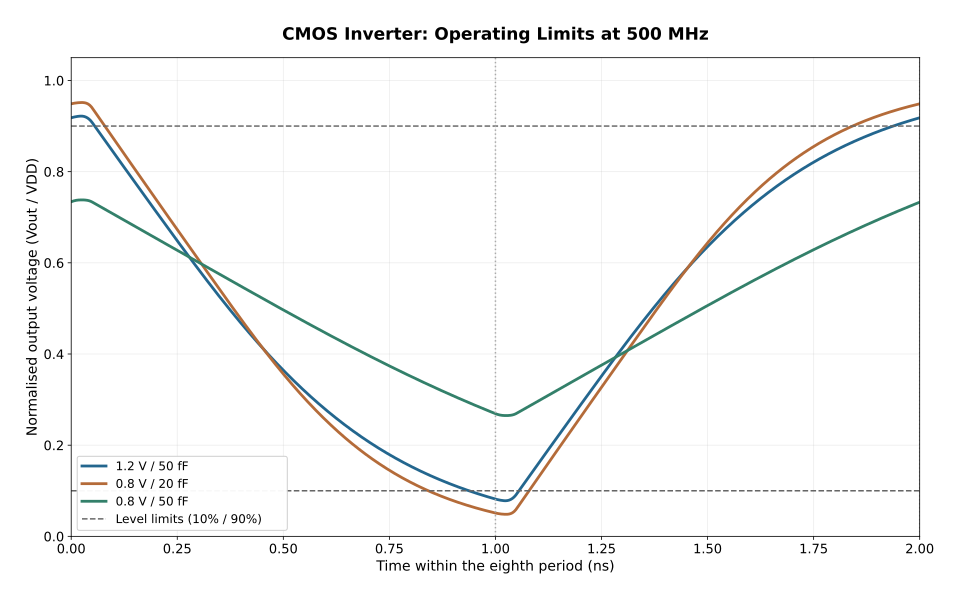

# M14-L5 – Design and Simulation Case Study {#L5}

**Course area:** M14 – Bachelor: Microelectronic Circuits and Systems

**Level:** Bachelor · Elective

**Prerequisites:** [MOSFETs](M14-L1.md), [Noise margins](M14-L2.md), [Switching dynamics](M14-L3.md), [Numerical integration](M12-L3.md).

**Learning objective:** Simulate a nonlinear inverter numerically and derive a suitable operating range from signal levels, load, frequency and energy requirements.

## Design Task and Model Limitations {#S1}

An output driver is to drive a subsequent digital block. The design is investigated using a synthetic CMOS model rather than a specific manufacturing process. The available design variables are supply voltage, external load capacitance and input frequency. Both transistors in the model have $\beta=200$ µA/V², $|V_T|=0.35$ V and $\lambda=0.08$/V. We use the extended large-signal model from [L1](M14-L1.md), omitting gate, Miller and temperature-dependent capacitances as well as subthreshold currents. The load capacitance is constant.

At the end of each half of the input period, the task requires an output level no higher than $0.1V_{DD}$ or no lower than $0.9V_{DD}$, respectively. These self-imposed criteria are stricter than merely crossing the switching threshold. They are neither a technology specification nor a complete setup/hold verification. The input voltage rises and falls linearly within 0.05 ns each; the two transitions begin at 0 and $T/2$, respectively.

## Nonlinear Differential Equation and Energy {#S2}

At the output node, taking the positive current direction from the pMOS to the node and from the node to the nMOS, respectively,

$$
C_L\dot v=I_p(V_{DD}-V_{in},V_{DD}-v)-I_n(V_{in},v).
$$

The energy $E_s$ drawn from the supply and the energy $E_d$ dissipated in the two conducting channels can be integrated simultaneously as two additional states:

$$
\dot E_s=V_{DD}I_p,\qquad \dot E_d=vI_n+(V_{DD}-v)I_p.
$$

Multiplying the node equation by $v$ directly gives $\dot E_s-\dot E_d=C_Lv\dot v$. Thus, for any time interval,

$$
\Delta E_s-\Delta E_d=\frac{C_L}{2}(v_{Ende}^2-v_{Start}^2).
$$

Here the original subscripts Ende and Start denote the end and beginning of the interval. In periodic steady state, the right-hand side vanishes. The energy balance is also valid for a period that has not yet reached steady state. As the model uses current in µA, capacitance in fF and time in ns, µA/fF = V/ns and µA·V·ns = fJ. Average power in fJ/ns corresponds to µW. Only the inverter supply branch is included in the energy balance; the external input driver is excluded.

## Reproducible Simulation {#S3}

We integrate using the fourth-order Runge–Kutta method from [M12-L3](M12-L3.md) and compare two step sizes. The eighth period is evaluated after seven complete preceding periods. This is a fixed settling time, not a mathematical proof of steady state. The code requires Python and NumPy. The static bisection function `dc` can be used separately to check the equilibrium points from [L2](M14-L2.md).

```python
import numpy as np
from math import sqrt

def ids(vg, vd, beta=200., vt=.35, lam=.08):
    q=max(vg-vt,0.)
    d=max(vd,0.)
    return beta*(q*d-d*d/2 if d<q else q*q/2)*(1+lam*d)

def currents(vin,vout,vdd,bn=200,bp=200):
    return ids(vin,vout,bn),ids(vdd-vin,vdd-vout,bp)

def dc(vin,vdd,bp=200):
    lo,hi=0.,vdd
    for _ in range(65):
        m=(lo+hi)/2
        n,p=currents(vin,m,vdd,bp=bp)
        if p>n: lo=m
        else: hi=m
    return (lo+hi)/2

def simulate(vdd=1.2,c=20.,f=100.,step=.002):
    period=1000/f # ns
    ramp=.05 # ns
    n=max(1,round(period/step)); n=2*((n+1)//2)
    h=period/n
    def vin(t):
        x=t%period
        if x<ramp: return vdd*x/ramp
        if x<period/2: return vdd
        if x<period/2+ramp: return vdd*(1-(x-period/2)/ramp)
        return 0.
    def rhs(t,z):
        v=z[0]; i,j=currents(vin(t),v,vdd)
        return np.array([(j-i)/c,vdd*j,v*i+(vdd-v)*j])
    z=np.array([vdd,0.,0.]); trace=[]
    for k in range(8*n+1):
        t=k*h
        if k>=7*n: trace.append((t-7*period,vin(t),*z))
        if k==8*n: break
        a=rhs(t,z); b=rhs(t+h/2,z+h*a/2); d=rhs(t+h/2,z+h*b/2); e=rhs(t+h,z+h*d)
        z+=h*(a+2*b+2*d+e)/6
    x=np.array(trace); es=x[-1,3]-x[0,3]; ed=x[-1,4]-x[0,4]; de=c/2*(x[-1,2]**2-x[0,2]**2)
    assert abs(es-ed-de)<1e-4 and np.min(x[:,2])>=-1e-7 and np.max(x[:,2])<=vdd+1e-7
    return x, (x[n//2,2],x[-1,2],es,es/period,abs(es-ed-de))

cases = [(1.2,20,100), (1.2,50,100), (1.2,50,500),
         (.8,20,100), (.8,20,500), (1.2,20,1000),
         (.8,50,500), (1.2,50,1000)]
for vdd,c,f in cases:
    x,r=simulate(vdd,c,f)
    _,fine=simulate(vdd,c,f,step=.001)
    assert max(abs(np.array(r[:4])-fine[:4]))<1e-4
    valid = r[0]<=.1*vdd and r[1]>=.9*vdd
    print(vdd,c,f,*(round(v,5) for v in r[:4]),valid)

```

The results are rounded to two to five decimal places. $V_L$ and $V_H$ are evaluated just before the start of the respective next input transition. $E_s$ is the energy in the eighth period, and $P_s$ is its average input power at the supply pin.

| $V_{DD}$ (V) | $C_L$ (fF) | $f$ (MHz) | $V_L$ (V) | $V_H$ (V) | $E_s$ (fJ) | $P_s$ (µW) | Level test |
| ---: | ---: | ---: | ---: | ---: | ---: | ---: | --- |
| 1.2 | 20 | 100 | 0.00000 | 1.20000 | 28.80 | 2.88 | Pass |
| 1.2 | 50 | 100 | 0.00000 | 1.20000 | 72.00 | 7.20 | Pass |
| 1.2 | 50 | 500 | 0.09818 | 1.10182 | 60.84 | 30.42 | Pass |
| 0.8 | 20 | 100 | 0.00000 | 0.80000 | 12.80 | 1.28 | Pass |
| 0.8 | 20 | 500 | 0.04097 | 0.75903 | 11.56 | 5.78 | Pass |
| 1.2 | 20 | 1000 | 0.05723 | 1.14277 | 26.42 | 26.42 | Pass |
| 0.8 | 50 | 500 | 0.21528 | 0.58642 | 15.11 | 7.55 | Fail |
| 1.2 | 50 | 1000 | 0.30717 | 0.89290 | 36.68 | 36.68 | Fail |

{alt="Output voltage traces at 500 MHz for 1.2 V with 50 fF and 0.8 V with 20 or 50 fF, normalised to the supply voltage, with level limits."}

## Interpretation and Design Decision {#S4}

At 100 MHz, both the 0.8 V and the 1.2 V variants with 20 fF reach almost the full voltage swing. Their power ratio is therefore approximately $0.8^2/1.2^2=0.444$. At a higher frequency or with a larger load, the available charging and discharging time becomes decisive. The 0.8 V case with 50 fF at 500 MHz consumes less power than the corresponding 1.2 V variant but fails the signal-level requirement. The lower energy per period here is partly a consequence of incomplete charging and discharging, not an equivalent improvement in efficiency.

For the example specification of 500 MHz and 50 fF, 1.2 V is the working choice among the operating points tested. At 0.8 V, the load would have to be reduced or the effective drive strength increased for this frequency. Another option would be to lower the frequency. The eight cases do not establish an exact maximum frequency; a finer parameter search including a margin would be necessary for that.

Repeating the calculation with approximately 1 ps instead of 2 ps changes the first four output quantities by less than $10^{-4}$ in their respective units. The energy balance error is below $10^{-4}$ fJ in both calculations. For the two cases that fail, the difference between the initial and final voltages of the eighth period is less than 1 mV; it is not exactly zero. The energy balance accounts for this residual change. The good numerical agreement verifies only the simplified model and its solution. Real process variation, temperature, parasitic coupling, input drivers, supply voltage drops and actual timing conditions remain unaddressed. Chip implementation would require a process-specific SPICE model, layout extraction and tests across process, voltage and temperature corners (PVT).

## Exercises with Solutions {#S5}

1. Why is $E_s$ in the third table row below the ideal full-swing value of 72 fJ?  
   **Solution** The output only traverses approximately 0.098 to 1.102 V. The charge transferred from the supply is smaller; a small overlap current is also possible.
2. At 0.8 V, 50 fF and 500 MHz, what is the maximum permissible low level?  
   **Solution** 0.08 V. The calculated value of 0.21528 V clearly misses the target. The high level is also below 0.72 V.
3. Which two independent checks reveal an integration error?  
   **Solution** Step-size comparison and energy conservation; both check numerical consistency. A separate experiment with real hardware would be necessary to assess model validity.
4. In the code, double the capacitance to 40 fF at 0.8 V and 500 MHz. What is to be expected?  
   **Solution** The slower voltage change causes the voltage swing to deteriorate; the levels must be checked using the new simulation. Proportional scaling of the entire waveform would not be correct for the same period.

**Further reading:** [Digital circuit and analogue interface](M3-L7.md); the next specialisation module M15 covers embedded systems.

## Sources {#S6}

- [MIT OCW 6.012 – Lectures 14–16: CMOS and switching delay](https://ocw.mit.edu/courses/6-012-microelectronic-devices-and-circuits-fall-2009/pages/lecture-notes/) · Lectures 14–16: switching delay, power, scaling; lecture table only. · Last accessed: 2026-11-25
- [Steve Ward – Computation Structures, Chapter 6: CMOS](https://computationstructures.org/notes/cmos/notes.html) · § 6.1 and § 6.5: capacitive switching and voltage dependence of power; not evidence of a SPICE simulation. · Last accessed: 2026-11-25
