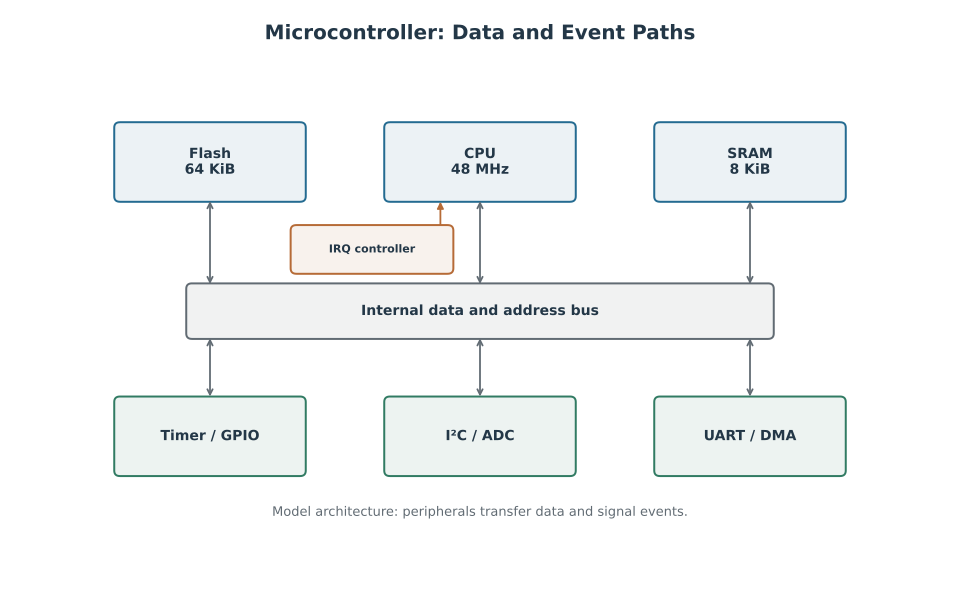

# M15-L1 – Microcontrollers, Memory and Peripherals {#L1}

**Course area:** M15 – Bachelor: Embedded Systems

**Level:** Bachelor · Elective

**Prerequisites:** [Digital logic](M3-L5.md), [Storage elements](M3-L6.md).

**Learning objective:** Read a microcontroller architecture and establish an explicit memory and computing budget for a sensor node.

## From a Program to an Embedded System {#S1}

An embedded system is a computer whose function is integrated into a larger engineering task. A microcontroller (MCU) combines a processor core, program memory, working memory and peripherals on a single chip. A sensor device, for example, must not only calculate a measured value but also read it within a specified time, check its validity and forward it. Electrical and timing behaviour are therefore part of the design.

The processor core contains registers, an arithmetic unit, a control unit and a program counter. Flash retains instructions and constant data even without power; SRAM holds mutable data, the call stack and buffers. Peripherals perform time-critical tasks: timers count autonomously, GPIO controls and reads pins, an ADC digitises analogue inputs, and serial interfaces transmit data. An interrupt controller relays events to the processor core. Direct memory access (DMA) can transfer data between peripherals and RAM without a CPU instruction for each byte. Configuration, synchronisation and completion handling remain necessary.

{alt="Block diagram of an MCU with CPU, flash, SRAM, bus, timer, interrupt controller and sensor/UART interfaces."}

## Address Space and Register Access {#S2}

With memory-mapped I/O, control and status registers appear in the CPU address space. Reading a status register differs from reading SRAM: it can have hardware-dependent side effects. Address allocation and permitted write operations are defined by the datasheet, not by the C language.

For a fictional 32-bit control register with enable bit 3, the mask is $m=2^3=8$. For an ordinary readable and writable register, `CTRL |= (1u << 3)` sets the bit while preserving the other bits; `CTRL &= ~(1u << 3)` clears it. A write-one-to-clear status bit, however, is acknowledged by writing a one. A read-modify-write operation could inadvertently clear additional bits there. With concurrent access, the entire read-modify-write sequence is not atomic even for an ordinary register.

A `volatile`-qualified register access in C tells the compiler that observable accesses must not simply be eliminated. It provides neither safe data exchange between contexts nor general memory barriers. Device headers and the manufacturer's documented access rules take precedence. The addresses of one MCU family cannot be transferred to arbitrary other controllers.

## Memory Budget of the Sensor Node {#S3}

Throughout this module we design a fictional device with a 48 MHz CPU clock, 64 KiB of flash and 8 KiB of SRAM. These figures are model assumptions, not a specific product. A record occupies 12 bytes on the transmission line (see [M15-L4](M15-L4.md)); it is stored in the buffer as exactly 12 bytes, without struct padding. All other memory items are budgeted separately.

| SRAM area | Bytes |
| --- | ---: |
| Application and drivers, static data | 2048 |
| Stack including nested interrupts (budget) | 1536 |
| 16 waiting records | 192 |
| Active transmit buffer including auxiliary data | 32 |
| Diagnostic and receive buffers | 512 |
| Queue counters and management data | 64 |
| Total | 4384 |

$$M_{frei}=8192-4384=3808\ \mathrm{Byte}.$$

Here the subscript frei denotes free memory. With 32 waiting records the total increases by 192 bytes to 4576 bytes. The budget is not a measurement of actual consumption: the linker script, map file, alignment, libraries, stack high-water mark and, where applicable, DMA memory areas must be verified in the hardware design. For flash we assume 36 KiB of program memory including constants; 28 KiB remains for extensions and potential boot/update areas. An initialised global object may occupy both flash (initial values) and SRAM (mutable runtime copy).

## Computing Time and Design Decision {#S4}

At 100 measurements per second and 48 MHz, ideally 480000 clock cycles are available per measurement interval. If the CPU portion requires 100 µs, this corresponds to 4800 cycles or 1% of the available time. The number of cycles is not an instruction count: pipelines, memory buses, flash wait states and multi-cycle operations affect execution time. The remaining time can be used for other tasks or sleep states. However, sleep only reduces average power if the corresponding clock and power domains are actually switched off; wake-up latency and energy must be considered.

An average utilisation of 1% does not guarantee a deadline. If a long, non-interruptible driver call starts just before the sampling deadline, a measurement may start too late despite the CPU being mostly idle. In [M15-L2](M15-L2.md) we therefore calculate with deadlines and maximum blocking times.

## Exercises with Solutions {#S5}

1. How many additional bytes are required for 64 instead of 16 records?  
   **Solution:** $48\cdot12=576$ bytes, provided the queue management budget remains unchanged.
2. Why would it be incorrect to interpret the clock frequency directly as the number of C lines executable per second?  
   **Solution:** The compiler and architecture translate a line into different instruction sequences; their execution time varies.
3. A status register clears set flags when a one is written. How do you acknowledge bit 3 alone?  
   **Solution:** Under the hypothetical register contract, write only `1u << 3`; the other bits are unaffected when written as zero. Do not use read-modify-write.
4. The map file shows 2600 rather than 2048 bytes of static data. Is the budget sufficient for 16 records?  
   **Solution:** 4936 bytes in total, leaving 3256 bytes. Only stack and runtime measurements can further substantiate these assumptions.

## Sources {#S6}

- [ETH Zürich – Core Courses and Specialisations (Bachelor)](https://ee.ethz.ch/studies/bachelor/bsc-eeit/third-year/core-courses.html) · Core Courses: Embedded Systems, Computers and Networks; curricular comparison, not evidence of the specific semester offering. · Last accessed: 2026-11-25
- [Arm CMSIS-Core – Device Header File](https://arm-software.github.io/CMSIS_6/main/Core/device_h_pg.html) · Interrupt Number Definition and Device Peripheral Access Layer: interrupt numbers, register definitions and base addresses; rolling documentation, not pinned to v6.3.0. · Last accessed: 2026-11-25
- [University of Texas at Austin – Embedded and Real-Time Operating Systems, lecture overview](https://users.ece.utexas.edu/~valvano/EE445M/lectures.html) · ECE445M, lecture schedule week 1: microcontroller architecture and peripherals; slides not reviewed. · Last accessed: 2026-11-25
