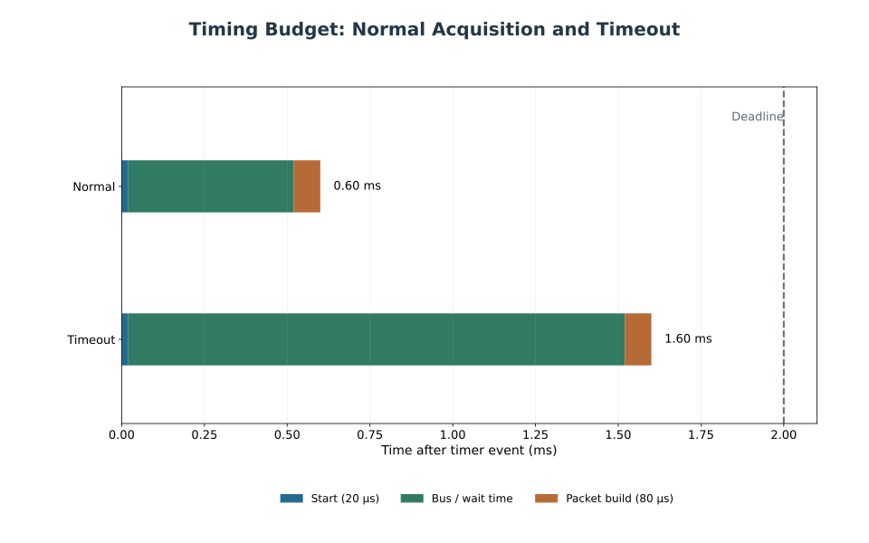

# M15-L2 – Clocks, Timers and Interrupts {#L2}

**Course area:** M15 – Bachelor: Embedded Systems

**Level:** Bachelor · Elective

**Prerequisites:** [Microcontrollers](M15-L1.md), [States and sampling](M13-L2.md).

**Learning objective:** Configure a periodic timer, interpret sampling jitter and verify a deadline using conservative execution-time bounds.

## Timers and Time Base {#S1}

A hardware timer receives a clock signal and counts according to a configurable scheme. For an up-counter with prescaler register $PSC$ and auto-reload register $ARR$, both counted from zero, the interval is

$$T=\frac{(PSC+1)(ARR+1)}{f_{tim}}.$$

For an assumed timer clock of 48 MHz, $PSC=47$ and $ARR=9999$ give a counter clock of 1 MHz and an event after 10000 counts, i.e. every 10 ms. On real hardware the timer clock may differ from the CPU clock. When reconfiguring, buffer registers and update events must be considered; the formula applies to steady-state periodic operation.

Polling (regularly checking) detects an event only at the next polling instant. A perfect 1 ms polling period without blocking produces a detection delay between zero and just under 1 ms. An interrupt signals it independently of the main program, but not necessarily immediately: masking, higher-priority routines and hardware latency delay the start.

## Sequence and Timing Terms {#S2}

The release time $r_k=kT$ denotes the scheduled event, the start time $s_k$ the actual start of work, and the completion time $f_k$ the end of work. The response time is $R_k=f_k-r_k$. A relative deadline $D$ is met if $R_k\le D$. Here jitter describes variation in the actual start relative to the scheduled time. The periodicity of a hardware clock does not guarantee that a sensor read by the main program is sampled periodically.

In the sensor node, the timer instant is recorded as the timestamp of the read request. It is not necessarily the physical sampling instant in the sensor; that depends on when the sensor performed its internal conversion. If the sensor itself measures periodically, its data-ready signal or an internal timestamp must be used if necessary.

{alt="Acquisition timeline showing the start phase, bus waiting time, processing, timeout and 2 ms deadline."}

## A Conservative Timing Budget {#S3}

We require at most 20 µs of CPU time for the start phase, an asynchronous bus operation normally taking 500 µs or a monitored waiting period of up to 1500 µs after the start phase, and 80 µs for completion processing and packet assembly. The undisturbed model takes 600 µs, and the fault case takes 1600 µs. The release interval is 10 ms, and the acquisition/diagnostic deadline is 2 ms. UART transmission follows asynchronously and has its own deadline of 150 ms.

For an extended hardware budget, allow at most 50 µs of start latency and a total of 120 µs of further delay due to higher-priority IRQs or release blocking during acquisition. Subject to these assumptions, which must be demonstrated, we have

$$R_{\mathrm{max}}\le 50+20+1500+80+120=1770\ \mu\mathrm{s}<2000\ \mu\mathrm{s}.$$

This bound makes no independent statement about hardware WCET (worst-case execution time). Without demonstrated execution-time and blocking bounds, it is merely a design budget. The final simulation in [M15-L5](M15-L5.md) uses ideal delays of 600 and 1600 µs; the additional disturbance times are not simulated.

## Concurrency and Counter Wraparound {#S4}

Interrupt service routines (ISRs) should remain short, time-bounded and free of blocking operations. They often flag an event or insert an item into a queue; the main logic processes it. Disabling interrupts for a long time can prevent certain data races but can itself cause missed deadlines. The NVIC in Cortex-M handles prioritised interrupts; the number of interrupts and priority bits depends on the implementation.

A 32-bit counter ticking once per microsecond wraps around after $2^{32}\ \mu\mathrm{s}\approx71{.}58$ minutes. In unsigned 32-bit arithmetic the modular difference also gives elapsed time across one wraparound, provided the actual difference is smaller than the full counter period. To check a deadline, compare the elapsed time since the start with the interval; a naive comparison `now >= deadline` fails at wraparound.

```python
MASK = 0xffffffff
start = 0xfffffff0
now = 0x00000020
elapsed = (now - start) & MASK
assert elapsed == 48
```

With a clock error of, for example, 50 ppm, a 1 s interval may differ by approximately 50 µs; over 1 h this amounts to about 0.18 s. Increasing counter resolution does not eliminate this systematic deviation.

## Exercises with Solutions {#S5}

1. With the counter clock unchanged at 1 MHz, choose the register $ARR$ for 5 ms.  
   **Solution:** 4999.
2. In a fault case the additional delay increases from 120 to 400 µs. Is the 2 ms deadline sufficient?  
   **Solution:** The upper bound rises to 2050 µs. Meeting the deadline is no longer demonstrated, even if individual measurements finish on time.
3. A serial interface transmits while the CPU performs other tasks. Is the transmission duration CPU computing time?  
   **Solution:** No. Only servicing the interface consumes CPU time; data transmission occupies a separate resource.
4. Why does a timestamp taken when UART data arrives not reliably identify the measurement instant?  
   **Solution:** Processing, queue waiting time and transmission delay the arrival by varying amounts. The measurement request or sensor timestamp must be stored separately.

## Sources {#S6}

- [University of Texas at Austin – Embedded and Real-Time Operating Systems, lecture overview](https://users.ece.utexas.edu/~valvano/EE445M/lectures.html) · ECE445M, lecture schedule weeks 1 and 4: timers and timing; slides not reviewed. · Last accessed: 2026-11-25
- [Arm CMSIS-Core – Interrupts and Exceptions (NVIC)](https://arm-software.github.io/CMSIS_6/main/Core/group__NVIC__gr.html) · NVIC API: IRQn, enabling and disabling interrupts; partial scope. · Last accessed: 2026-11-25
