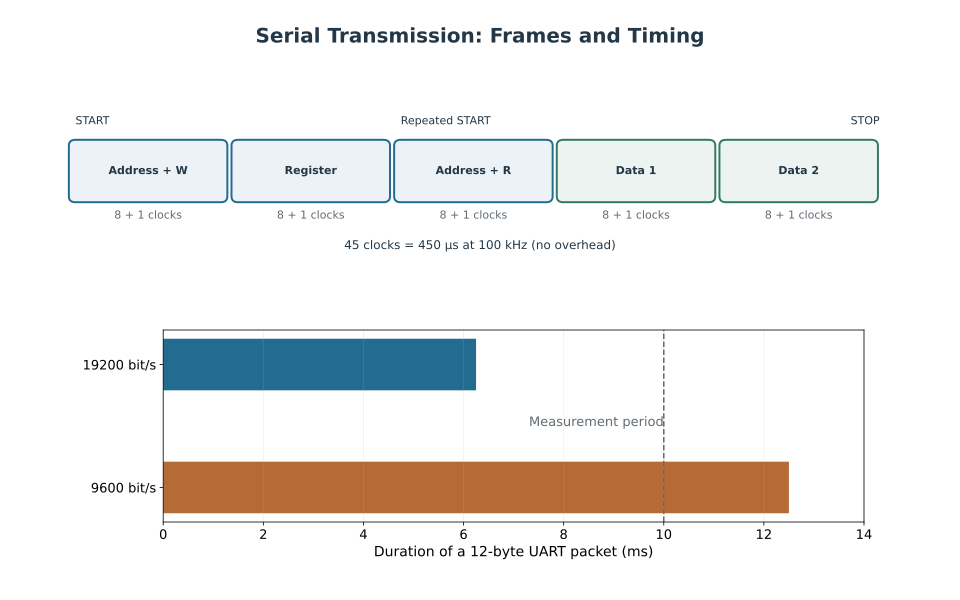

# M15-L3 – Serial Interfaces and Sensor Interfacing {#L3}

**Course area:** M15 – Bachelor: Embedded Systems

**Level:** Bachelor · Elective

**Prerequisites:** [Timers and interrupts](M15-L2.md), [CMOS levels](M14-L2.md).

**Learning objective:** Compare UART, SPI and I²C by transmission method and application limitations, and calculate data rates and electrical connection requirements.

## Three Transmission Methods {#S1}

For an asynchronous UART connection, the transmitter and receiver agree on the bit rate. An 8N1 frame comprises a start bit, eight data bits (least significant bit first), no parity bit and one stop bit. There is no separate clock line. Bidirectional operation usually requires TX, RX and a common ground reference. UART describes the data frame, not automatically the electrical levels of RS-232 or RS-485; these may require transceivers.

SPI is clock-synchronous. A controller generates SCK; separate data lines allow simultaneous transmission and reception in the usual four-wire arrangement. Chip select selects a target. Clock polarity CPOL and clock phase CPHA determine the idle state and sampling edge, respectively. Both devices must use the same mode according to their datasheets. SPI has no general bus standard for device-level addresses, acknowledgement or frame length; these rules depend on the sensor.

With conventional I²C, several devices share SDA (data) and SCL (clock), typically with open-drain outputs and pull-ups. The address selects the target. Each eight bits are followed by an acknowledgement bit. A target can delay the clock signal if clock stretching is supported. START or STOP is indicated by an SDA level transition while SCL is high. Address conflicts, bus loading, pull-up resistances and potentially competing controllers must be checked.

| Property | UART | SPI | I²C |
| --- | --- | --- | --- |
| Clock line | none | SCK | SCL |
| Addressing | not in UART | usually chip select | in bus protocol |
| Data direction | usually TX/RX | usually separate lines | shared SDA |
| Typical local task | diagnostics, data stream | fast ADC, flash | multiple sensors |

## Example: Reading an I²C Sensor Register {#S2}

A fictional sensor uses a 7-bit address `0x48` and an 8-bit register `0x10` for two measurement data bytes. The address bytes on the bus are `0x90` when writing and `0x91` when reading. Software libraries require either the unshifted address or an already shifted address byte, depending on the library. The two must not be confused.

The transaction consists of START, address+W, register byte, repeated START, address+R, first data byte (the controller acknowledges with ACK), second data byte (the controller responds with NACK) and STOP. Each of the five bytes, including the address bytes, requires nine clock cycles including ACK/NACK. Minimum at 100 kHz:

$$t_{bus}=\frac{5\cdot9}{100000}=450\ \mu\mathrm{s}.$$

With a modelled 50 µs for START/STOP/bus-free times and driver transitions, we budget 500 µs without stretching. At 100 measurements/s this is 5% of bus time. At 400 kHz the 45 clocks would ideally take 112.5 µs; the additional budget of 50 µs must be verified independently. Support for the higher rate does not follow from this calculation alone.

{alt="I²C read transaction with five nine-bit groups, and comparison of UART transmission times at 9600 and 19200 bit/s."}

## Electrical Limit of the I²C Bus {#S3}

For an RC pull-up model with bus capacitance $C_b$ and resistance $R_p$, the voltage after releasing the line is $v(t)=V_{DD}(1-e^{-t/(R_pC_b)})$. The rise time between 30 and 70% is

$$t_r=R_p C_b\ln\frac{0{.}7}{0{.}3}\approx0{.}8473R_pC_b.$$

At 3.3 V, 100 pF and 4.7 kΩ, the result is approximately 398 ns. This is below the 1000 ns limit for Standard-mode, but above 300 ns for Fast-mode. With 3.3 kΩ the result is about 280 ns. If the device can reliably sink at least 3 mA at $V_{OL}=0{.}4$ V, the current budget gives $R_{min}=(3{.}3-0{.}4)/0{.}003\approx967\ \Omega$. For Fast-mode at 100 pF, $R_{max}\approx3541\ \Omega$. The choice of 3.3 kΩ lies within this interval but has limited margin for capacitance and resistance tolerances. This does not replace checking component specifications and actual signal edges.

## UART Throughput and Comparison with SPI {#S4}

A 12-byte packet with 8N1 occupies 120 bit periods. Its transmission takes 6.25 ms at 19200 bit/s and 12.5 ms at 9600 bit/s. Transmitting 100 packets/s requires at least 12000 bit/s without pauses. Utilisation at 19200 is 62.5%; at 9600 it is 125%. No buffer depth can compensate for a permanently inadequate data rate.

A hypothetical SPI sensor that uses one command byte followed by two data bytes requires at least 24 µs at 1 MHz plus chip-select and driver times. This is faster than the I²C example but uses additional pins and a device-specific frame. A bus comparison must consider sensor conversion time, electrical topology, energy and interference immunity as well as throughput.

## Exercises with Solutions {#S5}

1. How many 8N1 payload bytes per second can 19200 bit/s theoretically carry?  
   **Solution:** 1920 bytes/s. Application headers and checksums must be counted in this total.
2. The bus capacitance increases to 200 pF. What is the rise time with 3.3 kΩ?  
   **Solution:** About 559 ns; too long for Fast-mode in this model.
3. An SPI controller transmits in mode 0, but the sensor expects mode 3. Is the same frequency sufficient?  
   **Solution:** No. The clock edges and idle state do not match the agreed interface.
4. Why does the I²C controller acknowledge the last byte read with NACK?  
   **Solution:** It signals the end of the read operation to the transmitting target before generating STOP.

## Sources {#S6}

- [NXP – UM10204, I²C-bus specification, Rev. 7.0, §§ 3.1, 6, 7.2](https://www.nxp.com/docs/en/user-guide/UM10204.pdf) · UM10204, Rev. 7.0, p. 9, §3.1.4–3.1.5: start/stop conditions and byte format; partial scope. · Last accessed: 2026-11-25
- [Microchip – SPI Timing, CPOL and CPHA](https://onlinedocs.microchip.com/oxy/GUID-6F1B86DC-C230-43D1-A405-0CC2E7EDF7EE-en-US-2/GUID-EAC2D943-F395-4D47-98C8-4EEBC798BFA2.html) · AVR151, §1.4, Table 1-3: SPI modes and clock edges. · Last accessed: 2026-11-25
- [Microchip – USART Overview, asynchronous operation and 8N1](https://onlinedocs.microchip.com/oxy/GUID-D5344754-46CE-40D6-918B-245670AF7E39-en-US-6/GUID-0DB53D39-B94A-4512-95BD-D6BA10D41F83.html) · §2 Overview: asynchronous 8N1 frame and baud rate; device-specific manual requires separate review. · Last accessed: 2026-11-25
