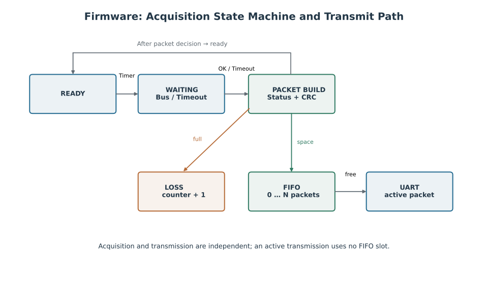

# M15-L4 – Embedded Software as a State Machine {#L4}

**Course area:** M15 – Bachelor: Embedded Systems

**Level:** Bachelor · Elective

**Prerequisites:** [Digital storage](M3-L6.md), [Interfaces](M15-L3.md).

**Learning objective:** Define non-blocking acquisition logic with a timeout, a data format and a bounded FIFO.

## Firmware as Coordination of Independent Tasks {#S1}

Embedded firmware connects hardware drivers, application decisions and data transport. If these functions are mixed in a single blocking loop, the measurement period depends on the transmission duration and bus faults. Clear separation allows the next measurement request to start independently while UART transmission is in progress.

The driver handles registers, bus accesses and hardware notifications. The application logic processes states, thresholds and faults. A transmission component manages the queue. The three components communicate through defined events and data objects. The state machine advances when an event arrives, rather than by continually waiting in a loop.

| State | Event | Action and next state |
| --- | --- | --- |
| Ready | Timer | Record sequence and time, start read → Waiting |
| Waiting | Bus success | Accept measured value → Packet assembly |
| Waiting | Bus fault or timeout | Set fault status, mark measured value invalid → Packet assembly |
| Packet assembly | Queue has space | Append packet → Ready |
| Packet assembly | Queue full | Drop new packet, increment loss counter → Ready |
| Waiting | New timer event (overrun) | Count missed request, do not overwrite ongoing request |

{alt="Acquisition state machine with a timeout path and bounded transmit queue, separate from the UART transmit buffer."}

Successful completion and timeout must unambiguously identify the same request. On cancellation, the driver is reset or placed in a defined fault state; late completion notifications for the cancelled request must not generate a second record. Actual I²C bus recovery is device-dependent. In the case study, a timeout is abstractly modelled as a completed failed read; no electrical bus-recovery algorithm is claimed.

## Ring Buffer and Overload {#S2}

A FIFO returns items in insertion order. A ring buffer with $N$ physical slots also stores the occupancy $n$ here, so that all $N$ slots are usable. Write index $w$ and read index $r$ advance modulo $N$ after each successful access. The invariants are $0\le n\le N$ and $w=(r+n)\bmod N$. For transmission, a complete record is moved from the queue into the separate active transmit buffer. This active record does not count towards queue occupancy.

```python
class Ring:
    def __init__(self, size):
        assert size > 0
        self.buf = [None]*size
        self.r = self.w = self.n = 0
    def push(self, x):
        if self.n == len(self.buf):
            return False
        self.buf[self.w] = x
        self.w = (self.w+1) % len(self.buf)
        self.n += 1
        return True
    def pop(self):
        if not self.n:
            return None
        x = self.buf[self.r]
        self.r = (self.r+1) % len(self.buf)
        self.n -= 1
        return x
q = Ring(3)
assert q.push(1) and q.push(2) and q.push(3)
assert not q.push(4) and q.pop() == 1
assert q.push(4)
assert [q.pop(), q.pop(), q.pop(), q.pop()] == [2,3,4,None]
```

This code is sequential. In actual firmware, the ISR and main program must access indices and occupancy consistently; a suitable short critical section or a proven single-producer/single-consumer method is required. `volatile` alone is insufficient. If a DMA transfer is started, its source must not be overwritten until completion is confirmed.

## An Explicit Data Format {#S3}

A packet is exactly twelve bytes regardless of the compiler; multi-byte numbers are serialised in little-endian order. The sequence counter increments at every scheduled request, even if the packet is subsequently dropped. A sensor fault is valid diagnostic information, not a numerical measurement.

| Byte offset | Content | Format |
| --- | --- | --- |
| 0–1 | Sync word | `AA 55` |
| 2–3 | Sequence | unsigned 16-bit |
| 4–7 | Request time | unsigned 32-bit, µs |
| 8–9 | Raw value | unsigned 16-bit; `FFFF` on fault |
| 10 | Status | 0 valid, 1 timeout |
| 11 | CRC-8 | polynomial 0x07, init 0, MSB first, XOR-out 0 |

The CRC is calculated over the first eleven bytes, including the sync word. For the ASCII bytes `123456789`, this variant produces `F4`. CRC is an error-detection mechanism, not cryptographic authentication or a guarantee against all multi-bit errors. The sync word can also appear within a payload field. If alignment is lost, a receiver must find candidates for the packet boundary, check length and CRC, and continue searching if a candidate is rejected; the sequence counter helps with plausibility checking. Comparisons across counter wraparound use modular arithmetic.

## Which Faults Must Be Distinguished? {#S4}

At $f_s$ measurement requests/s and $B$ bytes per frame, the average generation rate is $\lambda=B f_s$. A transmission pause of 120 ms at 100 Hz can produce approximately twelve newly completed packets. Depending on the phase and an already occupied queue, more items may be waiting. The capacity limit must therefore be checked against the intended load, not just the average data rate.

Three diagnostics are maintained separately: sensor timeout (packet with status 1), queue overflow (packet loss, local counter), and transmission error (receiver-side CRC/sequence checks). An actual receiver detects dropped packets only when a subsequent sequence gap occurs; the end of a data stream may require additional local diagnostics. The case study records all losses at the source and does not simulate bit errors on the line.

## Exercises with Solutions {#S5}

1. Why must a timeout not be transmitted as a measured value of zero?  
   **Solution:** Zero may be a valid physical measurement. Status and value must have distinct meanings.
2. With $N=16$, $r=14$ and $n=5$, where is the write index?  
   **Solution:** $(14+5)\bmod16=3$.
3. Why is the sync word insufficient for robust framing?  
   **Solution:** The two bytes can appear by chance in the payload; length, CRC and sequence checks provide additional criteria, but not absolute proof of uniqueness.
4. Why is a full buffer not automatically a sensor fault?  
   **Solution:** The sensor may operate correctly while the transport rate or a blocked output overloads the queue.

## Sources {#S6}

- [University of Texas at Austin – Embedded and Real-Time Operating Systems, lecture overview](https://users.ece.utexas.edu/~valvano/EE445M/lectures.html) · Spring 2026, weeks 1 and 3: modular software, thread states and synchronization; not a direct finite-state-machine text. · Last accessed: 2026-11-25
- [ETH Zürich – Core Courses and Specialisations (Bachelor)](https://ee.ethz.ch/studies/bachelor/bsc-eeit/third-year/core-courses.html) · Core Courses: Embedded Systems, Computers and Networks; curricular comparison, not evidence of the specific semester offering. · Last accessed: 2026-11-25
