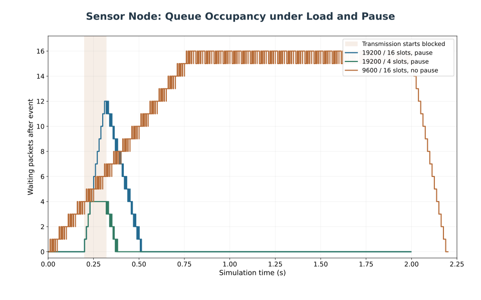

# M15-L5 – Sensor Node Case Study {#L5}

**Course area:** M15 – Bachelor: Embedded Systems

**Level:** Bachelor · Elective

**Prerequisites:** [M15-L1](M15-L1.md), [M15-L2](M15-L2.md), [M15-L3](M15-L3.md), [M15-L4](M15-L4.md).

**Learning objective:** Verify measurement requests, buffers, fault packets, timestamps and transport deadlines in a reproducible event model.

## Task and Criteria {#S1}

The sensor node is to initiate 200 periodic read requests at 100 Hz over 2 s. It has 8 KiB of SRAM (budget from [M15-L1](M15-L1.md)) and transmits twelve bytes per request. The normal path takes 600 µs from the timer event to the completed packet; every request whose sequence number satisfies $s\bmod37=17$ instead produces a timeout packet after 1600 µs. Requests are numbered from 0 to 199. This introduces five deliberate sensor faults. The test requires no lost packets, no violation of the 2 ms acquisition deadline and no packet whose transmission ends more than 150 ms after the scheduled timer instant. Fault packets count as successfully transmitted diagnostics, not as valid measurements.

Two UART rates (9600 and 19200 bit/s, 8N1), different FIFO capacities and an artificial transmission pause are compared. The pause blocks new transmission starts from 200 ms up to but not including 320 ms; packets already being transmitted finish normally. It represents, for example, an abstract flow-control block between packets. Acquisition continues. After the final measurement request, the buffer is allowed to drain completely. This drain is necessary so that packets still waiting are not incorrectly counted as lost.

## Reproducible Event Simulation {#S2}

Simulated time is expressed in integer microseconds. The event queue is sorted by timestamp and, in the event of a tie, by event type: transmission completion, end of the pause, then acquisition completion. For each append, FIFO occupancy is checked for a peak before any immediate transmission start; a packet in the transmitter itself occupies a separate memory slot. CPU times, arrival of bus events and the UART model are deterministic assumptions, not hardware measurements. In the simulation, `deque` replaces the ring demonstrated in M15-L4; the capacity limit and FIFO semantics remain the same.

```python
import heapq, struct
from collections import deque

def crc8(data):
    crc=0
    for b in data:
        crc ^= b
        for _ in range(8):
            crc=((crc<<1)^0x07)&255 if crc&128 else (crc<<1)&255
    return crc

def packet(seq, t):
    fault=seq%37==17
    adc=0xffff if fault else 1000+seq%200
    data=struct.pack('<2sHIHB',b'\xaa\x55',seq,t,adc,int(fault))
    return data+bytes([crc8(data)])

def simulate(baud, capacity, pause=False, n=200):
    duration=120_000_000//baud # us, exact for selected baud
    assert duration*baud==120_000_000
    events=[]; q=deque(); done=[]; dropped=[]; trace=[]; peak=0; busy=False
    for seq in range(n):
        t=seq*10000
        data=packet(seq,t)
        ready=t+(1600 if data[10] else 600)
        heapq.heappush(events,(ready,2,seq,data))
    if pause: heapq.heappush(events,(320000,1,-1,b''))
    while events:
        t,kind,s,data=heapq.heappop(events)
        if kind==0: # UART completed
            busy=False; done.append((s,t-s*10000,data))
        elif kind==2:
            if len(q)==capacity: dropped.append(s)
            else: q.append((s,data));peak=max(peak,len(q))
        if not busy and q and not (pause and 200000<=t<320000):
            s,data=q.popleft();busy=True
            heapq.heappush(events,(t+duration,0,s,data))
        trace.append((t,len(q)))
    assert len(done)+len(dropped)==n
    assert [s for s,_,_ in done]==sorted(s for s,_,_ in done)
    assert all(crc8(data[:-1])==data[-1] for _,_,data in done)
    assert peak<=capacity
    return dict(sent=len(done),drop=len(dropped),peak=peak,late=sum(delay>150000 for _,delay,_ in done),max_delay=max(delay for _,delay,_ in done),fault=sum(data[10] for _,_,data in done),last=max(s*10000+delay for s,delay,_ in done),trace=trace)
if __name__=='__main__':
    print('CRC',hex(crc8(b'123456789')),packet(0,0).hex())
    for c in [(19200,16,False),(19200,16,True),(19200,4,True),(9600,16,False),(9600,32,True)]:
        print(c,{k:v for k,v in simulate(*c).items() if k!='trace'})
```

Transmission duration is calculated from the 120 bit periods; the selected rates divide 120 million exactly. Other bit rates would require a finer or rational time representation. Time is measured relative to the request instant, not packet completion. The code checks sequence order, CRC and conservation of the number of generated records. Checking the CRC of an unchanged packet is a consistency test, not a test of an actual wireless or wired link.

## Results {#S3}

| Bit/s | FIFO slots | Pause | Sent | Dropped | Peak (slots) | Late (sent) | Max. delay (ms) | Fault packets sent |
| ---: | ---: | --- | ---: | ---: | ---: | ---: | ---: | ---: |
| 19200 | 16 | no | 200 | 0 | 1 | 0 | 7.85 | 5 |
| 19200 | 16 | yes | 200 | 0 | 12 | 0 | 126.25 | 5 |
| 19200 | 4 | yes | 192 | 8 | 4 | 0 | 126.25 | 5 |
| 9600 | 16 | no | 176 | 24 | 16 | 121 | 213.10 | 4 |
| 9600 | 32 | yes | 182 | 18 | 32 | 166 | 412.50 | 4 |

All read requests in the model complete as a record or fault diagnostic within 1600 µs, meeting the acquisition deadline. With 16 slots and 19200 bit/s, the sensor node also meets all transport criteria during the defined pause. Peak occupancy of 12 slots leaves four additional queue slots free. Transmission of the final packet ends after 1.99685 s in this configuration. A four-slot buffer saves 144 bytes but drops eight packets. Having no late transmitted packets does not mean that the entire test succeeded here.

{alt="Queue occupancy over time for three combinations of UART rate, capacity and transmission pause."}

## Design and Limits of Verification {#S4}

At 9600 bit/s the data rate is limited to 80 packets/s; the generation rate remains 100 packets/s. In the steady-state model, a backlog of 20 packets per second therefore develops as long as no data is discarded. Larger buffers delay the first overflow, but may also increase the maximum transport time. With 19200 bit/s, 160 packets/s are available, providing a reserve of 60 packets/s. With twelve packets waiting, the time to clear the backlog can be estimated as approximately $12/60=0{.}2$ s. The exact evolution depends on event phase, the existing transmitter state and release times.

For the 16-slot design, the SRAM budget is 4384 bytes; 3808 bytes remain unallocated. The CPU portions of the read requests are budgeted at $200\cdot100\ \mu\mathrm{s}=20$ ms in 2 s (1%). UART servicing, other interrupts, RTOS, bus recovery and actual stack peaks are not simulated separately. The budget is therefore not a measured worst-case execution time. In actual commissioning, timer/IRQ latencies would be tested with a logic analyser or tracing, along with the stack high-water mark and map file, bus faults, repeated interruptions, receiver parser and counter wraparound. The timing accuracy of the sensor converter itself must also be verified separately.

## Exercises with Solutions {#S5}

1. At 50 Hz, 9600 bit/s and 12 bytes, is the average baud rate sufficient without pauses?  
   **Solution:** 6000 bit/s, corresponding to 62.5% of the nominal data rate. Deadlines must also be checked individually.
2. Which configuration passes the defined criteria even with the single 120 ms pause?  
   **Solution:** 19200 bit/s with 16 FIFO slots. 200 records sent, no losses or deadline violations.
3. Why does the 9600 bit/s variant with 32 slots and a pause exhibit 166 late packets despite the larger buffer?  
   **Solution:** Its throughput is permanently insufficient; the larger queue allows more old packets to be retained, and the pause increases the backlog further.
4. Change `capacity` to 12 and 11 in the pause case at 19200 bit/s.  
   **Solution:** At 12, all 200 are sent; at 11, one packet is missing. This limit applies exactly to the event phases defined here; 12 would be without reserve.

**Further study:** M16 explores the physical measurement chain and digital measurement signal processing in greater depth. The sensor node here concerns raw-value transport, not sensor calibration yet.

## Sources {#S6}

- [University of Texas at Austin – Embedded and Real-Time Operating Systems, lecture overview](https://users.ece.utexas.edu/~valvano/EE445M/lectures.html) · ECE445M, lecture schedule week 9: sensor processing and input capture; slides not reviewed. · Last accessed: 2026-11-25
- [ETH Zürich – Core Courses and Specialisations (Bachelor)](https://ee.ethz.ch/studies/bachelor/bsc-eeit/third-year/core-courses.html) · Core Courses: Embedded Systems, Computers and Networks; curricular comparison, not evidence of the specific semester offering. · Last accessed: 2026-11-25
- [NXP – UM10204, I²C-bus specification, Rev. 7.0, §§ 3.1, 6, 7.2](https://www.nxp.com/docs/en/user-guide/UM10204.pdf) · UM10204, Rev. 7.0, p. 9, §3.1.4–3.1.5: start/stop conditions and byte format; partial scope. · Last accessed: 2026-11-25
- [Microchip – USART Overview, asynchronous operation and 8N1](https://onlinedocs.microchip.com/oxy/GUID-D5344754-46CE-40D6-918B-245670AF7E39-en-US-6/GUID-0DB53D39-B94A-4512-95BD-D6BA10D41F83.html) · §2 Overview: asynchronous 8N1 frame and baud rate; device-specific manual requires separate review. · Last accessed: 2026-11-25
