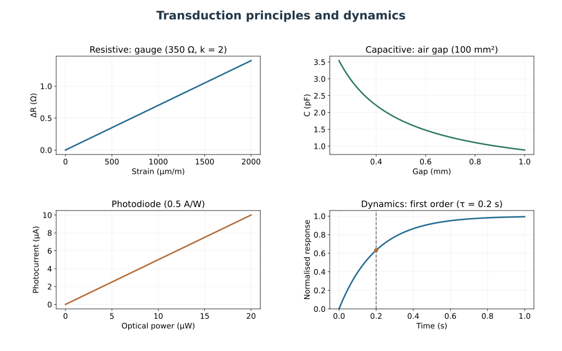

# M16-L1 – Transduction Principles and Sensor Models {#L1}

**Course area:** M16 – Bachelor: Sensor Systems and Measurement Signal Processing

**Level:** Bachelor · Elective

**Prerequisites:** [M3-L4](M3-L4.md), [M6-L1](M6-L1.md).

**Learning objective:** Select resistive, capacitive and optical transducers according to their characteristic curves, sensitivity and interfering quantities.

## From the Measurand to the Electrical Signal {#S1}

A sensor converts a physical quantity into an electrical quantity that can be evaluated. The measurand $x$ is not identical to the reported numerical value. Physical coupling, transduction, readout circuitry, sampling, calibration and processing lie between them. A strain transducer, for example, initially provides a change in resistance rather than a digital result in units of length. A measurement chain must describe both the influence of the desired quantity and that of interfering quantities.

A static sensor model is $y=f(x,z)+e$, where $z$ is an interfering quantity (e.g. temperature) and $e$ is an error term. Around an operating point, the following approximation holds:

$$\Delta y\approx S_x\Delta x+S_z\Delta z,\qquad S_x=\frac{\partial f}{\partial x}.$$

Sensitivity is the local slope, with its unit; resolution is the smallest distinguishable change under specified conditions. Neither alone describes the systematic measurement error. A deviation on the return path of the characteristic curve is called hysteresis; drift describes changes over time while the measurand remains constant.

{alt="Characteristic curves of a strain gauge, parallel-plate capacitor and photodiode, and a normalised first-order step response."}

## Three Transduction Principles {#S2}

A metallic strain gauge changes its resistance as a result of mechanical deformation. For small strain $\varepsilon=\Delta l/l$, the relation $\Delta R/R_0=k\varepsilon$ holds, with dimensionless gauge factor $k$. A strain gauge with $R_0=350\ \Omega$ and $k=2$ at $1000\ \mu\mathrm{m}/\mathrm{m}=10^{-3}$ produces a change of $0.7\ \Omega$. The resistance is considerably larger than the change of interest; a bridge is therefore used in [M16-L2](M16-L2.md). Temperature can also affect both resistance and mechanical strain.

An ideal parallel-plate capacitor with area $A$ and separation $d$ has $C=\epsilon_0\epsilon_r A/d$. For an air-gap measurement with $A=100\ \mathrm{mm^2}$ and $d=0.5$ mm, the capacitance is $C\approx1.77$ pF. If the separation decreases by 10%, the capacitance increases by 11.1%. The sensitivity $-\epsilon_0\epsilon_r A/d^2$ varies with separation. Stray capacitance from wiring, humidity and fringing fields are significant at such small capacitances. A readout circuit can convert capacitance into charging time, frequency or voltage.

At a given wavelength and within its linear range, a photodiode approximately delivers $I_{ph}=\mathcal R_\lambda P_{opt}$. With $\mathcal R_\lambda=0.5\ \mathrm{A/W}$ and $10\ \mu\mathrm W$, the photocurrent is 5 µA. An inverting transimpedance amplifier with $R_f=100$ kΩ ideally produces $-0.5$ V relative to the reference potential for the chosen current direction. Dark current, ambient light and wavelength affect the result; feedback capacitance and diode capacitance influence bandwidth and stability. Photocurrent does not constitute a distance measurement without a geometrical and optical model.

## Dynamic Characteristic {#S3}

Even with perfect static calibration, a time-varying measurand may appear delayed. A sensor with thermal inertia can initially be modelled as a first-order lag:

$$\tau\dot y+y=Sx,\qquad H(s)=\frac{S}{1+s\tau}.$$

Following a step from equilibrium, the normalised response reaches 63.2% of its final value after one time constant and 95% after approximately three time constants. For $\tau=0.2$ s, the cutoff frequency is $1/(2\pi\tau)=0.80$ Hz. A higher digital sampling frequency cannot remove this physical lag. The idealised equation is not valid for every sensor; mechanical resonances may require higher-order models.

## Selecting a Sensor for a Measurement Task {#S4}

| Task | Candidate | Main limitation |
| --- | --- | --- |
| Local strain in a beam | Strain gauge | Bonding, temperature, load path |
| Small displacement without mechanical contact | Capacitive displacement sensor | Stray fields, contamination, geometry |
| Optical power or interruption of a light beam | Photodiode | Ambient light, spectrum, saturation |

For the subsequent model chain, we select local tensile strain from 0 to 2000 µm/m in an idealised uniformly strained component. We use the 350 Ω strain gauge with gauge factor 2. A force value would only be justified with a mechanical model (geometry, elastic modulus, load path). The digital result is therefore expressed in µm/m. The later objective is to distinguish static measurement error from dynamic lag at a sampling rate of 100 Hz, not to demonstrate the performance of a real measuring instrument.

## Exercises with Solutions {#S5}

1. A 350 Ω strain gauge with $k=2$ is strained by 500 µm/m. What is $\Delta R$?  
   **Solution:** $350\cdot2\cdot500\cdot10^{-6}=0.35\ \Omega$.
2. The separation of an ideal parallel-plate capacitor doubles. What happens if the area remains unchanged?  
   **Solution:** Capacitance halves; the magnitude of the local sensitivity falls to one quarter.
3. With $0.4$ A/W and 20 µW of optical power, what ideal photocurrent results?  
   **Solution:** 8 µA; dark current and amplifier errors are not included.
4. A sensor takes 0.6 s to reach approximately 95% of the step. Estimate $\tau$.  
   **Solution:** Approximately 0.2 s for a first-order model. A faster ADC does not change this time constant.

## Sources {#S6}

- [TU Delft OpenCourseWare – Measurement Science: Sensors](https://ocw.tudelft.nl/course-lectures/sensors/) · Week 2, Sensors: overview of resistive, capacitive and inductive transducers; video not reviewed. · Last accessed: 2026-11-25
- [NI – Measuring Strain with Strain Gages](https://www.ni.com/en/shop/data-acquisition/sensor-fundamentals/measuring-strain-with-strain-gages.html) · Signal Conditioning for Strain Gages: bridge excitation, offset, amplification and filtering. · Last accessed: 2026-11-25
