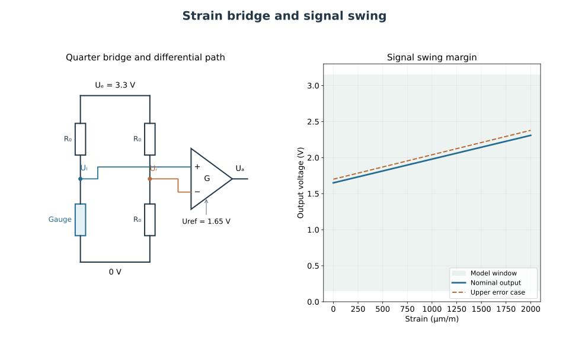

# M16-L2 – Bridge Circuit, Amplification and Interference {#L2}

**Course area:** M16 – Bachelor: Sensor Systems and Measurement Signal Processing

**Level:** Bachelor · Elective

**Prerequisites:** [M16-L1](M16-L1.md), [M3-L4](M3-L4.md).

**Learning objective:** Determine bridge voltage, gain, offset and signal swing margins in an analogue measurement chain.

## Differential Measurement with the Wheatstone Bridge {#S1}

Four resistors form two voltage dividers with a common excitation $U_E=3.3$ V. On the left, the upper resistor is $R_0$ and the lower one is the active strain gauge $R_0(1+\delta)$; on the right, both resistors are $R_0$. In the ideal model, the amplifier inputs do not load the bridge. With $\delta=k\varepsilon$, it follows that

$$U_L=U_E\frac{1+\delta}{2+\delta},\qquad U_R=\frac{U_E}{2},$$

$$U_d=U_L-U_R=U_E\frac{\delta}{2(2+\delta)}\approx\frac{U_E}{4}k\varepsilon.$$

The approximation requires $|\delta|\ll1$. At 2000 µm/m and $k=2$, the exact equation gives $3.2934$ mV, while the linear approximation gives 3.3000 mV. The bridge approximation error is about 0.2% of the signal here. The sign deliberately depends on the bridge arm and input assignment.

{alt="Quarter bridge with an active lower-left resistor and differential amplifier; nominal output characteristic and permissible model window."}

## Gain and Signal Swing {#S2}

An instrumentation amplifier ideally produces $U_A=U_{ref}+G U_d$. With $G=200$ and $U_{ref}=1.65$ V, the output at maximum tensile strain is 2.309 V. The nominal output sensitivity is 0.330 mV per µm/m. The small change in bridge voltage can thus be used effectively without approaching the 3.3 V ADC limit. The reference input shifts the output level but is not automatically an error-free voltage source. The experiment nominally operates between zero and 2000 µm/m. Negative strain produces a signal below the reference point and must be approved separately if needed.

Real amplifiers do not necessarily permit the entire range between the supply rails. For the teaching model, we assume a permissible output window of 0.15 to 3.15 V, a maximum total output offset of 50 mV and a maximum positive gain error of 3%. In the worst-case upper load condition, $1.65+0.05+206\cdot0.0032934=2.3784$ V; the margin to 3.15 V is about 0.772 V. At the lower end, at least 1.60 V remains. The common-mode condition must also be checked: $U_{cm}=(U_L+U_R)/2$ lies between 1.650 and 1.652 V. For an actual device, the permissible input common-mode voltage may depend on gain and output voltage. A valid output level alone therefore does not demonstrate circuit linearity.

## Interference Coupling and Noise Budget {#S3}

Common-mode rejection ratio (CMRR) is the ratio of differential gain to common-mode gain. For $\mathrm{CMRR}_{dB}=80$, a change of 0.1 V at the common-mode input ideally corresponds to an input-referred differential voltage of $0.1/10^4=10$ µV and 2 mV after amplification. This corresponds to about 6.1 µm/m. The value applies only at the specified frequency and operating conditions, since CMRR often decreases with increasing frequency. Wiring impedances and asymmetric filtering can introduce further common-mode to differential-mode conversion. A twisted differential pair, suitable shielding, symmetrical filtering and short connections can reduce interference. A digital averaging filter is no substitute for analogue interference suppression before the ADC.

An input offset of 50 µV would ideally shift the output by 10 mV. In strain units, this corresponds to roughly 30.3 µm/m. Zero-point calibration can capture a constant offset but not automatically its temperature drift. For uncorrelated noise contributions with standard deviations $\sigma_i$, the relation is $\sigma_{ges}=\sqrt{\sum_i\sigma_i^2}$ (subscript ges denotes total). Periodic interference, correlated drift and saturation must not be included in the budget in the same way without verification.

## Energy and Excitation {#S4}

In the unloaded bridge case, $3.3/700=4.71$ mA flows through each branch. The active 350 Ω resistor dissipates approximately 7.78 mW as heat; the entire bridge requires approximately 31.1 mW. Self-heating can shift the measured value. Halving the excitation voltage halves the sensitivity and reduces power dissipation to one quarter; in general, dissipation varies quadratically with voltage. Ratiometric operation uses the same excitation as the ADC reference: a common scaling of bridge voltage and ADC reference can cancel out in the code, provided that the gain, output reference and other error sources are compatible. The subsequent example uses a constant common 3.3 V reference.

## Exercises with Solutions {#S5}

1. Calculate the linear bridge voltage at 500 µm/m.  
   **Solution:** $3.3\cdot2\cdot500\cdot10^{-6}/4=0.825$ mV.
2. With $G=400$ and 2000 µm/m, is the ideal output within the model window?  
   **Solution:** $1.65+400\cdot0.0032934=2.9674$ V. Yes, but only about 183 mV of margin remains before additional errors.
3. What is the input-referred differential interference at 60 dB CMRR and a 50 mV common-mode change?  
   **Solution:** 50 µV, corresponding to 10 mV at the output with $G=200$.
4. The bridge excitation is reduced to 1.65 V. How does the nominal power dissipation change?  
   **Solution:** It falls to one quarter (7.78 mW for the entire bridge); the bridge sensitivity halves.

## Sources {#S6}

- [NI – Measuring Strain with Strain Gages](https://www.ni.com/en/shop/data-acquisition/sensor-fundamentals/measuring-strain-with-strain-gages.html) · Signal Conditioning for Strain Gages: bridge excitation, offset, amplification and filtering. · Last accessed: 2026-11-25
- [Analog Devices – How to Stay Out of Deep Water when Designing with Bridge Sensors](https://www.analog.com/en/resources/analog-dialogue/articles/how-to-stay-out-of-deep-water.html) · Introduction: bridge differential signal, common-mode voltage and offset. · Last accessed: 2026-11-25
