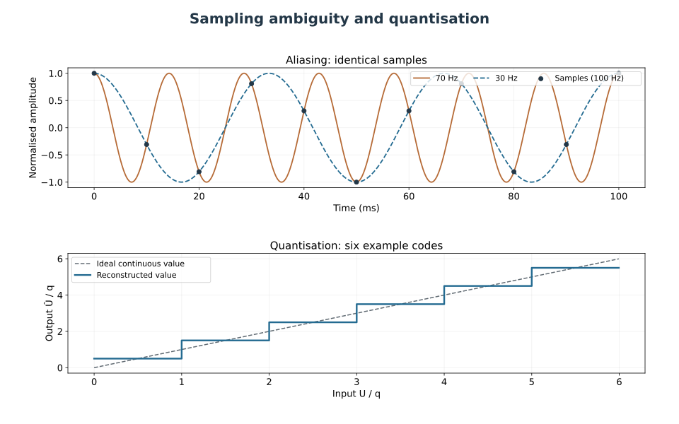

# M16-L3 – Sampling, Quantisation and Converter Errors {#L3}

**Course area:** M16 – Bachelor: Sensor Systems and Measurement Signal Processing

**Level:** Bachelor · Elective

**Prerequisites:** [M5-L1](M5-L1.md), [M16-L2](M16-L2.md).

**Learning objective:** Determine ADC resolution and the error budget, and calculate alias frequencies and requirements for the analogue prefilter.

## Sampling and Frequency Ambiguity {#S1}

An ADC captures a continuous-time signal at discrete instants $t_n=nT_s$ with $T_s=1/f_s$. For band-limited signals, ideal reconstruction from uniformly spaced samples is possible if $f_s>2f_{max}$. The mathematical model also assumes an ideal reconstruction filter and no quantisation. In practice, an analogue anti-aliasing filter must sufficiently suppress unwanted spectral components before sampling. At $f_s=100$ Hz, the Nyquist frequency is 50 Hz; interference at 70 Hz appears at 30 Hz because

$$\cos(2\pi\cdot70 n/100)=\cos(2\pi\cdot30 n/100).$$

After digitisation, these two cosine signals cannot be distinguished from their samples alone. The error cannot be eliminated by increasing the digital bit depth. For real-valued signals, the folded frequency $f_a=|f-mf_s|$ is selected with a suitable integer $m$ so that it lies between 0 and $f_s/2$; the phase relationship depends, among other things, on the sign before the absolute value is taken.

{alt="70 Hz and 30 Hz cosines with common sample values; idealised quantisation characteristic with midpoint reconstruction."}

## ADC Characteristic and Quantisation Noise {#S2}

As a continuing teaching model, we use a unipolar ideal 12-bit ADC with a 3.3 V full-scale range, $2^{12}=4096$ codes and quantisation step $q=3.3/4096=0.80566$ mV. For $0\le U<3.3$ V, it produces $c=\lfloor U/q\rfloor$; above and below the measurement range, the code is limited. The reconstructed voltage is $\hat U=(c+1/2)q$. Without overload, $\hat U-U$ lies between $-q/2$ and $q/2$ (boundary convention). With this definition, the range boundaries do not coincide with the reconstructed voltages of the outermost codes.

Relative to the nominal sensitivity of 0.330 mV/(µm/m), one LSB corresponds to approximately 2.44 µm/m. If the quantisation error is modelled as uniformly distributed and independent of the input, then

$$\sigma_q=\frac{q}{\sqrt{12}}=0.233\ \mathrm{mV}.$$

This approximation is useful when the input varies sufficiently or when dither is present, but not for every constant signal: without noise, the error can remain the same across all samples. For an ideal full-scale sine wave, the RMS signal value $V_{FS}/(2\sqrt2)$ and quantisation noise yield the familiar relation $\mathrm{SNR}_{dB}\approx6.02N+1.76$. For twelve bits, this is about 74 dB under precisely these model assumptions. A smaller input signal makes less use of the dynamic range. ENOB (effective number of bits) is determined from SINAD in a sinusoidal test, thus including distortion, and must not be confused with the nominal resolution alone.

## Additional Sources of Error {#S3}

An ADC can exhibit offset error, gain error, differential nonlinearity (unequal code widths) and integral nonlinearity (deviation of the characteristic curve). A linear calibration can fully compensate only for affine deviations. The reference voltage affects scaling; input impedance and the charging time of a sample-and-hold circuit can cause additional settling errors. With small timing jitter $\Delta t$, the voltage deviation is approximately $\dot U(t)\Delta t$. Steep edges or high frequencies therefore increase the timing-related error budget.

In the later experiment, we also assume independent analogue output noise with $\sigma_A=2$ mV. The root-sum-square budget gives $\sqrt{2^2+0.233^2}=2.014$ mV at the ADC, or approximately 6.10 µm/m relative to the nominal sensitivity. Here, analogue noise rather than quantisation dominates. More nominal bits alone therefore make little difference to the actual accuracy. The calculation assumes that no clipping occurs.

## Designing the Anti-Aliasing Path {#S4}

For a desired signal up to 5 Hz and interference at 70 Hz, we consider two buffered identical RC low-pass filters, each with a 10 Hz cutoff frequency. The overall amplitude response is $|H(f)|=1/(1+(f/10)^2)$. At 5 Hz, 80% of the amplitude remains (approximately −1.94 dB); at 70 Hz, 2% remains (approximately −34 dB). Thus, 100 mV of interference becomes 2 mV at 70 Hz, which can appear at 30 Hz after sampling. The amplitude of the desired 5 Hz signal is also measurably changed. A different filter or a higher sampling rate may be required if these deviations cannot be tolerated. The filter is a design example and is not included in the simplified dynamic experiment in M16-L5. A real specification encompasses all relevant interference bands, phase response and settling.

## Exercises with Solutions {#S5}

1. What alias results from a 123 Hz cosine at a sampling rate of 100 Hz?  
   **Solution:** 23 Hz.
2. What is $q$ at 16 bits and a 3.3 V full-scale range?  
   **Solution:** 50.35 µV; the analogue 2 mV noise remains unchanged.
3. Which code results at exactly 1.65 V in the ideal 12-bit model?  
   **Solution:** 2048, with a reconstructed value of approximately 1.650403 V.
4. Analogue interference is 0.2 V at 70 Hz. What amplitude reaches the ADC after the two 10 Hz RC stages?  
   **Solution:** 4 mV; it can appear in the digital signal as a 30 Hz component.

## Sources {#S6}

- [Analog Devices / Walt Kester – MT-001, Quantization Noise and SNR](https://www.analog.com/media/en/training-seminars/tutorials/MT-001.pdf) · Rev. A, p. 1, Quantization Noise Model: ideal ADC and quantization error; assumptions of the SNR model. · Last accessed: 2026-11-25
- [TU Delft OpenCourseWare – Measurement Science: Sensors](https://ocw.tudelft.nl/course-lectures/sensors/) · Week 2, Sensors: transduction and sensor types; contextual reading only, not evidence for ADC quantization. See MT-001 and MT-002 for the latter. · Last accessed: 2026-11-25
- [Analog Devices / Walt Kester – MT-002, What the Nyquist Criterion Means to Your Sampled Data System Design](https://www.analog.com/media/en/training-seminars/tutorials/MT-002.pdf) · Rev. A, p. 1, Fig. 1: sampling, analog prefilter and digital signal processing. · Last accessed: 2026-11-25
