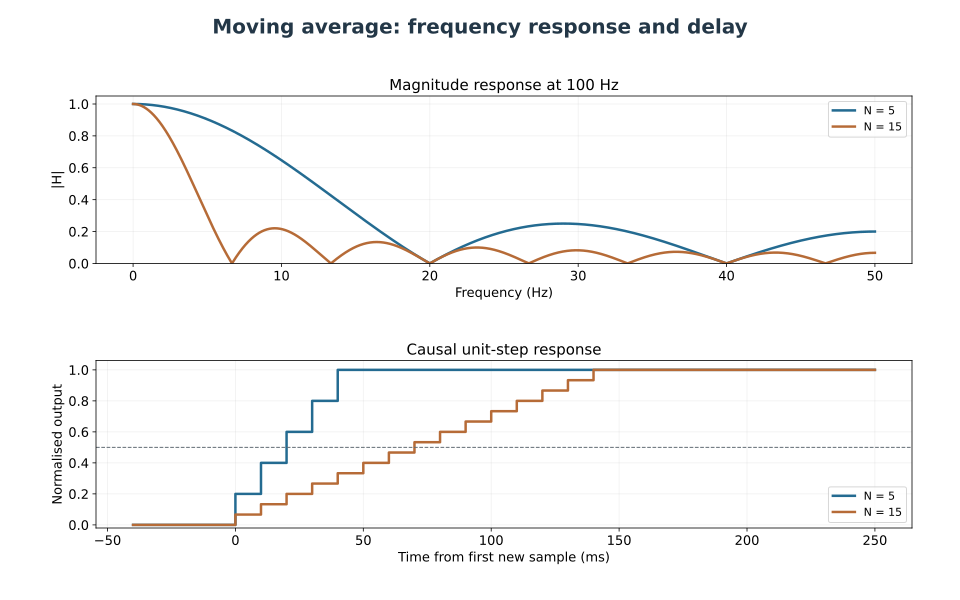

# M16-L4 – Filtering and Estimation with Noisy Data {#L4}

**Course area:** M16 – Bachelor: Sensor Systems and Measurement Signal Processing

**Level:** Bachelor · Elective

**Prerequisites:** [M5-L4](M5-L4.md), [M16-L3](M16-L3.md).

**Learning objective:** Design a causal filter by considering noise suppression, frequency response and time delay together.

## Random Fluctuations and Systematic Error {#S1}

A sensor provides multiple observations $x[n]=s[n]+e[n]$. If the true signal is constant within a measurement window and the additive errors are independent, have zero mean and have variance $\sigma^2$, the arithmetic mean is an unbiased estimator of the constant signal. Its variance is $\sigma^2/N$. However, a constant offset $b$ remains unchanged. A noisy signal with little mean error may allow more accurate evaluation than a smooth but incorrectly calibrated signal.

For correlated errors with autocovariance $\gamma[k]$, the more general expression is

$$\mathrm{Var}(\bar e)=\frac{1}{N^2}\left(N\gamma[0]+2\sum_{k=1}^{N-1}(N-k)\gamma[k]\right).$$

Slowly varying errors or periodic interference therefore do not necessarily follow the $1/\sqrt N$ rule for the standard deviation.

## Moving Average as an FIR Filter {#S2}

A causal moving average over $N$ samples is given by

$$y[n]=\frac1N\sum_{k=0}^{N-1}x[n-k].$$

It has a finite impulse response $h[k]=1/N$ for $0\le k<N$, and zero otherwise. In steady operation it can be calculated efficiently using the running sum $s[n]=s[n-1]+x[n]-x[n-N]$. This requires storing the oldest value and the sum. With integer arithmetic, the accumulator must accommodate $N$ times the maximum code; for 15 values from a 12-bit ADC this is 61425, which fits in an unsigned 16-bit integer without further signed or offset arithmetic. Initial values before measurements begin must be treated as assumptions; here we only output a valid filter result after $N$ actual measurements.

The transfer function for $\omega=2\pi f/f_s$ follows from the geometric series:

$$H(e^{j\omega})=e^{-j\omega(N-1)/2}\frac{\sin(N\omega/2)}{N\sin(\omega/2)}.$$

At $\omega=0$ the limiting value is one. At 100 Hz and $N=5$, the first zero occurs at 20 Hz; for $N=15$ it occurs at 6.67 Hz. For both filters the group delay is $(N-1)/(2f_s)$ away from zeros and phase discontinuities, i.e. 20 and 70 ms respectively. This refers to the filter delay, excluding additional computation time or communication delay. An ideal positive step is fully reflected in the output after $N$ new values; the transition starts immediately with the first new value, and for odd $N$ the halfway point is reached after $(N-1)/2$ intervals.

{alt="Frequency response and normalised step response of causal moving averages with 5 and 15 samples at 100 Hz."}

## Recursive Low-Pass Filter {#S3}

A memory-efficient alternative is the exponential moving average $y[n]=\alpha x[n]+(1-\alpha)y[n-1]$ with $0<\alpha\le1$. For $0<\alpha<1$, the filter has a pole at $z=1-\alpha$ and an infinitely long, decaying impulse response. With $\alpha=1-e^{-T_s/\tau}$, the decay rate corresponds to that of an ideal first-order low-pass filter with time constant $\tau$. The recursive filter does not have linear phase. For a constant signal and independent white noise, the steady-state output has variance $\sigma^2\alpha/(2-\alpha)$. The initial value influences the result during settling. When measurements are missing, a decision must be made as to whether the time interval should be adjusted, the state retained or the output marked as invalid.

## Filter Selection for the Measurement Chain {#S4}

With $\sigma=6.1$ µm/m and 100 Hz, the ideal expected standard deviations are 2.73 µm/m for $N=5$ and 1.58 µm/m for $N=15$. If the halfway point of a step must be detected within 30 ms, $N=5$ appears plausible; $N=15$ exceeds the budget even in the ideal filter model. Conversely, a longer window may be useful for slow static measurements. The case study in [M16-L5](M16-L5.md) calculates both the actual noise in a dataset and the detection time. A comparison requires identical raw data and a predefined metric. For filter selection in a control system, the phase margin and total loop latency must also be considered.

## Exercises with Solutions {#S5}

1. What is the expected standard deviation for $\sigma=12$ µm/m and 9 independent measurements?  
   **Solution:** 4 µm/m. A constant offset remains.
2. What group delay results for $N=11$ and 200 Hz?  
   **Solution:** 25 ms.
3. What is the output of a filter with $N=5$ at the first new value of a step from 500 to 1500 µm/m?  
   **Solution:** $(4\cdot500+1500)/5=700$ µm/m; at the third new value, 1100 µm/m.
4. For $T_s=10$ ms and $\tau=50$ ms, determine $\alpha$.  
   **Solution:** $1-e^{-0.2}\approx0.1813$. The initial value must be documented.

## Sources {#S6}

- [Steven W. Smith – The Scientist and Engineer’s Guide to DSP, Chapter 15](https://www.dspguide.com/ch15.htm) · Chapter 15, introduction: moving average and limits of frequency selectivity. · Last accessed: 2026-11-25
- [Analog Devices / Walt Kester – MT-002, What the Nyquist Criterion Means to Your Sampled Data System Design](https://www.analog.com/media/en/training-seminars/tutorials/MT-002.pdf) · Rev. A, p. 1, Fig. 1: sampling, analog prefilter and digital signal processing. · Last accessed: 2026-11-25
