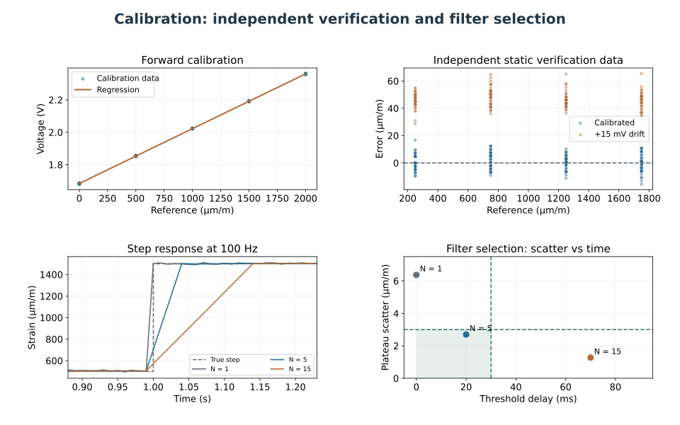

# M16-L5 – Case Study: Calibration and Quality Verification {#L5}

**Course area:** M16 – Bachelor: Sensor Systems and Measurement Signal Processing

**Level:** Bachelor · Elective

**Prerequisites:** [M16-L1](M16-L1.md), [M16-L2](M16-L2.md), [M16-L3](M16-L3.md), [M16-L4](M16-L4.md).

**Learning objective:** Calibrate a complete synthetic measurement chain and assess it using independent verification points, noise and step-response delay.

## Model and Test Plan {#S1}

The measurement chain is intended to measure tensile strain between 0 and 2000 µm/m. The nominal characteristic and quantisation come from the preceding lessons. The simulated actual forward characteristic incorporates the exact bridge, a 2.5% gain deviation, a 35 mV output offset and independent, normally distributed output noise with a standard deviation of 2 mV. The ideal ADC has twelve bits and a 3.3 V full-scale range. The simulated reference strain is exact; for a later, more realistic uncertainty budget we separately assume an independent standard uncertainty of 2 µm/m for the reference. The data are entirely synthetic and do not constitute measurements.

Calibration uses twelve independent values at each of 0, 500, 1000, 1500 and 2000 µm/m. A separate static verification uses 40 values at each of 250, 750, 1250 and 1750 µm/m. We then also test a 15 mV change in output offset at the same strain levels. Under nominal calibration conditions, the model should achieve an RMSE of no more than 8 µm/m and a maximum observed absolute deviation of no more than 25 µm/m across these verification points. For an ideal step at 100 Hz, a filter should reduce the plateau standard deviation below 3 µm/m and cross the halfway point of the step within 30 ms. These are teaching criteria, not a standard or statistically established limits. The step experiment deliberately excludes mechanical inertia and analogue filtering so that the digital contribution is apparent.

## Estimation and Inverse Characteristic {#S2}

Given a known reference $x_i$ and an observed voltage $y_i$, we estimate the forward model $y=a+bx$ by least squares. We minimise $\sum_i(y_i-a-bx_i)^2$, yielding

$$\hat b=\frac{\sum_i(x_i-\bar x)(y_i-\bar y)}{\sum_i(x_i-\bar x)^2},\qquad\hat a=\bar y-\hat b\bar x$$

For a new measured voltage, the inverse estimate is $\hat x=(y-\hat a)/\hat b$. The method requires a sufficiently accurate reference and an adequate linear model over this range. Significant reference errors or pronounced nonlinearity would require other models or uncertainty methods. Verification data are kept separate from estimation: a small training residual alone does not demonstrate that a new measurement will be reliable.

The example calculation is reproducible with Python and NumPy; the order of random values is determined by a fixed seed. In addition to evaluating the independent cases, the code checks residual conditions, the absence of clipping, moving average filters and the aliasing example. `np.polyfit` returns the slope before the intercept.

```python
import numpy as np
rng = np.random.default_rng(1601)
q = 3.3 / 4096

def voltage(e, drift=0):
    d = 2 * np.asarray(e) * 1e-6
    bridge = 3.3 * d / (2 * (2 + d))
    return 1.65 + .035 + 200 * 1.025 * bridge + drift

def sample(e, drift=0):
    v = voltage(e, drift) + rng.normal(0, .002, np.shape(e))
    code = np.clip(np.floor(v / q), 0, 4095).astype(int)
    assert np.all((v >= 0) & (v < 3.3))
    return (code + .5) * q

x = np.repeat(np.arange(0, 2001, 500), 12)
y = sample(x)
b, a = np.polyfit(x, y, 1)
r = y - (a + b*x)
assert abs(r.sum()) < 1e-10 and abs(r@x) < 1e-7
levels = np.arange(250, 2000, 500)
z = np.repeat(levels, 40)
v = sample(z)
v_drift = sample(z, .015)
nominal = (v-1.65)/.00033
cal = (v-a)/b
cal_drift = (v_drift-a)/b

def stats(estimate):
    e = estimate-z
    return np.mean(e), np.sqrt(np.mean(e**2)), np.max(np.abs(e))

print('fit', a, b, 'sV', np.sqrt(r@r/(len(x)-2)))
for name, est in [('nominal',nominal),('cal',cal),('drift',cal_drift)]:
    print(name,stats(est))
for level in levels:
    errors=(cal-z)[z==level]
    print(level, errors.mean(), errors.std(ddof=1))
# independent verification data: pooled scatter and observed max mean error
s=np.sqrt(sum(np.var((cal-z)[z==k],ddof=1)*39 for k in levels)/156)
print('pooled',s,'u',np.hypot(s,2))
# dynamic trial: input step at sample 100, 100 Hz
n=np.arange(300); truth=np.where(n<100,500,1500)
raw=(sample(truth)-a)/b
filters={}
for N in (1,5,15):
    out=np.full(len(raw),np.nan); out[N-1:]=np.convolve(raw,np.ones(N)/N,'valid')
    filters[N]=out
    cross=np.flatnonzero((n>=100)&(out>=1000))[0]-100
    print(N, np.std(out[130:280],ddof=1), cross*10)
    assert abs(out[-1]-np.mean(raw[-N:])) < 1e-9
assert np.allclose(np.cos(2*np.pi*70*n/100), np.cos(2*np.pi*30*n/100))
```

## Static Quality Verification and Drift {#S3}

The regression yields $\hat a=1.6843213$ V, $\hat b=0.0003381104$ V/(µm/m) and a residual standard deviation of 2.130 mV (58 degrees of freedom). The exact sensor bridge is slightly nonlinear; the straight line approximates it over the specified range. The independent verification results are:

| Method / condition | Mean error (µm/m) | RMSE (µm/m) | Largest absolute error (µm/m) |
| --- | ---: | ---: | ---: |
| Nominal characteristic, without calibration | 129.30 | 130.13 | 157.96 |
| Calibration line | 0.70 | 6.00 | 16.64 |
| Original calibration line after +15 mV offset drift | 46.35 | 46.81 | 65.49 |

The calibrated chain meets the nominal static model criteria. The unchanged calibration line fails after offset drift: even without noise, an additional bias of approximately $0.015/\hat b=44.36$ µm/m is expected. A new zero-point measurement could help if the error is purely an offset; if slope or hysteresis also change, this is insufficient.

| Verification strain (µm/m) | Mean deviation (µm/m) | Standard deviation (µm/m) |
| ---: | ---: | ---: |
| 250 | 0.50 | 5.75 |
| 750 | 1.97 | 6.19 |
| 1250 | 0.64 | 4.94 |
| 1750 | −0.28 | 6.89 |

The pooled within-level standard deviation is 5.98 µm/m. For a single new stationary observation, combining this in quadrature with the assumed independent reference uncertainty gives $u_{teil}=\sqrt{5.98^2+2^2}=6.31$ µm/m (the subscript teil denotes partial). This is explicitly only a partial budget: regression parameters, residual nonlinearity, temperature, reference correlation, long-term stability and the actual mechanical reference must be considered separately in a complete uncertainty assessment. The maximum observed group mean error of 1.97 µm/m is not a guaranteed error limit. Quantisation and the simulated analogue noise are already included in the observed scatter; do not add them a second time. Simply doubling the partial budget does not produce a certified 95% interval.

{alt="Calibration characteristic, independent errors under normal and drift conditions, and step responses of the three windows."}

## Dynamic Test and Acceptance {#S4}

The strain jumps from 500 to 1500 µm/m at 1.00 s (sample 100). The three variants are derived from the same raw data. The standard deviation is calculated over plateau samples 130 to 279. The halfway-point time is that of the first sample from sample 100 onwards with an estimated strain of at least 1000 µm/m.

| Moving average window | Plateau scatter (µm/m) | Threshold-crossing delay | Model criterion |
| ---: | ---: | ---: | --- |
| 1 | 6.37 | 0 ms | Noise too high |
| 5 | 2.70 | 20 ms | Met |
| 15 | 1.27 | 70 ms | Too slow |

We select $N=5$ for this test plan. With a finite sample size, the measured noise differs from the ideal $1/\sqrt{N}$ expectation; consecutive moving averages are correlated. The time is relative to the first new sample. For a real asynchronous step, up to approximately one sampling period is added, as well as sensor, analogue filter, processing and transport time. The 30 ms requirement for a real complete chain is therefore not demonstrated. Real acceptance would require reference traceability, ascending and descending load series, temperature tests, immunity to interference, mechanical coupling, clipping/error flags and documented dynamic reference measurements. In conjunction with [M15-L5](M15-L5.md), the filter state, measurement time and validity status must be preserved during data transport.

## Exercises with Solutions {#S5}

1. A new measurement is 2.0 V. What is the calibrated strain?  
   **Solution:** $(2.0-1.6843213)/0.0003381104\approx934$ µm/m; interpret only within the calibrated range.
2. Why are the reference levels 250, 750, 1250 and 1750 not used for fitting?  
   **Solution:** They allow independent verification of interpolation without the line being able to adapt to these errors.
3. What happens to the moving average when there is a 15 mV offset drift?  
   **Solution:** Averaging reduces random scatter; the constant drift error remains approximately 44 µm/m.
4. Which window is suitable for an ideal digital deadline of 30 ms and plateau scatter below 3 µm/m?  
   **Solution:** Only $N=5$ meets both criteria in this dataset; actual total latency and statistical repeatability remain unresolved.

**Further study:** M17 covers communication systems and the transmission of digitised information.

## Sources {#S6}

- [NIST/SEMATECH – Data analysis and model validation](https://www.itl.nist.gov/div898/handbook/mpc/section3/mpc365.htm) · §2.3.6.5: calibration data and model validation. · Last accessed: 2026-11-25
- [NIST/SEMATECH – Calibration of future measurements](https://www.itl.nist.gov/div898/handbook/mpc/section3/mpc366.htm) · §2.3.6.6: correction of future measurements using the inverse calibration curve. · Last accessed: 2026-11-25
- [NIST/SEMATECH – Uncertainty for linear calibration using check standards](https://itl.nist.gov/div898/handbook/mpc/section3/mpc3672.htm) · §2.3.6.7.2: uncertainty from check standard measurements. · Last accessed: 2026-11-25
- [Steven W. Smith – The Scientist and Engineer’s Guide to DSP, Chapter 15](https://www.dspguide.com/ch15.htm) · Chapter 15, Moving Average Filters: further reading on moving averages and noise reduction; specific test data are synthetic. · Last accessed: 2026-11-25
