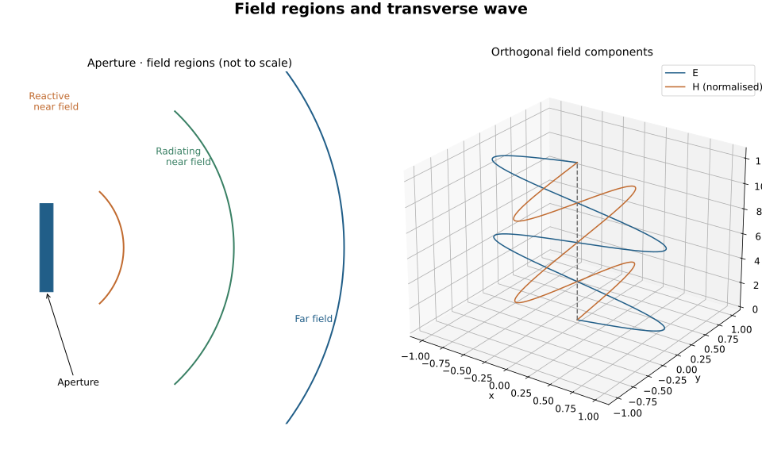

# M17-L1 – Radiation, Near Field and Far Field {#L1}

**Course area:** M17 – Bachelor: Antennas

**Level:** Bachelor · Elective

**Prerequisites:** [M4-L1](M4-L1.md), [M1-L6](M1-L6.md).

**Learning objective:** Distinguish field regions, calculate far-field quantities and describe linear polarisation.

## From a Transmission Line to Free Space {#S1}

A transmission line guides electromagnetic energy along its geometry. An antenna couples part of the power into freely propagating electromagnetic waves. On reception, the coupling operates in the opposite direction. Time-varying charges and currents determine the fields; a static charge distribution alone does not produce continuous radiation. The static field, stored reactive energy and radiated energy are different aspects of the same field model.

For a harmonic wave in homogeneous vacuum, $c=1/\sqrt{\mu_0\epsilon_0}$, $\lambda=c/f$ and $k=2\pi/\lambda$. For propagation in the positive z-direction, we can use RMS phasors to write

$$\underline{\mathbf E}=E_0e^{-jkz}\mathbf e_x,\qquad \underline{\mathbf H}=\frac{E_0}{Z_0}e^{-jkz}\mathbf e_y.$$

$Z_0\approx377\,\Omega$ is the free-space wave impedance, not the antenna input impedance. The time-averaged power flux density is $\langle\mathbf S\rangle=\operatorname{Re}(\underline{\mathbf E}\times\underline{\mathbf H}^{*})$, here $E_0^2/Z_0$ in W/m². With peak-value phasors, an additional factor of 1/2 would be required.

## Distance Regions {#S2}

The fields of a small harmonic electric dipole contain terms whose magnitudes decrease as $1/r^3$, $1/r^2$ and $1/r$. Only at large distances does the radiation term $1/r$ dominate. For electrically large apertures, the variation in path lengths across the aperture is decisive. The Fraunhofer distance guideline is

$$r_F\approx\frac{2D^2}{\lambda}.$$

$D$ is the largest relevant dimension. The expression follows approximately from the quadratic path difference $\Delta r\approx D^2/(8r)$; at $r_F$, the corresponding maximum phase deviation relative to the aperture centre is about $\pi/8$. It is not a universal sharp boundary: the distance must also be sufficiently large relative to both the wavelength and the antenna size. A common guideline for the inner Fresnel boundary of electrically large antennas is $0.62\sqrt{D^3/\lambda}$. Other criteria are appropriate for small dipoles. In the reactive near field, the E/H ratio is not generally $Z_0$; even in the radiating near field, the angular distribution may still depend on distance.

{alt="Schematic field regions around an aperture on the left, orthogonal E and H fields of a plane wave on the right."}

## Polarisation and Spherical Waves {#S3}

Polarisation describes the trajectory of the electric field vector over time at a fixed location. In-phase orthogonal components give linear polarisation; equal magnitudes and a 90° phase difference give circular polarisation. Otherwise, the general case is an ellipse. For circular polarisation, the viewing direction must be specified to define the sense of rotation.

In the far field, power propagates approximately radially. For isotropic radiation, $S=P_\mathrm{rad}/(4\pi r^2)$. A directional source changes the angular distribution, not the total power. For a fixed angular interval, the flux density decreases with the square of the distance, while the field amplitude decreases approximately as $1/r$. Reflections or obstacles can alter this relationship locally.

## Worked Example and Model Limitations {#S4}

At 2.4 GHz, $\lambda=0.1249$ m. An aperture of 0.8 m has $r_F\approx10.25$ m and an estimated inner Fresnel boundary of 1.26 m. At 1 km, the distance for this idealised geometry is considerably greater than both. An isotropic source with 0.01 W of radiated power produces $S\approx7.96\cdot10^{-10}$ W/m² and $E_\mathrm{eff}\approx0.548$ mV/m there. Here the original subscript eff denotes the RMS value. This calculation is neither a measurement nor a statement about exposure limits. At 0.5 m, however, a simple far-field model would be unsuitable for this aperture.

## Exercises with Solutions {#S5}

1. What wavelength results at 900 MHz? **Solution:** approximately 0.333 m.
2. Double D while keeping the frequency unchanged. **Solution:** the Fraunhofer distance guideline increases by a factor of four.
3. What happens to the isotropic power flux at three times the distance? **Solution:** it falls to 1/9, and the field amplitude to 1/3.
4. What is H at 1 V/m RMS in a plane free-space field? **Solution:** $1/377\approx2.65$ mA/m.

## Sources {#S6}

- [Eastern Mediterranean University – EENG463 Antenna Theory](https://opencourses.emu.edu.tr/course/view.php?id=395) · Overview of Electromagnetics and Fundamental Parameters of Antennas: radiation and field quantities. Course outline, PDFs not reviewed. · Last accessed: 2026-11-25
- [Steven W. Ellingson – Electromagnetics, Volume 2 (2020, VT Publishing, PDF)](https://vtechworks.lib.vt.edu/bitstream/handle/10919/93253/Electromagnetics_Vol2_screen-reader-friendly.pdf) · §§ 9.4–9.7 and 10.7: radiation and far-field fundamentals; not a complete reference for all near-field boundaries. · Last accessed: 2026-11-25
