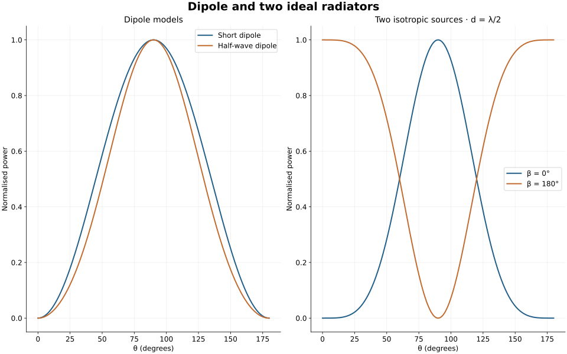

# M17-L3 – Dipoles, Apertures and Arrays {#L3}

**Course area:** M17 – Bachelor: Antennas

**Level:** Bachelor · Elective

**Prerequisites:** [M17-L2](M17-L2.md), [M1-L6](M1-L6.md).

**Learning objective:** Compare ideal antenna types and derive the array factor for two radiators.

## Dipole Models {#S1}

For the ideal short (Hertzian) dipole, a spatially constant current over a very short length is assumed. Its far-field magnitude is proportional to $\sin\theta$. A physical thin, short, centre-fed wire, by contrast, has an approximately triangular current distribution; in particular, its radiation resistance must therefore not be equated with that of the Hertzian current element.

For the thin half-wave dipole, we use an approximately sinusoidal current distribution. The normalised far-field amplitude is then described by

$$A(\theta)=\frac{\cos[(\pi/2)\cos\theta]}{\sin\theta}$$

with a limiting value of zero at both poles. The normalised power value is $|A|^2$. The ideal thin half-wave dipole has approximately $D_0=1.64$ (2.15 dBi). Its physical resonant length depends on the wire diameter and surroundings. A geometrically exact half-wavelength does not generally ensure a purely real input impedance or a match.

## Aperture and Effective Area {#S2}

The effective receiving area of a reciprocal antenna under conjugate matching and matched polarisation is

$$A_e=\frac{\lambda^2 G}{4\pi}.$$

It is a measure of power coupling, not a direct measure of the geometric silhouette. For a large aperture of area $A_\mathrm{geom}$, we often write $A_e=\eta_a A_\mathrm{geom}$ with aperture efficiency $\eta_a$. This relationship is useful for typical aperture antennas but should not be interpreted as a geometric limit for every wire radiator. A larger effective area allows greater gain at the same frequency; with typical aperture illumination, the main lobe narrows. The actual field distribution also affects sidelobes and efficiency.

## Two Elements and Relative Phase {#S3}

Two equally strong ideal isotropic model sources lie on the z-axis at $z=\pm d/2$. With additional feed phase $\beta$ at the positive element, we use the far-field convention

$$AF(\theta)=1+e^{j(kd\cos\theta+\beta)},\quad F_n=\frac{|AF|^2}{4}=\cos^2\left(\frac{kd\cos\theta+\beta}{2}\right).$$

The common spatial phase has been omitted. $F_n$ is normalised to the theoretical peak value of the sum; not every arbitrary combination of d and $\beta$ reaches this value within the visible angular range. For $d=\lambda/2$, $\beta=0$, the maximum is broadside to the axis at 90°, and the nulls are at the poles. With $\beta=\pi$, the maximum is at the poles and the null is broadside. The model assumes prescribed currents, no mutual coupling and identical element patterns. Real dipoles may nevertheless be unable to serve a direction intended by the array factor because of their own null in that direction.

{alt="Normalised dipole and array power patterns for two isotropic sources at half-wavelength spacing and two relative phases."}

## Worked Example and Design Limitations {#S4}

At 2.4 GHz, an idealised half-wavelength spacing is approximately 6.25 cm. For $\beta=0$ and $\theta=60^\circ$, $kd\cos\theta=\pi/2$; hence $F_n=0.5$. For an in-phase two-element array with $d=\lambda/2$, integrating the normalised power pattern gives $\Omega_A=2\pi$ and thus $D_0=2$ (3.01 dBi). This is not 6 dBi, although the field sum at the maximum is twice that of an equally excited single element and the local power density is four times as high: the total power is doubled under the chosen ideal geometry.

For an area of 0.1 m² and $\eta_a=0.6$, at 2.4 GHz we obtain $G\approx48.3$, or approximately 16.84 dBi. This simplified aperture value cannot replace electromagnetic simulation or measurement of impedance or radiation pattern. Larger array spacings can produce additional equally strong maxima; practical feed networks introduce losses and phase errors.

## Exercises with Solutions {#S5}

1. At 2.4 GHz, determine the idealised half-wavelength. **Solution:** approximately 6.25 cm.
2. $d=\lambda/2$, $\beta=0$, $\theta=90^\circ$. **Solution:** $F_n=1$.
3. Same geometry, $\beta=\pi$, $\theta=90^\circ$. **Solution:** $F_n=0$.
4. Why does 6 dB higher local power not automatically mean 6 dBi directivity? **Solution:** the total radiated power and its angular distribution must also be taken into account.

## Sources {#S6}

- [Eastern Mediterranean University – EENG463 Antenna Theory](https://opencourses.emu.edu.tr/course/view.php?id=395) · Linear Wire Antennas, Linear Arrays and Aperture Antennas: dipoles, arrays and apertures. Course outline, PDFs not reviewed. · Last accessed: 2026-11-25
- [Steven W. Ellingson – Electromagnetics, Volume 2 (2020, VT Publishing, PDF)](https://vtechworks.lib.vt.edu/bitstream/handle/10919/93253/Electromagnetics_Vol2_screen-reader-friendly.pdf) · §§ 9.5, 9.7 and 10.13: dipole radiation and effective aperture; this reference does not establish the array factor. · Last accessed: 2026-11-25
