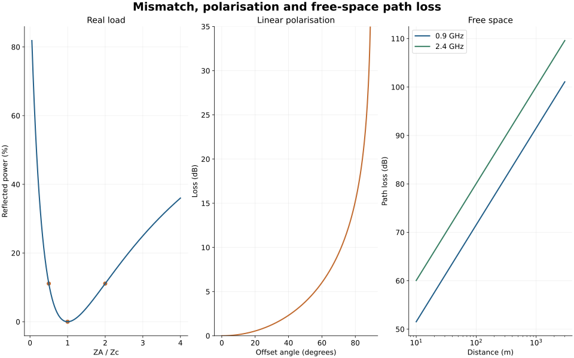

# M17-L4 – Matching and Propagation {#L4}

**Course area:** M17 – Bachelor: Antennas

**Level:** Bachelor · Elective

**Prerequisites:** [M17-L2](M17-L2.md), [M1-L6](M1-L6.md), [M4-L1](M4-L1.md).

**Learning objective:** Calculate reflection, polarisation losses and free-space path loss separately.

## Connection and Reflection {#S1}

An antenna has a complex input impedance $Z_A=R_A+jX_A$ at its feed point. On a lossless transmission line with real reference impedance $Z_c$, we obtain

$$\Gamma=\frac{Z_A-Z_c}{Z_A+Z_c},\quad P_a=P_+(1-|\Gamma|^2).$$

$P_+$ denotes the forward power at the reference point. The standing wave ratio is $SWR=(1+|\Gamma|)/(1-|\Gamma|)$ and the positive return loss is $RL=-20\log_{10}|\Gamma|$. In measurements, by contrast, $S_{11}$ is often displayed as a negative dB value. For $Z_A=100\,\Omega$ and $Z_c=50\,\Omega$, we obtain $\Gamma=1/3$, SWR 2 and RL 9.54 dB. 11.11% of the forward power is reflected, and the mismatch loss is $-10\log_{10}(8/9)=0.512$ dB. A well-matched antenna may nevertheless be inefficient: a terminating resistor can be perfectly matched while converting most of the power into heat.

## Reception and Polarisation {#S2}

With matched polarisation and conjugate load matching, the incident power flux density $S$ gives the available received power $P_r=S A_e$. For two linearly polarised antennas with an angular offset $\psi$ between their polarisation directions (along the same propagation axis), the additional power factor is $p=\cos^2\psi$. This factor concerns the field projection, not necessarily the geometric radiation pattern. At 45°, the loss is 3.01 dB; at 60°, it is 6.02 dB. At 90°, the ideal model has a null; real antennas and multipath propagation may produce finite coupling.

## Friis Equation {#S3}

Combining $S=P_tG_t/(4\pi r^2)$ and $A_e=\lambda^2G_r/(4\pi)$ gives, in free space,

$$P_r=P_t G_t G_r\left(\frac{\lambda}{4\pi r}\right)^2.$$

Here, $P_t$ is the accepted transmit power and $P_r$ is the available received power with matched polarisation. The free-space path loss is $L_\mathrm{FS}=20\log_{10}(4\pi r/\lambda)$ in dB. With distance in km and frequency in MHz, the approximate expression is $L_\mathrm{FS}=32.45+20\log_{10}r_\mathrm{km}+20\log_{10}f_\mathrm{MHz}$. At 2.4 GHz and 1 km, the loss is 100.05 dB. Doubling the distance increases the loss by 6.02 dB. Doubling the frequency also increases the isotropic free-space path loss by 6.02 dB; with constant physical receiving apertures, however, the gain may change at the same time. A comparison must therefore specify which quantities are held constant.

{alt="Reflected power fraction for real loads, polarisation loss and free-space path loss at two frequencies."}

## Terrestrial Propagation and the Fresnel Zone {#S4}

For the first Fresnel zone, the approximate radius is $r_1=\sqrt{\lambda d_1d_2/(d_1+d_2)}$. For two path segments of 500 m each at 2.4 GHz, the radius is 5.59 m. Obstacles within this zone may affect received power even with a geometric line of sight. The Fresnel zone must be distinguished from the Fresnel near-field region of an individual antenna. Ground reflections, vegetation, buildings, Earth's curvature and atmospheric refraction alter actual transmission. Free-space path loss is therefore a reference, not a guarantee of a given field strength or availability. A multipath channel can produce both constructive and destructive interference. A fixed additional attenuation is only a sensitivity scenario, not a physically derived multipath channel.

## Exercises with Solutions {#S5}

1. $Z_A=25\,\Omega$, $Z_c=50\,\Omega$. **Solution:** $\Gamma=-1/3$, SWR 2, 11.11% reflected power.
2. What attenuation results from a 30° polarisation offset? **Solution:** $-10\log_{10}(0.75)=1.25$ dB.
3. Increase r tenfold at the same frequency. **Solution:** +20 dB free-space path loss.
4. Is an unobstructed line of sight sufficient for the Friis model? **Solution:** No, multipath effects and obstacles within the Fresnel zone may alter the calculation.

## Sources {#S6}

- [Eastern Mediterranean University – EENG463 Antenna Theory](https://opencourses.emu.edu.tr/course/view.php?id=395) · Fundamental Parameters of Antennas-1/-2: input impedance, effective aperture and Friis equation. Course outline, PDFs not reviewed. · Last accessed: 2026-11-25
- [ITU-R P.525-5 – Calculation of free-space attenuation (11/2024)](https://www.itu.int/rec/R-REC-P.525-5-202411-I/en) · ITU-R P.525-5 (11/2024), annex §2.3, p. 3, eqs. (5)–(6): free-space attenuation; PDF text retrieved, page image unavailable. · Last accessed: 2026-11-25
