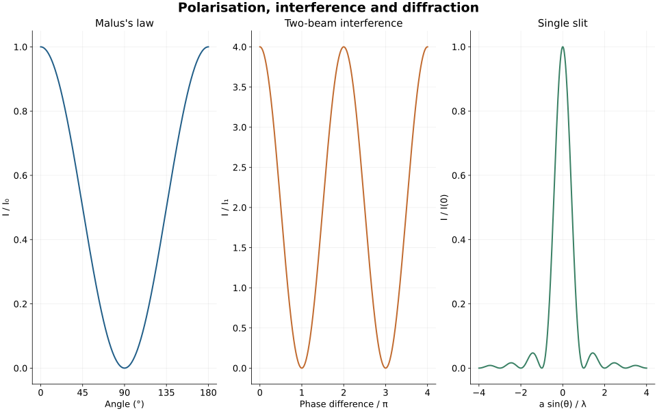

# M18-L1 – Light as an Electromagnetic Wave {#L1}

**Course area:** M18 – Bachelor: Fundamentals of Photonics

**Level:** Bachelor · Elective

**Prerequisites:** [M4-L1](M4-L1.md), [M17-L1](M17-L1.md).

**Learning objective:** Quantitatively determine wavelength, polarisation and the effects of coherent superposition.

## From Electromagnetic Fields to Optics {#S1}

Photonics deals with the generation, guiding, processing and detection of light. Maxwell's equations also apply in optics. The higher frequencies and shorter wavelengths compared with radio technology change the relevant component dimensions, not the underlying physics. A field in a transparent, isotropic, non-magnetic medium can be modelled as a plane wave:

$$E(z,t)=E_0\cos(\omega t-kz+\varphi),\qquad k=\frac{2\pi n}{\lambda_0},\qquad \lambda_0=\frac{c}{f}.$$

The frequency remains the same when crossing between stationary media; the wavelength and phase velocity change: $\lambda=\lambda_0/n$, $v_\mathrm{ph}=c/n$. The refractive index generally depends on frequency. For a real refractive index and peak value $E_0$, the time-averaged intensity is approximately $I=n\epsilon_0 c E_0^2/2$ in W/m². An optical detector typically measures averaged power rather than individual field oscillations.

## Polarisation and Interference {#S2}

The electric field directions of two orthogonal components and their phase difference determine the polarisation. For linearly polarised light passing through an ideal polariser rotated by an angle $\theta$, projection of the field amplitude gives Malus's law:

$$I=I_0\cos^2\theta.$$

When two waves of equal frequency and polarisation are superposed, their complex field amplitudes are added first. For a relative phase that is stable over time,

$$I=I_1+I_2+2\sqrt{I_1 I_2}\cos\Delta\varphi.$$

A path-length difference $\Delta s$ in the same medium produces $\Delta\varphi=2\pi n\Delta s/\lambda_0$ (account for any additional reflection phases separately). For equal individual intensities $I_1=I_2$, the local intensity varies between zero and $4I_1$. The maximum does not imply energy generation: in an interferometer, power is redistributed between the outputs or spatial interference orders. For independently fluctuating phases, the interference term vanishes in the long-time average. Coherence refers to field correlation, not merely equal colour.

## Diffraction and Resolution {#S3}

A finite aperture produces an angular distribution even without geometric deflection. For uniform coherent illumination of a slit of width $a$, integration of the phases across the aperture in the Fraunhofer region yields:

$$\frac{I(\theta)}{I(0)}=\left(\frac{\sin u}{u}\right)^2,\qquad u=\frac{\pi a\sin\theta}{\lambda},$$

with a limiting value of one at $u=0$. The first minimum occurs at $a\sin\theta=\lambda$ (if attainable). Geometrical optics neglects this broadening. A smaller aperture increases the angular width. For a circular aperture, the corresponding first zero is approximately at $1.22\lambda/a$, where $a$ now denotes the diameter.

{alt="Malus's law, two-beam interference with equal intensities and single-slit diffraction."}

## Worked Example and Model Limitations {#S4}

At $\lambda_0=633$ nm, $f\approx474$ THz. In a medium with $n=1.5$, the wavelength is 422 nm; the frequency does not change. For a 50 µm slit in air, the first minimum occurs at approximately 0.725°. At a distance of 2 m, this corresponds to a lateral displacement of approximately 25.3 mm. The Fresnel parameter $a^2/(\lambda L)\approx0.002$ is small here, so the far-field approximation is reasonable. A relative phase change of $\pi$ switches an ideal interference point from maximum to minimum intensity.

## Exercises with Solutions {#S5}

1. A polariser is oriented at 60° to the input polarisation direction. **Solution:** 25% of the input intensity.
2. Two coherent waves have individual intensities of 1 and 4 W/m². **Solution:** Maximum 9, minimum 1 W/m².
3. What change in path length in air produces a phase change of $\pi$ at 633 nm? **Solution:** 316.5 nm (single pass).
4. Double the slit width. **Solution:** The first diffraction angle approximately halves for small angles.

## Sources {#S6}

- [MIT OpenCourseWare – Optics (2.71), Lecture Slides](https://ocw.mit.edu/courses/2-71-optics-spring-2009/pages/lecture-slides/) · Sessions 12 and 14: wave equation and electromagnetic energy/polarization; lecture table only. · Last accessed: 2026-11-25
- [MIT OpenCourseWare – 6.974 Fundamentals of Photonics, Lecture Notes](https://ocw.mit.edu/courses/6-974-fundamentals-of-photonics-quantum-electronics-spring-2006/pages/lecture-notes/) · Lecture index 2–12: Maxwell equations, electromagnetic waves and optics; PDF not reviewed. · Last accessed: 2026-11-25
