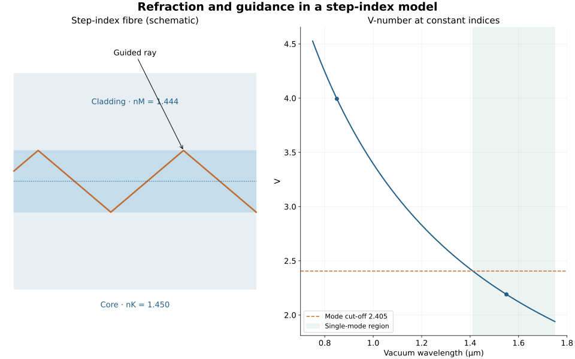

# M18-L2 – Optical Interfaces and Waveguides {#L2}

**Course area:** M18 – Bachelor: Fundamentals of Photonics

**Level:** Bachelor · Elective

**Prerequisites:** [M18-L1](M18-L1.md), [M4-L1](M4-L1.md).

**Learning objective:** Calculate reflection losses, numerical aperture and the single-mode region of an idealised fibre.

## Refraction and Reflection {#S1}

At a plane interface, frequency and the tangential component of the wave vector are conserved. With angles measured from the surface normal, Snell's law follows:

$$n_1\sin\theta_1=n_2\sin\theta_2.$$

For normal incidence at a lossless interface between two non-magnetic media, the power fractions are

$$R=\left(\frac{n_1-n_2}{n_1+n_2}\right)^2,\qquad T=1-R.$$

The sign reversal of the reflected field when $n_2>n_1$ implies a phase shift of $\pi$. At oblique incidence, the Fresnel coefficients differ for s- and p-polarisation. Reflection is not equivalent to heat loss; it may redirect power into an unwanted path or produce feedback. At a single uncoated glass–air interface with $n=1.5$, 4% of the power is reflected; the transmission loss is $-10\log_{10}(0.96)=0.177$ dB. Multiple coherent reflections require a field calculation rather than simply multiplying power fractions.

## Total Internal Reflection and Numerical Aperture {#S2}

If $n_1>n_2$, no propagating refracted plane wave exists for angles above $\theta_c=\arcsin(n_2/n_1)$. The evanescent field in the optically less dense medium carries no time-averaged net power perpendicular to the ideal interface, but it can interact with a neighbouring medium. A step-index fibre has a core $n_\mathrm{K}$ and cladding $n_\mathrm{M}<n_\mathrm{K}$ (the original subscripts K and M denote core and cladding, respectively). For meridional rays, the ray model yields the acceptance cone from refraction at the end face and the critical angle at the core–cladding interface:

$$n_0\sin\theta_\mathrm{max}=\mathrm{NA}=\sqrt{n_\mathrm{K}^2-n_\mathrm{M}^2}.$$

NA is dimensionless. The cone does not guarantee that a given ray couples efficiently into a particular guided mode: field profile, position, angle and polarisation affect the overlap.

## The Waveguide as a System of Modes {#S3}

In the wave description, modes are permissible transverse field distributions with longitudinal factor $e^{-j\beta z}$. For losslessly guided modes of an ideal step-index fibre, $n_\mathrm{M}k_0<\beta<n_\mathrm{K}k_0$ with $k_0=2\pi/\lambda_0$. The normalised frequency is

$$V=\frac{2\pi a}{\lambda_0}\,\mathrm{NA},$$

where $a$ denotes the core radius. For a weakly guiding circular step-index fibre, the onset of higher-order spatial modes occurs at $V\approx2.405$. Below this limit, the fundamental mode remains with its polarisation states. The mode is not completely confined to the core; bending, perturbations and coupling alter the guidance. For large V, the number of guided modes including polarisation is approximately $V^2/2$, but this approximation does not apply in the transition region.

{alt="Ray guidance in the fibre core and normalised frequency V as a function of vacuum wavelength."}

## Worked Example and Model Limitations {#S4}

With $n_\mathrm{K}=1.450$, $n_\mathrm{M}=1.444$ and $a=4.1$ µm, the results are $\mathrm{NA}\approx0.1318$, $\theta_c\approx84.79°$ and an acceptance half-angle of 7.57° in air. At 1550 nm, V is approximately 2.19; at 850 nm, approximately 3.99. The modelled cut-off wavelength is approximately 1411 nm. The example uses constant refractive indices and the weak-guidance approximation; actual manufacturer cut-off values also take cable geometry into account, among other factors.

## Exercises with Solutions {#S5}

1. Normal incidence from a medium of index 1.0 to one of index 1.5: **Solution:** 4% is reflected.
2. Can total internal reflection occur when passing from air to glass? **Solution:** No, only from a higher to a lower refractive index.
3. What is the effect of doubling the core radius at the same NA and wavelength? **Solution:** V doubles.
4. Why is a single-mode fibre not free of dispersion? **Solution:** The group delay of the fundamental mode can depend on wavelength.

## Sources {#S6}

- [MIT OpenCourseWare – Optics (2.71), Lecture Slides](https://ocw.mit.edu/courses/2-71-optics-spring-2009/pages/lecture-slides/) · Session 2: reflection, refraction and waveguides; lecture table only. · Last accessed: 2026-11-25
- [MIT OpenCourseWare – 6.974 Fundamentals of Photonics, Lecture Notes](https://ocw.mit.edu/courses/6-974-fundamentals-of-photonics-quantum-electronics-spring-2006/pages/lecture-notes/) · Lecture index 2–12: optical interfaces, waveguides and fibres; PDF not reviewed. · Last accessed: 2026-11-25
- [FOA Reference Guide – Optical Fiber](https://www.thefoa.org/tech/ref/basic/fiber.html) · Optical Fiber section: core, cladding, total internal reflection and numerical aperture; physical foundations. · Last accessed: 2026-11-25
