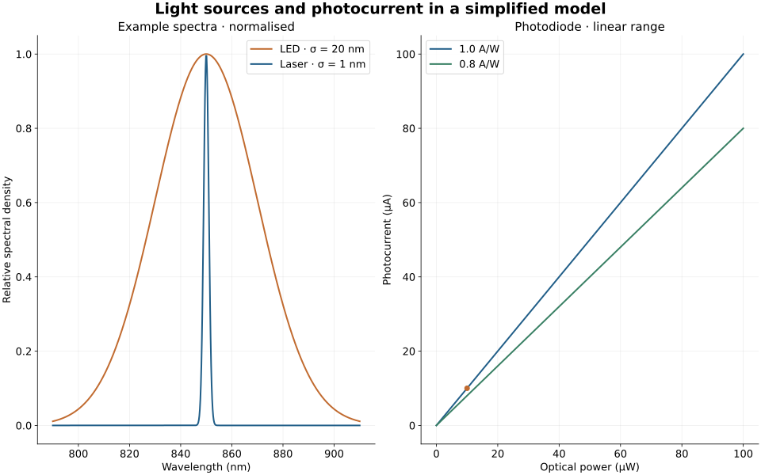

# M18-L3 – Light Sources and Optical Detectors {#L3}

**Course area:** M18 – Bachelor: Fundamentals of Photonics

**Level:** Bachelor · Elective

**Prerequisites:** [M3-L1](M3-L1.md), [M3-L2](M3-L2.md), [M18-L1](M18-L1.md).

**Learning objective:** Distinguish optical sources and calculate the conversion of optical power into photocurrent.

## Photons and Semiconductor Transitions {#S1}

A photon has energy

$$E_\gamma=hf=\frac{hc}{\lambda_0}.$$

With $h=6.62607015\cdot10^{-34}$ Js and $c=299792458$ m/s, a useful calculation rule is $E_\gamma[\mathrm{eV}]\approx1240/\lambda_0[\mathrm{nm}]$. In an LED, injected electrons and holes recombine through spontaneous emission; part of the electrical energy is converted into light. Material, temperature and current density influence the spectral distribution and efficiency. The band gap establishes an energy scale, not the exact wavelength of a monochromatic emission.

## LEDs and the Laser Principle {#S2}

In a laser, stimulated emission is the governing process. Optical feedback, for example through two cavity mirrors or a grating, selects modes. At threshold, the small-signal gain exactly balances the losses. Above threshold, gain saturation limits the steady-state field build-up. In a simplified Fabry–Pérot model with intensity reflectances $R_1,R_2$, length $l$, internal loss constant $\alpha_i$ and modal gain $g$, the threshold condition is

$$R_1R_2\,e^{2(g-\alpha_i)l}=1,\qquad g_\mathrm{th}=\alpha_i+\frac{1}{2l}\ln\frac{1}{R_1 R_2}.$$

An LED is often inexpensive, has a broader spectrum and is easier to operate. Lasers can provide a narrower spectral width and higher directional output power. This improves coupling into small modes and can reduce chromatic dispersion; however, the specific properties depend on the device. Laser light is dangerous even in the invisible infrared range; the model is not a guide to operating exposed laser sources.

## Receiving Light with a Photodiode {#S3}

Absorbed photons can generate charge carriers that are separated and collected in the electric field. Let $\eta$ be the external quantum efficiency (collected charge-carrier pairs per incident photon, without internal gain). The photon flux is $\Phi=P/E_\gamma$, which gives

$$I_\mathrm{ph}=q\eta\Phi=\mathcal R P,\qquad \mathcal R=\frac{\eta q\lambda_0}{hc}.$$

The responsivity $\mathcal R$ is measured in A/W and depends on wavelength. A PIN photodiode is often reverse-biased in receivers. An avalanche photodiode has internal multiplication, which can introduce additional noise. Dark current, capacitance-limited bandwidth, thermal noise and saturation limit the measurement. A transimpedance amplifier converts current into voltage; ideally, $V_\mathrm{out}=-R_f I_\mathrm{ph}$. For a one-sided equivalent noise bandwidth B, the shot-noise variance of an ideal PIN diode is approximately $\sigma_i^2=2q(I_\mathrm{ph}+I_\mathrm{dark})B$; amplifier noise must be included separately.

{alt="Normalised idealised LED and laser spectra, and photocurrent versus received power."}

## Worked Example and Model Limitations {#S4}

At 1550 nm and $\eta=0.8$, the responsivity is approximately 1.00 A/W. At −20 dBm, corresponding to 10 µW, the photocurrent is approximately 10 µA. With an ideal 10 kΩ transimpedance resistor, this corresponds to −0.10 V. For B=100 MHz and negligible dark current, the RMS shot noise is approximately 17.9 nA; this is not a complete determination of receiver sensitivity. An ordinary silicon detector is unsuitable at 1550 nm because of its band gap; appropriate InGaAs detectors are one example.

With $R_1=R_2=0.3$, $l=300$ µm and $\alpha_i=1000$ m⁻¹, the cavity model gives $g_\mathrm{th}\approx5013$ m⁻¹. This value denotes modal gain, not a threshold current directly.

## Exercises with Solutions {#S5}

1. Photon energy at 850 nm? **Solution:** Approximately 1.46 eV.
2. A photodiode with 0.8 A/W receives 25 µW. **Solution:** 20 µA photocurrent.
3. Double the noise bandwidth while keeping the current unchanged. **Solution:** The shot-noise standard deviation increases by $\sqrt2$.
4. Why does a narrower laser spectrum not automatically provide higher receiver sensitivity? **Solution:** Noise power, modulation format, detector and amplifier electronics remain additional influencing factors.

## Sources {#S6}

- [MIT OpenCourseWare – 6.974 Fundamentals of Photonics, Lecture Notes](https://ocw.mit.edu/courses/6-974-fundamentals-of-photonics-quantum-electronics-spring-2006/pages/lecture-notes/) · Lecture index 20–26: light-matter interaction, absorption, gain and lasers; partial relevance, PDF not reviewed. · Last accessed: 2026-11-25
- [MIT OpenCourseWare – Modern Optics Project Laboratory](https://ocw.mit.edu/courses/6-161-modern-optics-project-laboratory-fall-2005/) · Labs > Laser Safety Requirements, source safety context only; not a direct photodetector physics reference. Review existing Hamamatsu source. · Last accessed: 2026-11-25
- [Hamamatsu Photonics – The WITS$ guide to selecting a photodetector](https://hub.hamamatsu.com/us/en/technical-notes/detector-selection/the-wits-guide-to-selecting-a-photodetector.html) · Selection based on wavelength, Eq. 1: quantum efficiency and spectral responsivity; Selection based on intensity: noise and bandwidth. · Last accessed: 2026-11-25
