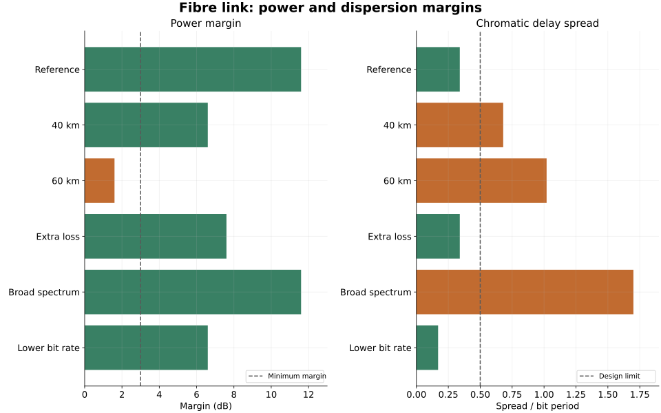

# M18-L4 – Case Study: Fibre Link or Optical Sensor {#L4}

**Course area:** M18 – Bachelor: Fundamentals of Photonics

**Level:** Bachelor · Elective

**Prerequisites:** [M18-L1](M18-L1.md), [M18-L2](M18-L2.md), [M18-L3](M18-L3.md).

**Learning objective:** Design an optical link using two independent criteria and document the limitations of the model.

## Initial Question and Model Limitations {#S1}

As an optional model of optical measurement-signal transport, an optical link is to connect two electronic stations at 1550 nm using an idealised single-mode fibre. We examine which combinations of link length and spectral width satisfy two independently chosen design limits. The inputs are synthetic calculation assumptions, not specifications of a particular product. The model accounts for mean optical power and chromatic delay spread, but not the actual bit error rate.

| Quantity | Model value |
| --- | ---: |
| Mean launched transmitter power before the first connector | −2 dBm |
| Minimum received power | −20 dBm |
| Required power margin | 3 dB |
| Connectors | 2 × 0.5 dB |
| Splices | 4 × 0.1 dB |
| Fibre attenuation | 0.25 dB/km |
| Chromatic dispersion parameter | 17 ps/(nm·km) |
| RMS spectral width | 0.1 nm |
| Binary data rate | 10 Gbit/s |
| Allowable RMS delay spread relative to the bit period | 0.50 |

To isolate the effects, the receiver limit is assumed constant even when the rate changes. In practice, a data sheet must specify sensitivity for the format, rate, BER, temperature and other operating conditions. The four splices remain constant in all variants. No separate coupling loss is included because the transmitter power is already defined at the specified optical reference plane.

## Two Independent Design Criteria {#S2}

The total loss $A=1.4+0.25L+A_\mathrm{extra}$ (dB) gives $P_R=P_T-A$ (dBm). The power margin $m=P_R-P_\mathrm{min}$ must be at least 3 dB. For the second test we use the linearised chromatic delay spread $\sigma_\tau=|D|L\sigma_\lambda$. The dispersion parameter $D$ describes the change in group delay per wavelength interval and distance; the product is an approximation for a narrow spectrum. For binary signal transmission, $T_b=1/R_b$. The dimensionless metric is $f_\tau=|D|L\sigma_\lambda/T_b$. In this model it must not exceed 0.5. This deliberately chosen design limit is not a physical BER threshold.

For the 20-km reference case: $A=6.4$ dB, $P_R=-8.4$ dBm and $m=11.6$ dB. The chromatic delay spread is 34 ps, or 34% of the bit period. Both criteria are satisfied. Without additional losses, the analytical results are

$$L_\mathrm{P,max}=\frac{-2-(-20)-3-1.4}{0.25}=54.4\,\mathrm{km},$$

$$L_\mathrm{D,max}=\frac{0.5\cdot100}{17\cdot0.1}=29.41\,\mathrm{km}.$$

The smaller value limits the design under consideration. Higher transmitter power can improve the power budget, but not the dispersion value modelled here. In practice, increasing the power is also limited by receiver overload, nonlinearities and safety requirements.

## Reproducible Computational Experiment {#S3}

The following Python program requires no external libraries. It uses dBm for power levels, dB for losses and ps for delays. $1/R_b$ in ps corresponds to $1000/R_b$ when Rb is in Gbit/s. The assertions check differences and the classification of the six cases. The original German case labels in the code mean reference, additional loss, broad spectrum and lower bit rate, respectively.

```python
from math import sqrt, isclose
# All optical powers are time-averaged; loss values are didactic.
Ptx=-2; Prmin=-20; reserve=3; alpha=.25; D=17; budget=.5
# name, length km, additional loss dB, linewidth nm, bitrate Gbit/s
cases=[('Referenz',20,0,.1,10),('40 km',40,0,.1,10),('60 km',60,0,.1,10),('Zusatzverlust',20,4,.1,10),('Breites Spektrum',20,0,.5,10),('Kleinere Bitrate',40,0,.1,2.5)]
def case(L,extra,width,Rb):
    loss=2*.5+4*.1+alpha*L+extra
    rx=Ptx-loss
    margin=rx-Prmin
    dt=abs(D)*L*width # ps, RMS if width is RMS
    fraction=dt*Rb/1000
    return rx,margin,dt,fraction,margin>=reserve and fraction<=budget
if __name__=='__main__':
    for name,*args in cases:
        print(name,case(*args))
    assert isclose(case(40,0,.1,10)[0]-case(20,0,.1,10)[0],-5)
    assert isclose(case(20,4,.1,10)[0]-case(20,0,.1,10)[0],-4)
    assert isclose(case(20,0,.5,10)[2]/case(20,0,.1,10)[2],5)
    assert [case(*c[1:])[-1] for c in cases]==[True,False,False,True,False,True]
```

## Results and Interpretation {#S4}

| Scenario | Received power (dBm) | Margin (dB) | Delay spread (ps) | Spread / bit period | Both criteria |
| --- | ---: | ---: | ---: | ---: | --- |
| Reference, 20 km | −8.4 | 11.6 | 34 | 0.34 | yes |
| 40 km | −13.4 | 6.6 | 68 | 0.68 | no |
| 60 km | −18.4 | 1.6 | 102 | 1.02 | no |
| 20 km, additional 4 dB loss | −12.4 | 7.6 | 34 | 0.34 | yes |
| 20 km, 0.5 nm spectral width | −8.4 | 11.6 | 170 | 1.70 | no |
| 40 km, 2.5 Gbit/s | −13.4 | 6.6 | 68 | 0.17 | yes |

{alt="Six scenarios showing the power margin and relative chromatic delay spread."}

The 40-km link has sufficient mean received power but exceeds the dispersion criterion. The lower rate helps in this model because it allows longer bit periods. The broad-spectrum source shows that even a short link can be more dispersion-limited at the same power. An optical sensor with a reflected signal, on the other hand, would have different path and reflection losses (for example, twice the length-dependent attenuation for a coaxial outward and return path). For a real link, reflected power, modulation spectrum, receiver bandwidth, power limits, detector noise, ageing, temperature, polarisation and measurement uncertainty, among other factors, would have to be considered. The computational study does not replace a measurement; never look into fibre ends or open optical connectors.

## Exercises with Solutions {#S5}

1. At 40 km and 10 Gbit/s, the link must satisfy the dispersion criterion. What maximum RMS spectral width is permissible? **Solution:** $50/(17\cdot40)=0.0735$ nm.
2. How much additional attenuation can the reference case tolerate before reaching the required margin? **Solution:** $11.6-3=8.6$ dB.
3. What is the power margin at 30 km with 2 dB additional loss? **Solution:** 7.1 dB; the delay spread of 51 ps nevertheless slightly exceeds the second criterion at 10 Gbit/s.
4. Design a 40-km link at 0.1 nm. What maximum data rate follows from the dispersion criterion? **Solution:** $0.5\cdot1000/68\approx7.35$ Gbit/s; the power margin is sufficient. The practically usable rate remains undetermined.

## Sources {#S6}

- [FOA Reference Guide – Optical Fiber](https://www.thefoa.org/tech/ref/basic/fiber.html) · Optical Fiber section: core, cladding, total internal reflection and numerical aperture; physical foundations. · Last accessed: 2026-11-25
- [The Fiber Optic Association – Fiber Optic Data Links](https://www.thefoa.org/tech/ref/appln/datalink.html) · Datalinks and Analog or Digital? sections: optical transmitters, receivers, attenuation and power budget. · Last accessed: 2026-11-25
- [Hamamatsu Photonics – The WITS$ guide to selecting a photodetector](https://hub.hamamatsu.com/us/en/technical-notes/detector-selection/the-wits-guide-to-selecting-a-photodetector.html) · Selection based on wavelength, Eq. 1: quantum efficiency and spectral responsivity; Selection based on intensity: noise and bandwidth. · Last accessed: 2026-11-25
