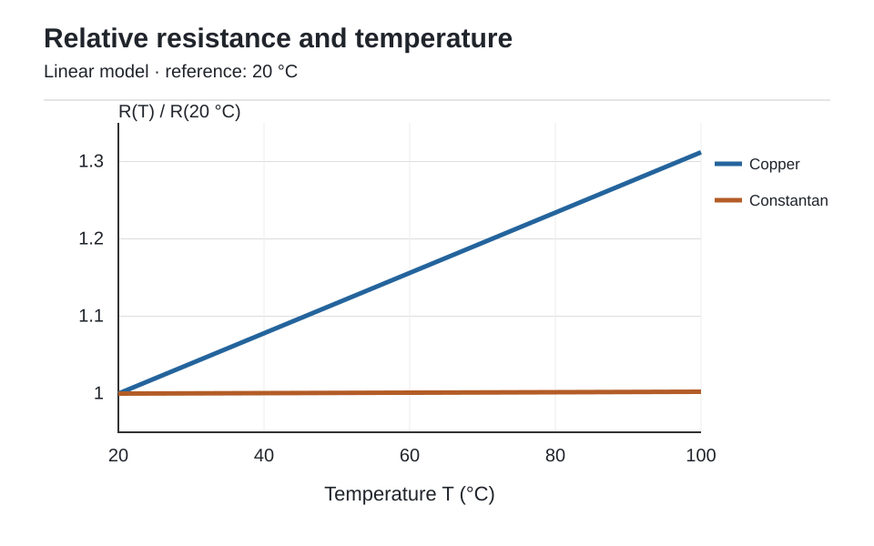

# M19-L1 – Conductive materials and temperature dependence {#L1}

**Course area:** M19 – Bachelor: Materials and component technology

**Level:** Bachelor · Foundations

**Prerequisites:** [Resistance and Ohm's law](M1-L2.md), [Conductivity and charge carriers](M3-L1.md).

**Learning objective:** Separate material and geometric influences, estimate conductor losses with changing temperature, and evaluate the limits of a simplified material comparison.

## From circuit diagram to material {#S1}

An ideal wire in a circuit diagram has no voltage drop. A real conductor must meet electrical, thermal and mechanical requirements. Copper offers high conductivity; aluminium generally allows larger cross-sections for the same mass. An alloy may deliberately have a higher resistivity or lower temperature dependence, for example in a measuring resistor. Material suitability therefore depends on more than conductivity. Contact technology, corrosion, mechanical stress and heat dissipation also matter.

## Material parameters and geometry {#S2}

For a homogeneous, isotropic conductor with uniform cross-section in a direct-current model,

$$R=\rho\frac{\ell}{A},\qquad \sigma=\frac{1}{\rho},\qquad J=\frac{I}{A}.$$

$R$ is resistance in ohms, $\rho$ is resistivity in $\Omega\,\mathrm m$, $\ell$ is conductor length, $A$ is cross-sectional area, and $J$ is the mean current density in $\mathrm{A/m^2}$. From $E=\rho J$, a spatially constant field gives $U=E\ell$. A longer conductor therefore has greater resistance for the same material and cross-section, but not a greater current density for that reason alone. At a given current, the dissipated power is $P=I^2R$.

For pure metals near a reference state, the linear approximation is often useful:

$$R(T)\approx R(T_0)\left[1+\alpha(T-T_0)\right].$$

$\alpha$ denotes the temperature coefficient in $\mathrm{K^{-1}}$. A temperature difference of 50 K equals a difference of 50 °C. The approximation assumes, in particular, negligible geometric change and a limited temperature range.

*Figure: Linear teaching model referenced to 20 °C; slopes follow tabulated temperature coefficients. The constantan curve is nearly horizontal on this scale.*

## Worked example: two conductor materials {#S3}

Consider a hypothetical copper conductor 10 m long with a cross-section of 2 mm² at 20 °C. For the teaching model, use $\rho_\mathrm{Cu}=1.68\cdot10^{-8}\,\Omega\mathrm m$ and $\alpha_\mathrm{Cu}=0.0039\,\mathrm{K^{-1}}$. Hence $R_{20}=0.084\,\Omega$. At 70 °C, $R_{70}=0.084(1+0.0039\cdot50)=0.10038\,\Omega$. For a current assumed constant at 5 A, the dissipated power is 2.10 W at 20 °C and approximately 2.51 W at 70 °C. The 70 °C temperature is specified, not derived from a heat balance.

An aluminium conductor of the same length should have the same resistance at 20 °C in the model. With $\rho_\mathrm{Al}=2.65\cdot10^{-8}\,\Omega\mathrm m$, the required area is $A_\mathrm{Al}=A_\mathrm{Cu}\rho_\mathrm{Al}/\rho_\mathrm{Cu}\approx3.15\,\mathrm{mm^2}$. The comparison shows how material choice and geometry interact. It does not establish permissible current loading or a standards-compliant installation cross-section.

## Contacts and system boundaries {#S4}

A connection with an assumed contact resistance of 2 mΩ produces 0.2 W of local heat at 10 A. Even though the resistance is small, heat in a confined space may be significant. The conductor model excludes such local hot spots as well as oxide films, mechanical creep, and skin and proximity effects in alternating current. A substantiated component selection requires manufacturer data, application conditions, thermal validation and, where applicable, standards-compliant testing by qualified personnel. These examples are calculation models, not instructions for constructing or operating electrical installations.

## Self-check {#S5}

### Exercises

1. A homogeneous conductor becomes twice as long and has half the cross-sectional area at the same temperature. By what factor does its resistance change?
2. The copper conductor in S3 cools by 30 K from 70 °C. Find its resistance using the same reference model.
3. A measuring resistor should change its relative resistance as little as possible with temperature. Which parameter matters in the linear model? Why is it insufficient for actual component selection?

::: {.lc-solutions data-lc-section="S5"}
1. $R\propto\ell/A$; the resistance increases by a factor of four.
2. At 40 °C the difference from 20 °C is 20 K. $R_{40}=0.084(1+0.0039\cdot20)=0.090552\,\Omega$.
3. A small magnitude of $\alpha$ limits relative change. Tolerance, long-term stability, self-heating, frequency behaviour and load capacity also need assessment.
:::

## Sources {#S6}

- [OpenStax – University Physics Volume 2, § 9.3 Resistivity and Resistance](https://openstax.org/books/university-physics-volume-2/pages/9-3-resistivity-and-resistance) · Table 9.1 and temperature model; material parameters and resistance relationships · Last accessed: 2026-11-25 · Content verified: 2026-11-25
